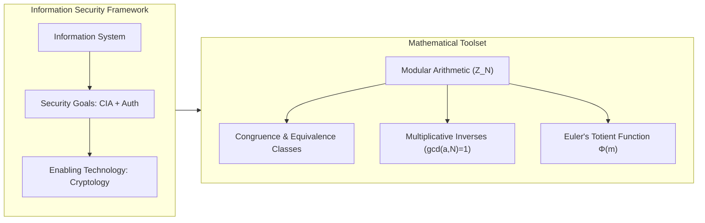
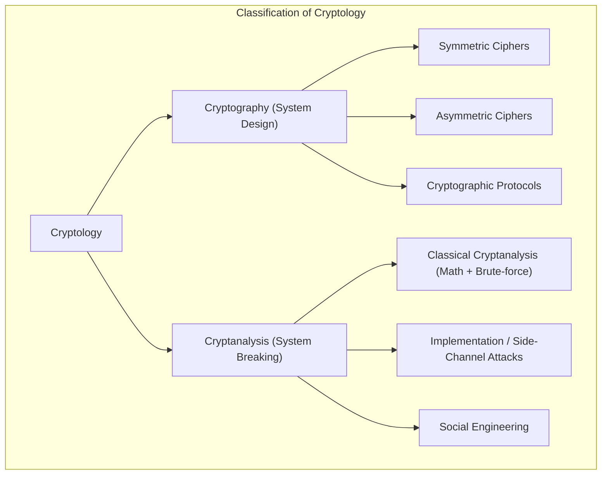
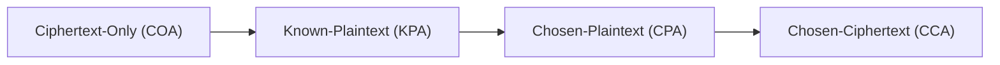
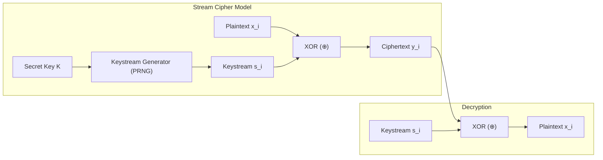
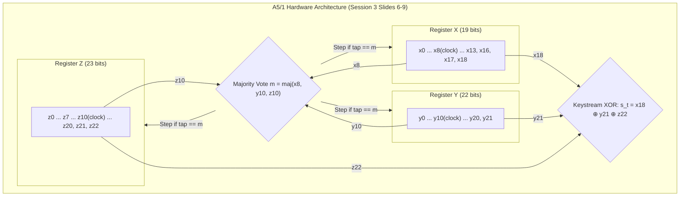
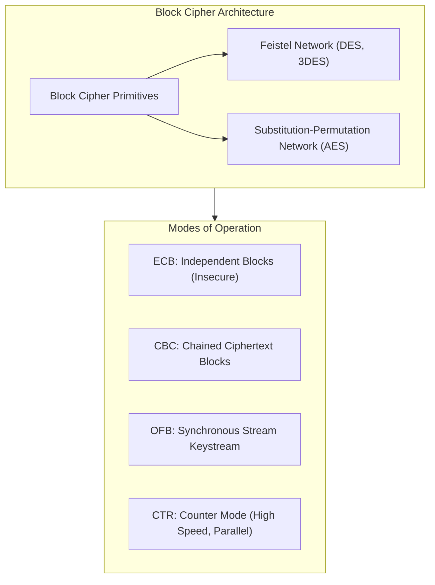
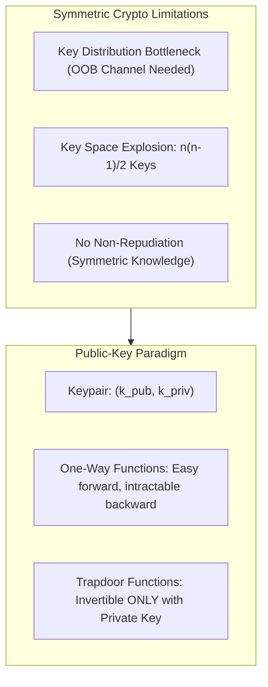
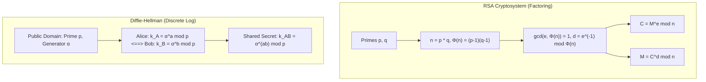
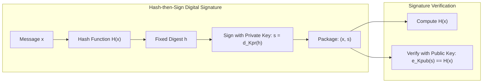
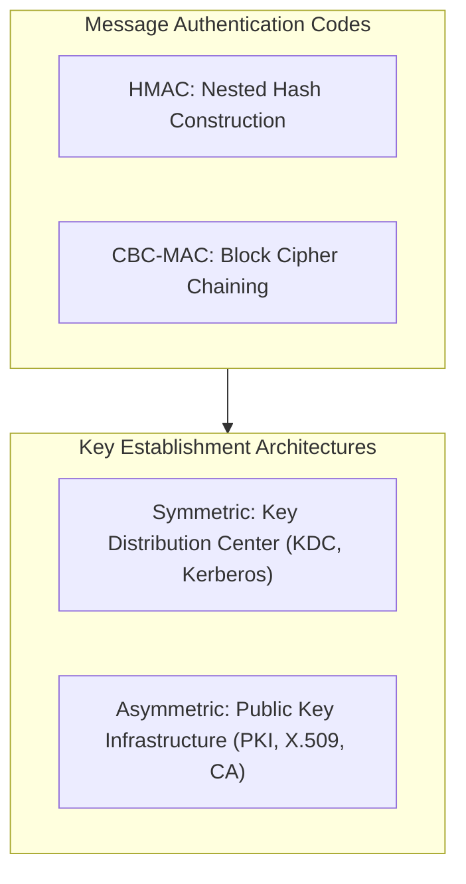

# Complete Course Companion: Introduction to Cryptography
**Course Code:** ICT3.08E / ICT3.001 (Bachelor Year 3, ICT Department)  
**Institution:** University of Science and Technology of Hanoi (USTH) — Trường Đại học Khoa học và Công nghệ Hà Nội  
**Lecturer:** Nguyen Minh Huong  
**Academic References:**
1. Christof Paar & Jan Pelzl, *Understanding Cryptography: A Textbook for Students and Practitioners*, Springer, 2009.
2. Mark Stamp, *Information Security: Principles and Practice*, 2nd Edition, John Wiley & Sons, 2011.
3. Matt Bishop, *Computer Security: Art and Science*, Addison-Wesley, 2003.

---

## Table of Contents

- [1. Course Introduction and Pedagogical Structure](#1-course-introduction-and-pedagogical-structure)
  - [Course Grading Scheme](#course-grading-scheme)
  - [Recommended Literature](#recommended-literature)
- [2. Session 1: Information Security Foundations & Modular Arithmetic](#2-session-1-information-security-foundations-modular-arithmetic)
  - [2.1 Fundamental Concepts of Information Security](#21-fundamental-concepts-of-information-security)
    - [2.1.1 Information Systems and Core Components](#211-information-systems-and-core-components)
    - [2.1.2 The Security Goals (The CIA Triad and Beyond)](#212-the-security-goals-the-cia-triad-and-beyond)
    - [2.1.3 The Communication Model (Alice, Bob, and Trudy)](#213-the-communication-model-alice-bob-and-trudy)
    - [2.1.4 Dimensions of Information Security](#214-dimensions-of-information-security)
  - [2.2 Modular Arithmetic: Mathematical Foundations](#22-modular-arithmetic-mathematical-foundations)
    - [2.2.1 Motivation: Why Modular Arithmetic?](#221-motivation-why-modular-arithmetic)
    - [2.2.2 The Modulus Operation and Division Algorithm](#222-the-modulus-operation-and-division-algorithm)
    - [2.2.3 Congruence Relations and Equivalence Classes](#223-congruence-relations-and-equivalence-classes)
    - [2.2.4 Algebraic Properties: Addition, Multiplication, Exponentiation](#224-algebraic-properties-addition-multiplication-exponentiation)
    - [2.2.5 Modular Division and the Multiplicative Inverse](#225-modular-division-and-the-multiplicative-inverse)
    - [2.2.6 Euler's Totient Function $\Phi(m)$](#226-eulers-totient-function-phim)
  - [2.3 Solved Exercises from Session 1](#23-solved-exercises-from-session-1)
    - [2.3.1 Exercise 1 (Slide 24): Equivalence Classes and Fast Arithmetic](#231-exercise-1-slide-24-equivalence-classes-and-fast-arithmetic)
    - [2.3.2 Exercise 2 (Slide 25): Modular Exponentiation and Linear Congruences](#232-exercise-2-slide-25-modular-exponentiation-and-linear-congruences)
    - [2.3.3 Exercise 3 (Slide 26): Euler's Totient Computations](#233-exercise-3-slide-26-eulers-totient-computations)
  - [2.4 Practical Labwork Integration: Lab 1 (Exercises 1, 2, 3, 4)](#24-practical-labwork-integration-lab-1-exercises-1-2-3-4)
    - [2.4.1 Lab 1 - Exercise 1: Binary Form and Bitwise XOR](#241-lab-1-exercise-1-binary-form-and-bitwise-xor)
    - [2.4.2 Lab 1 - Exercise 2: ASCII Code Mapping and Secret Message Extraction](#242-lab-1-exercise-2-ascii-code-mapping-and-secret-message-extraction)
    - [2.4.3 Lab 1 - Exercise 3: Byte-Level XOR Decryption](#243-lab-1-exercise-3-byte-level-xor-decryption)
- [3. Session 2: Basics of Symmetric Cryptology & Classical Ciphers](#3-session-2-basics-of-symmetric-cryptology-classical-ciphers)
  - [3.1 Taxonomy of Cryptology](#31-taxonomy-of-cryptology)
    - [3.1.2 The General Symmetric Cipher Model](#312-the-general-symmetric-cipher-model)
  - [3.2 Kerckhoffs' Principle](#32-kerckhoffs-principle)
    - [3.2.1 Modern Formulation (Shannon's Maxim)](#321-modern-formulation-shannons-maxim)
    - [3.2.2 Security through Obscurity vs. Open Design](#322-security-through-obscurity-vs-open-design)
  - [3.3 Cryptanalysis and Attack Classifications](#33-cryptanalysis-and-attack-classifications)
    - [3.3.1 Attack Domains](#331-attack-domains)
    - [3.3.2 Adversary Knowledge Models](#332-adversary-knowledge-models)
    - [3.3.3 Exhaustive Key Search (Brute-Force Attacks) and Key Lengths](#333-exhaustive-key-search-brute-force-attacks-and-key-lengths)
  - [3.4 Historical and Classical Ciphers](#34-historical-and-classical-ciphers)
    - [3.4.1 Monoalphabetic Substitution Ciphers and Frequency Analysis](#341-monoalphabetic-substitution-ciphers-and-frequency-analysis)
    - [3.4.2 Shift (Caesar) Cipher](#342-shift-caesar-cipher)
    - [3.4.3 Affine Cipher: Mathematical Formulation and Key Space Analysis](#343-affine-cipher-mathematical-formulation-and-key-space-analysis)
    - [3.4.4 Cryptanalysis of Affine Cipher (Known-Plaintext Attack)](#344-cryptanalysis-of-affine-cipher-known-plaintext-attack)
    - [3.4.5 Interactive Lecture Cipher ("Your Cipher?" via XOR)](#345-interactive-lecture-cipher-your-cipher-via-xor)
- [4. Session 3: Symmetric Cryptography — Stream Ciphers](#4-session-3-symmetric-cryptography-stream-ciphers)
  - [4.1 Fundamentals of Stream Ciphers](#41-fundamentals-of-stream-ciphers)
    - [4.1.1 Stream Ciphers vs. Block Ciphers](#411-stream-ciphers-vs-block-ciphers)
    - [4.1.2 Properties of Bitwise XOR (Modulo 2 Addition)](#412-properties-of-bitwise-xor-modulo-2-addition)
    - [4.1.3 The Vernam One-Time Pad (OTP)](#413-the-vernam-one-time-pad-otp)
  - [4.2 Linear Feedback Shift Registers (LFSRs)](#42-linear-feedback-shift-registers-lfsrs)
  - [4.3 The GSM A5/1 Stream Cipher](#43-the-gsm-a51-stream-cipher)
    - [4.3.1 Register Configurations and Feedback Equations](#431-register-configurations-and-feedback-equations)
    - [4.3.2 Non-Linear Majority Clocking Rule](#432-non-linear-majority-clocking-rule)
    - [4.3.3 Keystream Bit Generation](#433-keystream-bit-generation)
  - [4.4 The RC4 Stream Cipher](#44-the-rc4-stream-cipher)
    - [4.4.1 Key-Scheduling Algorithm (KSA)](#441-key-scheduling-algorithm-ksa)
- [KSA Pseudocode](#ksa-pseudocode)
    - [4.4.2 Pseudo-Random Generation Algorithm (PRGA)](#442-pseudo-random-generation-algorithm-prga)
- [PRGA Pseudocode](#prga-pseudocode)
    - [4.4.3 Security Status and Practical Weaknesses](#443-security-status-and-practical-weaknesses)
  - [4.5 Labwork 1 Exercise 4 In-Depth Solution & A5/1 Execution Trace](#45-labwork-1-exercise-4-in-depth-solution-a51-execution-trace)
    - [4.5.1 Mathematical Background & GSM A5/1 Architecture](#451-mathematical-background-gsm-a51-architecture)
    - [4.5.2 Feedback Tap Polynomials & Stepping Mechanism (`Session3.pdf`, Slide 8)](#452-feedback-tap-polynomials-stepping-mechanism-session3pdf-slide-8)
    - [4.5.3 Stop-and-Go Majority Clocking Rule (`Session3.pdf`, Slide 9)](#453-stop-and-go-majority-clocking-rule-session3pdf-slide-9)
    - [4.5.4 Initial State Binary Vector Conversion](#454-initial-state-binary-vector-conversion)
    - [4.5.5 Official USTH Lab Execution Table (Option 1: Output First, Then Step)](#455-official-usth-lab-execution-table-option-1-output-first-then-step)
    - [4.5.6 Python Verification Script (Both Conventions Supported)](#456-python-verification-script-both-conventions-supported)
- [Output: 0100000001](#output-0100000001)
- [5. Session 4: Symmetric Cryptography — Block Ciphers & Modes of Operation](#5-session-4-symmetric-cryptography-block-ciphers-modes-of-operation)
  - [5.1 Principles of Modern Block Ciphers](#51-principles-of-modern-block-ciphers)
    - [5.1.1 Shannon's Primitives: Confusion and Diffusion](#511-shannons-primitives-confusion-and-diffusion)
    - [5.1.2 The Feistel Cipher Architecture](#512-the-feistel-cipher-architecture)
  - [5.2 The Data Encryption Standard (DES)](#52-the-data-encryption-standard-des)
    - [5.2.1 DES Round Function $f(R_{i-1}, K_i)$](#521-des-round-function-fri-1-ki)
    - [5.2.2 DES Key Schedule](#522-des-key-schedule)
  - [5.3 Advanced Encryption Standard (AES / Rijndael)](#53-advanced-encryption-standard-aes-rijndael)
    - [5.3.1 The Four Round Transformations](#531-the-four-round-transformations)
    - [5.3.2 AES-128 Key Expansion Schedule](#532-aes-128-key-expansion-schedule)
  - [5.4 Block Cipher Modes of Operation](#54-block-cipher-modes-of-operation)
    - [5.4.1 In-Depth Comparison Table of Operational Modes](#541-in-depth-comparison-table-of-operational-modes)
    - [5.4.2 Attack Analysis: Substitution Attacks on ECB and Fixed-IV CBC](#542-attack-analysis-substitution-attacks-on-ecb-and-fixed-iv-cbc)
  - [5.5 Exhaustive Key Search & False Positive Keys](#55-exhaustive-key-search-false-positive-keys)
  - [5.6 Multiple Encryption & The Meet-in-the-Middle Attack](#56-multiple-encryption-the-meet-in-the-middle-attack)
    - [5.6.1 Double DES (2DES) and Meet-in-the-Middle Formulation](#561-double-des-2des-and-meet-in-the-middle-formulation)
    - [5.6.2 Triple DES (3DES)](#562-triple-des-3des)
  - [5.7 Key Whitening](#57-key-whitening)
  - [5.8 Solved Examination Exercise: DES S-Box Lookup](#58-solved-examination-exercise-des-s-box-lookup)
    - [5.8.1 Reference DES $S_1$ Lookup Table](#581-reference-des-s1-lookup-table)
    - [5.8.2 General Step-by-Step Solution Algorithm](#582-general-step-by-step-solution-algorithm)
    - [5.8.3 Concrete Example Walkthrough (ID Ending in `789`)](#583-concrete-example-walkthrough-id-ending-in-789)
- [6. Session 5: Introduction to Asymmetric / Public-Key Cryptography](#6-session-5-introduction-to-asymmetric-public-key-cryptography)
  - [6.1 Limitations of Symmetric Cryptography](#61-limitations-of-symmetric-cryptography)
  - [6.2 The Public-Key (Asymmetric) Paradigm](#62-the-public-key-asymmetric-paradigm)
    - [6.2.1 Core Security Mechanisms](#621-core-security-mechanisms)
    - [6.2.2 The Hybrid Cryptosystem Pattern](#622-the-hybrid-cryptosystem-pattern)
  - [6.3 Mathematical Foundations of Public-Key Cryptography](#63-mathematical-foundations-of-public-key-cryptography)
    - [6.3.1 One-Way Functions and Trapdoors](#631-one-way-functions-and-trapdoors)
    - [6.3.2 The Three Fundamental Hard Problems in Cryptography](#632-the-three-fundamental-hard-problems-in-cryptography)
- [7. Session 6: Asymmetric Cryptography — RSA & Diffie-Hellman Key Exchange](#7-session-6-asymmetric-cryptography-rsa-diffie-hellman-key-exchange)
  - [7.1 The RSA Cryptosystem](#71-the-rsa-cryptosystem)
    - [7.1.1 RSA Key Generation Protocol](#711-rsa-key-generation-protocol)
    - [7.1.2 RSA Encryption and Decryption Functions](#712-rsa-encryption-and-decryption-functions)
    - [7.1.3 Mathematical Proof of Correctness](#713-mathematical-proof-of-correctness)
  - [7.2 The Square-and-Multiply Algorithm for Fast Exponentiation](#72-the-square-and-multiply-algorithm-for-fast-exponentiation)
    - [7.2.1 Algorithmic Procedure (Left-to-Right Binary Scan)](#721-algorithmic-procedure-left-to-right-binary-scan)
  - [7.3 Cryptanalysis and Attacks on RSA](#73-cryptanalysis-and-attacks-on-rsa)
  - [7.4 The Diffie-Hellman Key Exchange (DHKE)](#74-the-diffie-hellman-key-exchange-dhke)
    - [7.4.1 Protocol Workflow](#741-protocol-workflow)
    - [7.4.2 Hardness Assumption: Computational Diffie-Hellman (CDH)](#742-hardness-assumption-computational-diffie-hellman-cdh)
    - [7.4.3 The Active Man-in-the-Middle (MitM) Attack](#743-the-active-man-in-the-middle-mitm-attack)
  - [7.5 Solved Exercises from Session 6 Slides](#75-solved-exercises-from-session-6-slides)
    - [7.5.1 Slide 10: Textbook RSA Example](#751-slide-10-textbook-rsa-example)
    - [7.5.2 Slide 11: Modular Reduction of RSA Exponent](#752-slide-11-modular-reduction-of-rsa-exponent)
  - [7.6 Cross-Curricular Labwork Solutions: Labs 2 & 3](#76-cross-curricular-labwork-solutions-labs-2-3)
    - [7.6.1 Lab 2 - Exercise 1: Greatest Common Divisor via Euclidean Algorithm](#761-lab-2-exercise-1-greatest-common-divisor-via-euclidean-algorithm)
    - [7.6.2 Lab 2 - Exercise 2: Coprime Pairwise Identification in Set A](#762-lab-2-exercise-2-coprime-pairwise-identification-in-set-a)
    - [7.6.3 Lab 2 - Exercise 3: Square-and-Multiply Exponentiation](#763-lab-2-exercise-3-square-and-multiply-exponentiation)
    - [7.6.4 Lab 2 - Exercise 4: Modular Multiplicative Inverse](#764-lab-2-exercise-4-modular-multiplicative-inverse)
    - [7.6.5 Lab 3 - Exercises 1 & 2: Data Conversions](#765-lab-3-exercises-1-2-data-conversions)
    - [7.6.6 Lab 3 - Exercise 3: RSA Implementation Verification](#766-lab-3-exercise-3-rsa-implementation-verification)
    - [7.6.7 Lab 3 - Exercise 4: RSA Plaintext Recovery (CTF Challenge)](#767-lab-3-exercise-4-rsa-plaintext-recovery-ctf-challenge)
- [8. Session 7: Digital Signatures & Cryptographic Hash Functions](#8-session-7-digital-signatures-cryptographic-hash-functions)
  - [8.1 The Digital Signature Paradigm](#81-the-digital-signature-paradigm)
    - [Contrast with MACs](#contrast-with-macs)
  - [8.2 The RSA Signature Scheme](#82-the-rsa-signature-scheme)
    - [Flaws of Textbook RSA Signatures](#flaws-of-textbook-rsa-signatures)
  - [8.3 The Elgamal Digital Signature Scheme](#83-the-elgamal-digital-signature-scheme)
    - [8.3.1 Key Generation](#831-key-generation)
    - [8.3.2 Signature Generation](#832-signature-generation)
    - [8.3.3 Signature Verification](#833-signature-verification)
    - [8.3.4 Correctness Proof](#834-correctness-proof)
  - [8.3.5 Solved Lecture Example: DSA Signature Generation & Verification](#835-solved-lecture-example-dsa-signature-generation-verification)
  - [8.4 Cryptographic Hash Functions](#84-cryptographic-hash-functions)
    - [8.4.1 The Three Security Properties](#841-the-three-security-properties)
    - [8.4.2 The Birthday Paradox and Collision Bounds](#842-the-birthday-paradox-and-collision-bounds)
  - [8.5 The Secure Hash Algorithm 1 (SHA-1)](#85-the-secure-hash-algorithm-1-sha-1)
    - [8.5.1 Preprocessing and Padding](#851-preprocessing-and-padding)
    - [8.5.2 Message Schedule Word Expansion](#852-message-schedule-word-expansion)
    - [8.5.3 Compression Round Operation](#853-compression-round-operation)
  - [8.5.4 Solved Lecture Exercise: SHA-1 First Round Output Computation](#854-solved-lecture-exercise-sha-1-first-round-output-computation)
  - [8.6 Hash Functions Constructed from Block Ciphers](#86-hash-functions-constructed-from-block-ciphers)
- [9. Session 8: Message Authentication Codes (MACs) & Key Management](#9-session-8-message-authentication-codes-macs-key-management)
  - [9.1 Message Authentication Codes (MACs)](#91-message-authentication-codes-macs)
    - [9.1.1 Flawed Hash MAC Constructions](#911-flawed-hash-mac-constructions)
    - [9.1.2 HMAC (Hash-Based Message Authentication Code)](#912-hmac-hash-based-message-authentication-code)
  - [9.2 Key Establishment in Symmetric Networks](#92-key-establishment-in-symmetric-networks)
    - [9.2.1 Key Distribution Centers (KDC)](#921-key-distribution-centers-kdc)
    - [9.2.2 The Kerberos Protocol](#922-the-kerberos-protocol)
  - [9.3 Asymmetric Key Distribution & Public Key Infrastructure (PKI)](#93-asymmetric-key-distribution-public-key-infrastructure-pki)
    - [9.3.1 Digital Certificates (X.509)](#931-digital-certificates-x509)
    - [9.3.2 Certificate Verification Chain](#932-certificate-verification-chain)
  - [9.3.3 Solved Lecture Example: Active MitM Attack on Diffie-Hellman](#933-solved-lecture-example-active-mitm-attack-on-diffie-hellman)
  - [9.4 Solved Examination Exercise: CA Certificate Signing](#94-solved-examination-exercise-ca-certificate-signing)
    - [Step-by-Step Solution:](#step-by-step-solution)
- [10. Cross-Curricular Labworks & Python Implementations](#10-cross-curricular-labworks-python-implementations)
- [----------------- LAB 1: A5/1 CIPHER -----------------](#lab-1-a51-cipher)
- [----------------- LAB 2: EXTENDED EUCLIDEAN & MODULAR ARITHMETIC -----------------](#lab-2-extended-euclidean-modular-arithmetic)
- [----------------- LAB 3: RSA CRYPTOSYSTEM -----------------](#lab-3-rsa-cryptosystem)
- [----------------- EXECUTION AND TESTS -----------------](#execution-and-tests)
- [11. Examination Archives & Step-by-Step Solutions (2024–2026)](#11-examination-archives-step-by-step-solutions-20242026)
  - [11.1 Final Examination 2024–2025 (Course Code: ICT3.001)](#111-final-examination-20242025-course-code-ict3001)
    - [Exercise 1: Public Key Infrastructure & RSA Key Generation (4/20 points)](#exercise-1-public-key-infrastructure-rsa-key-generation-420-points)
    - [Exercise 2: Certification Authority (CA) Digital Signature (4/20 points)](#exercise-2-certification-authority-ca-digital-signature-420-points)
  - [11.2 Final Examination 2025–2026 (Course Code: ICT3.08E)](#112-final-examination-20252026-course-code-ict308e)
    - [Exercise 1: DES S-Box Computation (3/20 points)](#exercise-1-des-s-box-computation-320-points)
    - [Exercise 2: RSA Keypair Generation & Exponent Selection (9/20 points)](#exercise-2-rsa-keypair-generation-exponent-selection-920-points)
    - [Exercise 3: Diffie-Hellman Key Exchange (DHKE) (4/20 points)](#exercise-3-diffie-hellman-key-exchange-dhke-420-points)

---

<a id="1-course-introduction-and-pedagogical-structure"></a>
## 1. Course Introduction and Pedagogical Structure
*(Source: `session1.pdf`, Slides 1–13)*

The course **Introduction to Cryptography** (`ICT3.08E` / `ICT3.001`) at the University of Science and Technology of Hanoi (USTH) introduces the theoretical foundations, mathematical underpinnings, algorithmic mechanisms, and engineering implementations of modern cryptographic systems.

<a id="course-grading-scheme"></a>
### Course Grading Scheme
- **Mid-term Assessment:** 40%
- **Active Class Participation / Labwork:** 5%
- **Final Examination:** 60% (Writing examination, standard duration 60–75 minutes, calculator and double-sided handwritten reference sheet permitted; laptop without internet permitted for final 15 minutes of selected sessions).

<a id="recommended-literature"></a>
### Recommended Literature
1. **Primary Textbook:** Paar, Christof, and Jan Pelzl. *Understanding Cryptography: A Textbook for Students and Practitioners*. Springer Science & Business Media, 2009.
2. **Security Principles:** Stamp, Mark. *Information Security: Principles and Practice*. 2nd Edition, John Wiley & Sons, 2011.
3. **Computer Security Systems:** Bishop, Matt. *Computer Security: Art and Science*. Addison Wesley, 2003.

---

<a id="2-session-1-information-security-foundations-modular-arithmetic"></a>
## 2. Session 1: Information Security Foundations & Modular Arithmetic
*(Source: `session1.pdf`, Slides 1–26)*



<a id="21-fundamental-concepts-of-information-security"></a>
### 2.1 Fundamental Concepts of Information Security
*(Source: `session1.pdf`, Slides 3–13)*

<a id="211-information-systems-and-core-components"></a>
#### 2.1.1 Information Systems and Core Components
An **Information System (IS)** is defined as an organized socio-technical system designed for the collection, processing, organization, storage, retrieval, and communication of information.
- **Hardware:** Physical computation engines, storage media, network routers, and endpoints.
- **Software:** Operating systems, application logic, DBMS, and cryptographic libraries.
- **Data:** Plaintext information, databases, configuration keys, and session records.
- **People:** Legitimate users, administrators, and unauthorized malicious adversaries.
- **Procedures:** Operational policies, key rollover schedules, access control matrices.
- **Networks:** Physical and logical transmission mediums (typically assumed to be hostile/unsecured).

<a id="212-the-security-goals-the-cia-triad-and-beyond"></a>
#### 2.1.2 The Security Goals (The CIA Triad and Beyond)
Information Security is the practice of protecting information assets from unauthorized access, disruption, modification, inspection, or destruction. The foundational objectives include:

1. **Confidentiality:** Preventing unauthorized disclosure of information. Secrets must remain unintelligible to eavesdroppers.
2. **Integrity:** Ensuring information is protected from unauthorized, undetected modification, insertion, deletion, or replay during transit and storage.
3. **Availability:** Ensuring legitimate users have timely and uninterrupted access to information assets and computing services upon demand.
4. **Authentication:** Corroborating the claimed identity of a principal (user, process, or device).
5. **Authorization:** Enforcing access controls that restrict authenticated users to strictly permitted operations.
6. **Non-Repudiation:** Preventing an entity from falsely denying the authenticity of a previously originated message or contract.

<a id="213-the-communication-model-alice-bob-and-trudy"></a>
#### 2.1.3 The Communication Model (Alice, Bob, and Trudy)
*(Source: `session1.pdf`, Slide 7; `Session2.pdf`, Slide 4)*
The canonical cryptographic scenario consists of:
- **Alice:** The legitimate sender of message $x$.
- **Bob:** The intended legitimate recipient.
- **Trudy (Bad / Adversary):** An active or passive adversary situated on an insecure communications channel with capabilities to intercept, eavesdrop, inject, or alter transmitted packets.

<a id="214-dimensions-of-information-security"></a>
#### 2.1.4 Dimensions of Information Security
Guaranteeing security in real-world systems requires a multi-layered defense architecture:
- **Cryptology:** Mathematical transformations to provide confidentiality, integrity, and authenticity.
- **Access Control:** Mechanisms specifying which identities can access which resources.
- **Security Protocols:** Rules governing communication sequences (e.g., TLS, IPsec, SSH, Kerberos).
- **Software & Systems Security:** Hardening source code against implementation bugs (buffer overflows, memory leaks, timing side-channels).

---

<a id="22-modular-arithmetic-mathematical-foundations"></a>
### 2.2 Modular Arithmetic: Mathematical Foundations

> [!TIP]
> **Standalone Algorithm Script:** [`code/modular_arithmetic.py`](code/modular_arithmetic.py)  
> *Execute:* `python code/modular_arithmetic.py`
*(Source: `session1.pdf`, Slides 14–26; Paar & Pelzl, Chapter 1)*

<a id="221-motivation-why-modular-arithmetic"></a>
#### 2.2.1 Motivation: Why Modular Arithmetic?
Modular arithmetic operates on finite sets of integers rather than infinite mathematical fields:
1. **Asymmetric Cryptography:** Public-key cryptosystems such as RSA, Diffie-Hellman Key Exchange (DHKE), and Elliptic Curve Cryptography (ECC) depend intrinsically on operations over cyclic groups and finite residue fields.
2. **Classical and Historical Ciphers:** Systems like the Caesar cipher and Affine cipher are formulated elegantly over the integer ring modulo 26 ($\mathbb{Z}_{26}$).
3. **Hardware & Software Fixed-Precision:** Computers naturally execute arithmetic modulo $2^{32}$ or $2^{64}$ due to word size constraints.

<a id="222-the-modulus-operation-and-division-algorithm"></a>
#### 2.2.2 The Modulus Operation and Division Algorithm
*(Source: `session1.pdf`, Slides 15–16)*

> **Definition (Modulus Operation):**  
> Let $a, r, m \in \mathbb{Z}$ with $m > 0$. We say that $a$ is congruent to $r$ modulo $m$:
> $$a \equiv r \pmod m \iff m \mid (a - r)$$
> That is, $m$ divides the difference $(a - r)$ without remainder.

*Terminology:*
- $m$: **Modulus** (always a strictly positive integer, $m > 0$).
- $r$: **Remainder** (or residue).
- $q$: **Quotient**.

**Division Algorithm Theorem:**  
For any integer $a$ and positive integer $m$, there exist unique integers $q$ (quotient) and $r$ (remainder) such that:
$$a = q \cdot m + r \quad \text{where } 0 \le r < m$$

*Convention on Remainders:*  
Although any integer differing by multiples of $m$ is congruent (e.g., $12 \equiv 3 \equiv 21 \equiv -6 \pmod 9$), in cryptographic algorithms we systematically standardize on the **canonical representative** $r \in \{0, 1, 2, \dots, m - 1\}$.

<a id="223-congruence-relations-and-equivalence-classes"></a>
#### 2.2.3 Congruence Relations and Equivalence Classes
*(Source: `session1.pdf`, Slides 17, 23)*

**Congruence Modulo $N$:**  
Two integers $a$ and $b$ are congruent modulo $N$, denoted $a \equiv b \pmod N$, if and only if they yield identical remainders upon division by $N$.  
The congruence relation is an **equivalence relation** satisfying:
1. **Reflexivity:** $a \equiv a \pmod N$.
2. **Symmetry:** $a \equiv b \pmod N \iff b \equiv a \pmod N$.
3. **Transitivity:** If $a \equiv b \pmod N$ and $b \equiv c \pmod N$, then $a \equiv c \pmod N$.

**Equivalence Classes (Residue Classes):**  
An equivalence class $[r]$ modulo $m$ is the infinite set of all integers that produce remainder $r$ modulo $m$:
$$[r] = \{ x \in \mathbb{Z} \mid x \equiv r \pmod m \} = \{ q \cdot m + r \mid q \in \mathbb{Z} \}$$
The complete set of residue classes modulo $m$ is denoted by the ring:
$$\mathbb{Z}_m = \{0, 1, 2, \dots, m - 1\}$$

*Computational Optimization Rule:*  
Because every element of an equivalence class behaves identically under arithmetic operations modulo $m$, we are free to replace large numbers with smaller equivalent residues at any intermediate stage of computation to simplify calculations.

<a id="224-algebraic-properties-addition-multiplication-exponentiation"></a>
#### 2.2.4 Algebraic Properties: Addition, Multiplication, Exponentiation
*(Source: `session1.pdf`, Slides 18–20)*

Let $a, b, c, d, k \in \mathbb{Z}$ and $N \in \mathbb{Z}^+$:
1. **Addition:**
   - If $a + b = c$, then $a + b \equiv c \pmod N$.
   - If $a \equiv b \pmod N$, then $a + k \equiv b + k \pmod N$.
   - If $a \equiv b \pmod N$ and $c \equiv d \pmod N$, then:
     $$a + c \equiv b + d \pmod N$$
   - Additive Inverse: $-a \equiv -b \pmod N$.
2. **Multiplication:**
   - If $a \cdot b = c$, then $a \cdot b \equiv c \pmod N$.
   - If $a \equiv b \pmod N$, then $k \cdot a \equiv k \cdot b \pmod N \quad (\forall k \in \mathbb{Z})$.
   - If $a \equiv b \pmod N$ and $c \equiv d \pmod N$, then:
     $$a \cdot c \equiv b \cdot d \pmod N$$
3. **Modular Exponentiation:**
   - If $a \equiv b \pmod N$, then for any positive integer $k > 0$:
     $$a^k \equiv b^k \pmod N$$

<a id="225-modular-division-and-the-multiplicative-inverse"></a>
#### 2.2.5 Modular Division and the Multiplicative Inverse
*(Source: `session1.pdf`, Slides 21–22)*

Modular division is **not** equivalent to standard rational division. Dividing by $a$ modulo $N$ is defined as multiplying by the **modular multiplicative inverse** of $a$.

> **Theorem (Cancellation / Division Law):**  
> If $k \cdot a \equiv k \cdot b \pmod N$ and $\gcd(k, N) = 1$ ($k$ and $N$ are coprime), then:
> $$a \equiv b \pmod N$$
> *(Warning: If $\gcd(k, N) \ne 1$, dividing out $k$ is mathematically invalid).*

> **Definition (Multiplicative Inverse):**  
> For an integer $a \in \mathbb{Z}_N$, its multiplicative inverse modulo $N$ is an integer $x \in \mathbb{Z}_N$ (denoted $a^{-1}$) such that:
> $$a \cdot x \equiv 1 \pmod N$$
> **Existence Condition:** $a^{-1} \pmod N$ exists **if and only if** $\gcd(a, N) = 1$.
> The inverse is unique in $\mathbb{Z}_N$ and can be computed via the **Extended Euclidean Algorithm (EEA)**.

<a id="226-eulers-totient-function-phim"></a>
#### 2.2.6 Euler's Totient Function $\Phi(m)$
*(Source: `session1.pdf`, Slide 26; Paar & Pelzl, Section 6.3)*

> **Definition:**  
> Euler's totient function (also known as Euler's phi function), denoted $\Phi(m)$, is the number of strictly positive integers less than or equal to $m$ that are relatively prime (coprime) to $m$:
> $$\Phi(m) = \big| \{ a \in \mathbb{Z} \mid 1 \le a \le m \text{ and } \gcd(a, m) = 1 \} \big|$$

**Key Computational Properties:**
1. **Prime Argument:** If $p$ is a prime number, every integer in $\{1, 2, \dots, p-1\}$ is coprime to $p$:
   $$\Phi(p) = p - 1$$
2. **Prime Power Argument:** If $p$ is prime and $k \ge 1$:
   $$\Phi(p^k) = p^k - p^{k-1} = p^k \left( 1 - \frac{1}{p} \right)$$
3. **Multiplicative Property:** If $\gcd(m, n) = 1$, then:
   $$\Phi(m \cdot n) = \Phi(m) \cdot \Phi(n)$$
4. **General Prime Factorization:** For any positive integer $m = p_1^{k_1} p_2^{k_2} \cdots p_r^{k_r}$:
   $$\Phi(m) = m \prod_{i=1}^r \left( 1 - \frac{1}{p_i} \right)$$

---

<a id="23-solved-exercises-from-session-1"></a>
### 2.3 Solved Exercises from Session 1
*(Source: `session1.pdf`, Slides 24–26)*

<a id="231-exercise-1-slide-24-equivalence-classes-and-fast-arithmetic"></a>
#### 2.3.1 Exercise 1 (Slide 24): Equivalence Classes and Fast Arithmetic
**Problem Statement:** Compute the result of each expression modulo 13 without using a calculator:
1. $15 \cdot 29 \pmod{13}$
2. $2 \cdot 29 \pmod{13}$
3. $2 \cdot 3 \pmod{13}$
4. $-11 \cdot 3 \pmod{13}$

**Step-by-Step Solutions:**
- **Part 1:** Compute $15 \cdot 29 \pmod{13}$.  
  Reduce each factor modulo 13 first:
  $$15 = 13 \cdot 1 + 2 \implies 15 \equiv 2 \pmod{13}$$
  $$29 = 13 \cdot 2 + 3 \implies 29 \equiv 3 \pmod{13}$$
  $$15 \cdot 29 \equiv 2 \cdot 3 \equiv \mathbf{6} \pmod{13}$$
- **Part 2:** Compute $2 \cdot 29 \pmod{13}$.  
  Since $29 \equiv 3 \pmod{13}$:
  $$2 \cdot 29 \equiv 2 \cdot 3 \equiv \mathbf{6} \pmod{13}$$
- **Part 3:** Compute $2 \cdot 3 \pmod{13}$.  
  Direct calculation:
  $$2 \cdot 3 = 6 \implies \mathbf{6} \pmod{13}$$
- **Part 4:** Compute $-11 \cdot 3 \pmod{13}$.  
  Reduce $-11$ modulo 13:
  $$-11 = -1 \cdot 13 + 2 \implies -11 \equiv 2 \pmod{13}$$
  $$-11 \cdot 3 \equiv 2 \cdot 3 \equiv \mathbf{6} \pmod{13}$$

> [!TIP]
> **Pedagogical Takeaway:** All four sub-problems evaluate to the exact same equivalence class representative $[6]_{13}$. This demonstrates that substituting equivalent residue class members preserves the multiplicative invariant while dramatically reducing computational complexity.

---

<a id="232-exercise-2-slide-25-modular-exponentiation-and-linear-congruences"></a>
#### 2.3.2 Exercise 2 (Slide 25): Modular Exponentiation and Linear Congruences
**Problem Statement:** Compute $x$ as far as possible without a calculator:
1. $x = 3^2 \pmod{13}$
2. $x = 7^2 \pmod{13}$
3. $x = 3^{10} \pmod{13}$
4. $x = 7^{100} \pmod{13}$
5. $7x \equiv 11 \pmod{13}$

**Step-by-Step Solutions:**
- **Part 1:** $x = 3^2 \pmod{13}$  
  $$3^2 = 9 < 13 \implies \mathbf{x = 9}$$

- **Part 2:** $x = 7^2 \pmod{13}$  
  $$7^2 = 49$$
  $$49 = 3 \cdot 13 + 10 \implies \mathbf{x = 10} \quad (\text{or } -3 \pmod{13})$$

- **Part 3:** $x = 3^{10} \pmod{13}$  
  Notice powers of 3 modulo 13:
  $$3^3 = 27 = 2 \cdot 13 + 1 \equiv 1 \pmod{13}$$
  Express the exponent 10 in terms of base 3:
  $$10 = 3 \cdot 3 + 1$$
  $$3^{10} = (3^3)^3 \cdot 3^1 \equiv (1)^3 \cdot 3 \equiv \mathbf{3} \pmod{13}$$

- **Part 4:** $x = 7^{100} \pmod{13}$  
  By **Fermat's Little Theorem**, for prime $p = 13$ and $\gcd(7, 13) = 1$:
  $$7^{p-1} = 7^{12} \equiv 1 \pmod{13}$$
  Divide the exponent 100 by 12:
  $$100 = 12 \cdot 8 + 4$$
  $$7^{100} = (7^{12})^8 \cdot 7^4 \equiv (1)^8 \cdot 7^4 \equiv 7^4 \pmod{13}$$
  From Part 2, $7^2 \equiv -3 \pmod{13}$:
  $$7^4 = (7^2)^2 \equiv (-3)^2 = 9 \pmod{13}$$
  Therefore, $\mathbf{x = 9}$.

- **Part 5:** Solve the linear congruence $7x \equiv 11 \pmod{13}$  
  Find the modular multiplicative inverse of 7 modulo 13, $7^{-1} \pmod{13}$:
  $$7 \cdot 1 = 7 \not\equiv 1$$
  $$7 \cdot 2 = 14 = 1 \cdot 13 + 1 \equiv 1 \pmod{13}$$
  Hence, $7^{-1} \equiv 2 \pmod{13}$.  
  Multiply both sides of the congruence by 2:
  $$2 \cdot (7x) \equiv 2 \cdot 11 \pmod{13}$$
  $$1 \cdot x \equiv 22 \pmod{13}$$
  $$22 = 1 \cdot 13 + 9 \implies \mathbf{x \equiv 9 \pmod{13}}$$
  *Verification:* $7 \cdot 9 = 63 = 4 \cdot 13 + 11 \equiv 11 \pmod{13}$. Correct!

---

<a id="233-exercise-3-slide-26-eulers-totient-computations"></a>
#### 2.3.3 Exercise 3 (Slide 26): Euler's Totient Computations
**Problem Statement:** Determine $\Phi(m)$ for $m \in \{3, 4, 5, 9, 26\}$.

**Step-by-Step Solutions:**
1. **$m = 3$:**  
   3 is prime $\implies \Phi(3) = 3 - 1 = \mathbf{2}$.  
   *Coprime set:* $\{1, 2\}$.
2. **$m = 4$:**  
   Prime factorization: $4 = 2^2$.  
   $$\Phi(4) = 4 \left( 1 - \frac{1}{2} \right) = 4 \cdot \frac{1}{2} = \mathbf{2}$$  
   *Coprime set:* $\{1, 3\}$.
3. **$m = 5$:**  
   5 is prime $\implies \Phi(5) = 5 - 1 = \mathbf{4}$.  
   *Coprime set:* $\{1, 2, 3, 4\}$.
4. **$m = 9$:**  
   Prime factorization: $9 = 3^2$.  
   $$\Phi(9) = 9 \left( 1 - \frac{1}{3} \right) = 9 \cdot \frac{2}{3} = \mathbf{6}$$  
   *Coprime set:* $\{1, 2, 4, 5, 7, 8\}$.
5. **$m = 26$:**  
   Prime factorization: $26 = 2 \cdot 13$. Since $\gcd(2, 13) = 1$:  
   $$\Phi(26) = \Phi(2) \cdot \Phi(13) = (2 - 1) \cdot (13 - 1) = 1 \cdot 12 = \mathbf{12}$$  
   *Coprime set:*
   $$\{1, 3, 5, 7, 9, 11, 15, 17, 19, 21, 23, 25\}$$

> [!IMPORTANT]
> **Direct Cross-Session Link:** Notice that the 12 coprime integers in $\Phi(26)$ are the exact 12 permissible values for key multiplier $a$ in the Affine Cipher taught in Session 2 (Slide 17)!

---

<a id="24-practical-labwork-integration-lab-1-exercises-1-2-3-4"></a>
### 2.4 Practical Labwork Integration: Lab 1 (Exercises 1, 2, 3, 4)

> [!TIP]
> **Standalone Algorithm Script (Lab 1 Ex 1-3):** [`code/binary_xor_stream.py`](code/binary_xor_stream.py)  
> *Execute:* `python code/binary_xor_stream.py`
*(Source: `Lab1.pdf`, Page 1)*

<a id="241-lab-1-exercise-1-binary-form-and-bitwise-xor"></a>
#### 2.4.1 Lab 1 - Exercise 1: Binary Form and Bitwise XOR
**Problem Statement:** Given $a = 123$, $b = 543$:
1. Compute the binary form of $a$.
2. Compute $a \oplus b$ in both binary and decimal form.

**Solution:**
- Convert $a = 123_{10}$ to binary:
  $$123 = 64 + 32 + 16 + 8 + 2 + 1 = \mathbf{01111011_2}$$
- Convert $b = 543_{10}$ to binary:
  $$543 = 512 + 16 + 8 + 4 + 2 + 1 = \mathbf{1000011111_2}$$
- Bitwise XOR ($a \oplus b$):
  ```
    a = 00 0111 1011  (123)
    b = 10 0001 1111  (543)
  --------------------------
  XOR = 10 0101 1000  (binary)
  ```
- Convert binary result to decimal:
  $$1 \cdot 2^9 + 0 \cdot 2^8 + 0 \cdot 2^7 + 1 \cdot 2^6 + 0 \cdot 2^5 + 1 \cdot 2^4 + 1 \cdot 2^3 + 0 \cdot 2^2 + 0 \cdot 2^1 + 0 \cdot 2^0$$
  $$= 512 + 64 + 16 + 8 = \mathbf{600_{10}}$$

---

<a id="242-lab-1-exercise-2-ascii-code-mapping-and-secret-message-extraction"></a>
#### 2.4.2 Lab 1 - Exercise 2: ASCII Code Mapping and Secret Message Extraction
**Problem Statement:** Extract the hidden text from ASCII values:
$$A = \{105, 110, 116, 114, 111, 50, 99, 114, 121, 112, 116, 111, 123, 119, 51, 108, 99, 48, 109, 51, 95, 116, 48, 95, 106, 48, 117, 114, 110, 51, 121, 125\}$$

**Decoding Table:**
| Dec | Char | Dec | Char | Dec | Char | Dec | Char |
| :---: | :---: | :---: | :---: | :---: | :---: | :---: | :---: |
| 105 | `i` | 99  | `c` | 99  | `c` | 106 | `j` |
| 110 | `n` | 114 | `r` | 48  | `0` | 48  | `0` |
| 116 | `t` | 121 | `y` | 109 | `m` | 117 | `u` |
| 114 | `r` | 112 | `p` | 51  | `3` | 114 | `r` |
| 111 | `o` | 116 | `t` | 95  | `_` | 110 | `n` |
| 50  | `2` | 111 | `o` | 116 | `t` | 51  | `3` |
|     |     | 123 | `{` | 48  | `0` | 121 | `y` |
|     |     | 119 | `w` | 95  | `_` | 125 | `}` |
|     |     | 51  | `3` |     |     |     |     |
|     |     | 108 | `l` |     |     |     |     |

**Recovered Plaintext Flag:**
$$\mathbf{\text{intro2crypto\{w3lc0m3\_t0\_j0urn3y\}}}$$

---

<a id="243-lab-1-exercise-3-byte-level-xor-decryption"></a>
#### 2.4.3 Lab 1 - Exercise 3: Byte-Level XOR Decryption
**Problem Statement:** Given ciphertext numbers $B = \{99, 100, 126, 120, 101, 56, 105, 120, 115, 122, 126, 101, 113, 59, 121, 126, 57, 122, 85, 58, 100, 85, 96, 58, 127, 120, 100, 57, 115, 119\}$, decrypt the message knowing each byte was XORed with key $k = 10_{10}$.

**Mathematical Principle:**  
Since $(x \oplus k) \oplus k = x \oplus (k \oplus k) = x \oplus 0 = x$, decryption is performed by XORing each received byte with $10$.

**Byte-by-Byte Inversion Table:**
| $C_i$ | $C_i \oplus 10$ | Char | $C_i$ | $C_i \oplus 10$ | Char | $C_i$ | $C_i \oplus 10$ | Char |
| :---: | :---: | :---: | :---: | :---: | :---: | :---: | :---: | :---: |
| 99  | 105 | `i` | 126 | 120 | `x` | 100 | 110 | `n` |
| 100 | 110 | `n` | 101 | 111 | `o` | 85  | 95  | `_` |
| 126 | 116 | `t` | 113 | 123 | `{` | 96  | 106 | `j` |
| 120 | 114 | `r` | 59  | 49  | `1` | 58  | 48  | `0` |
| 101 | 111 | `o` | 121 | 115 | `s` | 127 | 117 | `u` |
| 56  | 50  | `2` | 126 | 116 | `t` | 120 | 114 | `r` |
| 105 | 99  | `c` | 57  | 51  | `3` | 100 | 110 | `n` |
| 120 | 114 | `r` | 122 | 112 | `p` | 57  | 51  | `3` |
| 115 | 121 | `y` | 85  | 95  | `_` | 115 | 121 | `y` |
| 122 | 112 | `p` | 58  | 48  | `0` | 119 | 125 | `}` |

**Recovered Plaintext Flag:**
$$\mathbf{\text{intro2crypto\{1st3p\_0n\_j0urn3y\}}}$$

---

<a id="3-session-2-basics-of-symmetric-cryptology-classical-ciphers"></a>
## 3. Session 2: Basics of Symmetric Cryptology & Classical Ciphers
*(Source: `Session2.pdf`, Slides 1–20)*



<a id="31-taxonomy-of-cryptology"></a>
### 3.1 Taxonomy of Cryptology
*(Source: `Session2.pdf`, Slide 3)*

Cryptology is split into two complementary, adversarial branches:
1. **Cryptography:** The science of securing communications by designing ciphers, key agreements, digital signatures, and hash functions.
2. **Cryptanalysis:** The science and engineering of analyzing, evaluating, and breaking cryptographic schemes without possessing prior knowledge of secret keys.

<a id="312-the-general-symmetric-cipher-model"></a>
#### 3.1.2 The General Symmetric Cipher Model
*(Source: `Session2.pdf`, Slides 4–5)*

In a symmetric cryptosystem, Alice and Bob share a single common secret key $K$ established beforehand over a secure out-of-band channel.

```
       Plaintext x                                   Plaintext x
            │                                             ▲
            ▼                                             │
      ┌───────────┐      Insecure Channel y        ┌───────────┐
      │Encryption │ ─────────────────────────────> │Decryption │
      │   e_K(x)  │                                │   d_K(y)  │
      └─────▲─────┘               │                └─────▲─────┘
            │                     ▼                      │
       Shared Key K          Trudy (Attacker)       Shared Key K
            │                                            │
            └─────────── Secure Channel ─────────────────┘
```

- **Plaintext ($x \in \mathcal{X}$):** Original unencrypted message.
- **Ciphertext ($y \in \mathcal{Y}$):** Encrypted message transmitted over the public, insecure channel.
- **Key ($K \in \mathcal{K}$):** Secret parameter selected from keyspace $\mathcal{K}$.
- **Encryption Function:**
  $$y = e_K(x)$$
- **Decryption Function:**
  $$x = d_K(y)$$
- **Operational Requirement (Correctness Invariant):**
  $$d_K(y) = d_K(e_K(x)) = x \quad \forall x \in \mathcal{X}$$

---

<a id="32-kerckhoffs-principle"></a>
### 3.2 Kerckhoffs' Principle
*(Source: `Session2.pdf`, Slide 6)*

> **Auguste Kerckhoffs' Principle (1883):**  
> *"A cryptosystem should be secure even if the attacker knows all details about the system, with the exception of the secret key. In particular, the system should be secure when the attacker knows the encryption and decryption algorithms."*

<a id="321-modern-formulation-shannons-maxim"></a>
#### 3.2.1 Modern Formulation (Shannon's Maxim)
Claude Shannon concisely reformulated this as:  
$$\text{"The enemy knows the system."}$$

<a id="322-security-through-obscurity-vs-open-design"></a>
#### 3.2.2 Security through Obscurity vs. Open Design
- **Security through Obscurity (Flawed):** Relying on secret proprietary algorithms. Once reverse-engineered (via decompilation, memory inspection, or leaks), the entire security infrastructure collapses immediately.
- **Open Design (Standard Engineering Practice):** Modern cryptographic algorithms (AES, RSA, SHA-3) are published openly and subjected to decades of public mathematical scrutiny by international researchers. System security depends solely on maintaining the secrecy of a compact, easily replaceable key $K$.

---

<a id="33-cryptanalysis-and-attack-classifications"></a>
### 3.3 Cryptanalysis and Attack Classifications
*(Source: `Session2.pdf`, Slides 7–10)*

<a id="331-attack-domains"></a>
#### 3.3.1 Attack Domains
1. **Classical Mathematical Cryptanalysis:** Exploiting algebraic weaknesses, statistical biases, and structural properties in the cipher algorithms.
2. **Implementation / Side-Channel Attacks:** Measuring physical artifacts of hardware execution:
   - Power consumption analysis (Simple Power Analysis - SPA, Differential Power Analysis - DPA).
   - Timing attacks (measuring variable execution times of operations like modular exponentiation).
   - Electromagnetic radiation leaks and acoustic cryptanalysis.
   - Fault injection attacks.
3. **Social Engineering:** Manipulating human operators (phishing, coercion, bribery) to bypass cryptography entirely.

<a id="332-adversary-knowledge-models"></a>
#### 3.3.2 Adversary Knowledge Models
Adversaries are formally categorized according to the data they possess:



| Attack Model | Adversary's Known Information / Capability | Practical Real-World Example |
| :--- | :--- | :--- |
| **Ciphertext-Only Attack (COA)** | Has access only to a set of ciphertexts $\{y_1, y_2, \dots\}$. The weakest attack assumption. | Intercepting encrypted radio packets over open air. |
| **Known-Plaintext Attack (KPA)** | Possesses pairs of plaintexts and their corresponding ciphertexts: $\{(x_1, y_1), (x_2, y_2), \dots\}$. | Knowing standard headers in files (e.g., PDF `%PDF-`, PNG magic bytes, HTTP headers). |
| **Chosen-Plaintext Attack (CPA)** | Can choose arbitrary plaintexts $x_i$ and obtain their ciphertexts $y_i = e_K(x_i)$. | Submitting chosen data to an encryption oracle or web service. |
| **Chosen-Ciphertext Attack (CCA)** | Can submit arbitrary ciphertexts $y_j$ and obtain decrypted plaintexts $x_j = d_K(y_j)$ (except target $y$). | Attacking an interactive automated decryption/verification server. |

<a id="333-exhaustive-key-search-brute-force-attacks-and-key-lengths"></a>
#### 3.3.3 Exhaustive Key Search (Brute-Force Attacks) and Key Lengths
*(Source: `Session2.pdf`, Slide 9)*

A brute-force attack checks every key in the keyspace $\mathcal{K}$ until a test pair satisfies:
$$d_K(y_0) = x_0$$
At least one known plaintext-ciphertext pair $(x_0, y_0)$ is required to verify key candidates.

**Key Space vs. Computational Search Time:**
| Key Length | Key Space ($|\mathcal{K}|$) | Time to Exhaustively Search | Current Security Status |
| :---: | :---: | :---: | :--- |
| **56 bits** (DES) | $2^{56} \approx 7.2 \times 10^{16}$ | Hours to a few days | **Completely broken** (insecure) |
| **64 bits** | $2^{64} \approx 1.84 \times 10^{19}$ | Days / weeks using dedicated hardware (ASICs) | **Insecure** |
| **128 bits** (AES-128) | $2^{128} \approx 3.4 \times 10^{38}$ | Decades/centuries across all computers on Earth | **Currently unbreakable** against classical computers |
| **256 bits** (AES-256) | $2^{256} \approx 1.15 \times 10^{77}$ | Exceeds thermodynamic limits of universe | **Post-quantum secure** (Grover's algorithm reduces to $2^{128}$) |

---

<a id="34-historical-and-classical-ciphers"></a>
### 3.4 Historical and Classical Ciphers
*(Source: `Session2.pdf`, Slides 11–18)*

<a id="341-monoalphabetic-substitution-ciphers-and-frequency-analysis"></a>
#### 3.4.1 Monoalphabetic Substitution Ciphers and Frequency Analysis

> [!TIP]
> **Standalone Algorithm Script (Polyalphabetic Vigenère):** [`code/vigenere_cipher.py`](code/vigenere_cipher.py)  
> *Execute:* `python code/vigenere_cipher.py`
In an arbitrary substitution cipher, each character of the alphabet is substituted with another fixed permutation character.
- Alphabet size: $n = 26$.
- Key space: $|\mathcal{K}| = 26! \approx 4.0329 \times 10^{26} \approx 2^{88.4}$.
- **Lecture Slide 13 Exercise (Brute-Force Time Calculation):**  
  Suppose a specialized hardware attacker tests keys at the massive rate of $2^{40} \approx 1.0995 \times 10^{12}$ keys per second:
  $$\text{Total Time} = \frac{26!}{2^{40}} \approx \frac{4.0329 \times 10^{26}}{1.0995 \times 10^{12}} \approx 3.6678 \times 10^{14} \text{ seconds}$$
  $$\text{Total Years} = \frac{3.6678 \times 10^{14}}{365.25 \times 86400} \approx \mathbf{11,622,920 \text{ years (11.6 million years)!}}$$
  *Conclusion:* Exhaustive search is completely futile against a monoalphabetic substitution cipher, yet the cipher is broken in minutes via analytical letter-frequency counts.
- *Cryptanalysis:* Despite a huge key space that defeats brute force, monoalphabetic substitutions are trivial to break using **Frequency Analysis** because natural languages possess pronounced, stable letter frequencies (e.g., `'E'`, `'T'`, `'A'`, `'O'`, `'I'`, `'N'` in English) and digraph/trigraph distributions (`'TH'`, `'HE'`, `'IN'`).

---

<a id="342-shift-caesar-cipher"></a>
#### 3.4.2 Shift (Caesar) Cipher

> [!TIP]
> **Standalone Algorithm Script:** [`code/caesar_cipher.py`](code/caesar_cipher.py)  
> *Execute:* `python code/caesar_cipher.py`
*(Source: `Session2.pdf`, Slides 15–16)*

Map letters to integers: $\text{'a'} \mapsto 0, \text{'b'} \mapsto 1, \dots, \text{'z'} \mapsto 25$.

**Mathematical Definition:**
- **Encryption:**
  $$y = e_k(x) \equiv (x + k) \pmod{26}$$
- **Decryption:**
  $$x = d_k(y) \equiv (y - k) \pmod{26}$$
- **Key Space:** $|\mathcal{K}| = 26$ ($k \in \{0, 1, \dots, 25\}$; $k = 0$ is identity).

**Walkthrough of Lecture Example (Slide 15):**
- Plaintext: `"ictlab"`
- Ciphertext: `"lfwode"`
- Character shift analysis:
  $$\text{'i'} (8) \to \text{'l'} (11): \quad 11 - 8 = +3$$
  $$\text{'c'} (2) \to \text{'f'} (5): \quad 5 - 2 = +3$$
  $$\text{'t'} (19) \to \text{'w'} (22): \quad 22 - 19 = +3$$
  $$\text{'l'} (11) \to \text{'o'} (14): \quad 14 - 11 = +3$$
  $$\text{'a'} (0) \to \text{'d'} (3): \quad 3 - 0 = +3$$
  $$\text{'b'} (1) \to \text{'e'} (4): \quad 4 - 1 = +3$$
- **Encryption Rule Identified:** $y \equiv (x + 3) \pmod{26}$ with key $k = 3$.

*Security Assessment:* Insecure. With only 26 keys, an attacker can test all keys manually in under two minutes or instantly by computer.

---

<a id="343-affine-cipher-mathematical-formulation-and-key-space-analysis"></a>
#### 3.4.3 Affine Cipher: Mathematical Formulation and Key Space Analysis

> [!TIP]
> **Standalone Algorithm Script:** [`code/affine_cipher.py`](code/affine_cipher.py)  
> *Execute:* `python code/affine_cipher.py`
*(Source: `Session2.pdf`, Slide 17)*

The Affine cipher combines modular multiplication with modular addition.
- **Key:** $k = (a, b)$ with $a, b \in \mathbb{Z}_{26}$.
- **Encryption Function:**
  $$y = e_k(x) \equiv (a \cdot x + b) \pmod{26}$$
- **Decryption Function:**
  To invert the transformation:
  $$y - b \equiv a \cdot x \pmod{26}$$
  Multiply both sides by the modular multiplicative inverse $a^{-1} \pmod{26}$:
  $$x = d_k(y) \equiv a^{-1} \cdot (y - b) \pmod{26}$$

> [!CRITICAL]
> **Bijectivity Condition:** Decryption is only possible if $a^{-1} \pmod{26}$ exists, which requires:
> $$\gcd(a, 26) = 1$$
> Since $26 = 2 \cdot 13$, $a$ must neither be divisible by 2 nor by 13.

**Permissible Values of $a$ and Their Multiplicative Inverses:**
From Euler's Totient $\Phi(26) = 12$, there are exactly 12 permissible values of $a$:

| Multiplier $a$ | Multiplicative Inverse $a^{-1} \pmod{26}$ | Verification Check ($a \cdot a^{-1} \pmod{26}$) |
| :---: | :---: | :---: |
| **1** | **1** | $1 \cdot 1 = 1 \equiv 1$ |
| **3** | **9** | $3 \cdot 9 = 27 = 26 + 1 \equiv 1$ |
| **5** | **21** | $5 \cdot 21 = 105 = 4 \cdot 26 + 1 \equiv 1$ |
| **7** | **15** | $7 \cdot 15 = 105 = 4 \cdot 26 + 1 \equiv 1$ |
| **9** | **3** | $9 \cdot 3 = 27 \equiv 1$ |
| **11** | **19** | $11 \cdot 19 = 209 = 8 \cdot 26 + 1 \equiv 1$ |
| **15** | **7** | $15 \cdot 7 = 105 \equiv 1$ |
| **17** | **23** | $17 \cdot 23 = 391 = 15 \cdot 26 + 1 \equiv 1$ |
| **19** | **11** | $19 \cdot 11 = 209 \equiv 1$ |
| **21** | **5** | $21 \cdot 5 = 105 \equiv 1$ |
| **23** | **17** | $23 \cdot 17 = 391 \equiv 1$ |
| **25** | **25** | $25 \cdot 25 = 625 = 24 \cdot 26 + 1 \equiv 1$ |

**Total Key Space:**
$$|\mathcal{K}| = \Phi(26) \times 26 = 12 \times 26 = \mathbf{312 \text{ keys}}$$

---

<a id="344-cryptanalysis-of-affine-cipher-known-plaintext-attack"></a>
#### 3.4.4 Cryptanalysis of Affine Cipher (Known-Plaintext Attack)
Because $|\mathcal{K}| = 312$, a brute-force attack on modern computers requires fractions of a millisecond. Under a **Known-Plaintext Attack (KPA)**, knowledge of merely **two character correspondences** suffices to completely recover the key $(a, b)$.

**Worked Analytical Example:**  
Suppose an attacker knows that the plaintext letters `"IF"` correspond to ciphertext letters `"OX"`:
- Plaintext:
  - $\text{'I'} \mapsto x_1 = 8$
  - $\text{'F'} \mapsto x_2 = 5$
- Ciphertext:
  - $\text{'O'} \mapsto y_1 = 14$
  - $\text{'X'} \mapsto y_2 = 23$

Set up the system of linear modular congruences:
$$\begin{cases} 8a + b \equiv 14 \pmod{26} & (1) \\ 5a + b \equiv 23 \pmod{26} & (2) \end{cases}$$

Subtract equation (2) from equation (1):
$$(8a + b) - (5a + b) \equiv 14 - 23 \pmod{26}$$
$$3a \equiv -9 \equiv 17 \pmod{26}$$

Multiply by $3^{-1} \equiv 9 \pmod{26}$:
$$a \equiv 17 \cdot 9 = 153 \pmod{26}$$
$$153 = 5 \cdot 26 + 23 \implies \mathbf{a = 23}$$

Substitute $a = 23$ back into equation (1):
$$8(23) + b \equiv 14 \pmod{26}$$
$$184 + b \equiv 14 \pmod{26}$$
$$184 = 7 \cdot 26 + 2 \implies 2 + b \equiv 14 \pmod{26} \implies \mathbf{b = 12}$$

**Key Recovered:** $k = (23, 12)$.  
*Decryption key parameter:* $a^{-1} = 23^{-1} \equiv 17 \pmod{26}$.  
Full decryption formula: $x \equiv 17(y - 12) \pmod{26}$.

---

<a id="345-interactive-lecture-cipher-your-cipher-via-xor"></a>
#### 3.4.5 Interactive Lecture Cipher ("Your Cipher?" via XOR)
*(Source: `Session2.pdf`, Slide 18)*

**Exercise Instruction:** Choose a secret number, convert it to binary, and XOR it with $(10110)_2 = 22_{10}$.

**Cryptographic Analysis:**
- Let key $K = (10110)_2 = 22_{10}$.
- For any student input value $X$:
  $$Y = X \oplus K$$
- Since $Y \oplus K = (X \oplus K) \oplus K = X \oplus (K \oplus K) = X \oplus 0 = X$, the recipient recovers $X$ with the same key $K$.
- This illustrates the core primitive of the **Vernam cipher (One-Time Pad)** and modern stream ciphers, bridging historical substitution ciphers with the binary stream cipher architectures examined in **Session 3**.

---

<a id="4-session-3-symmetric-cryptography-stream-ciphers"></a>
## 4. Session 3: Symmetric Cryptography — Stream Ciphers
*(Source: `Session3.pdf`, Slides 1–12; Labwork: `Lab1.pdf`, Exercise 4; Reference: Paar & Pelzl, Chapter 2)*



<a id="41-fundamentals-of-stream-ciphers"></a>
### 4.1 Fundamentals of Stream Ciphers
*(Source: `Session3.pdf`, Slides 3–5)*

<a id="411-stream-ciphers-vs-block-ciphers"></a>
#### 4.1.1 Stream Ciphers vs. Block Ciphers
- **Stream Ciphers:** Encrypt continuous data bit-by-bit (or byte-by-byte). A pseudorandom keystream $S = (s_0, s_1, s_2, \dots)$ is generated from a compact key $K$ and combined with plaintext stream $X = (x_0, x_1, x_2, \dots)$ using the bitwise exclusive-OR (XOR) operation:
  $$y_i = e_{s_i}(x_i) \equiv (x_i + s_i) \pmod 2 = x_i \oplus s_i$$
- **Block Ciphers:** Group plaintext bits into large fixed-size blocks (e.g., 64 or 128 bits) and encrypt each block as a single unit with a shared fixed key.

<a id="412-properties-of-bitwise-xor-modulo-2-addition"></a>
#### 4.1.2 Properties of Bitwise XOR (Modulo 2 Addition)
The exclusive-OR ($\oplus$) operator represents addition modulo 2:
$$0 \oplus 0 = 0, \quad 0 \oplus 1 = 1, \quad 1 \oplus 0 = 1, \quad 1 \oplus 1 = 0$$
- **Self-Inverting Invariant:** Because $s_i \oplus s_i = 0$ and $x_i \oplus 0 = x_i$:
  $$x_i = d_{s_i}(y_i) = y_i \oplus s_i = (x_i \oplus s_i) \oplus s_i = x_i \oplus (s_i \oplus s_i) = x_i$$
- Encryption and decryption use the **exact same hardware/software circuit**.

<a id="413-the-vernam-one-time-pad-otp"></a>
#### 4.1.3 The Vernam One-Time Pad (OTP)
Invented in 1917 by Gilbert Vernam and proven by Claude Shannon (1949):
- If the keystream $S$ is **truly random**, **as long as the plaintext**, and **never reused**, the cipher achieves **Information-Theoretic (Unconditional) Security**:
  $$P(X = x \mid Y = y) = P(X = x)$$
- *Limitation:* Generating, distributing, and synchronizing truly random keys of message length is impractical for general communication networks. Practical stream ciphers instead expand a small key $K$ ($k$ bits) into an arbitrary-length pseudorandom keystream using a **Keystream Generator (PRNG)**.

---

<a id="42-linear-feedback-shift-registers-lfsrs"></a>
### 4.2 Linear Feedback Shift Registers (LFSRs)
*(Source: `Session3.pdf`, Slides 7–9; Paar & Pelzl, Section 2.2)*

An LFSR consists of $m$ flip-flops (registers) $(r_{m-1}, r_{m-2}, \dots, r_1, r_0)$ and a feedback path defined by a recurrence relation:
$$r_{m-1}^{(t+1)} = \bigoplus_{i=0}^{m-1} p_i \cdot r_i^{(t)}$$
where coefficients $p_i \in \{0, 1\}$ form the **feedback polynomial** $P(x) = x^m + p_{m-1}x^{m-1} + \dots + p_1 x + 1$.
- **Maximal Period:** If $P(x)$ is a primitive polynomial, the LFSR generates an **m-sequence** with maximal period:
  $$T = 2^m - 1$$
- **Linearity Weakness:** Because the output is governed by linear equations over $GF(2)$, an adversary observing $2m$ consecutive keystream bits can reconstruct the feedback polynomial and secret state completely using the **Berlekamp-Massey algorithm** in $O(m^2)$ operations. Modern stream ciphers must introduce non-linear clocking or non-linear filtering.

---

<a id="43-the-gsm-a51-stream-cipher"></a>
### 4.3 The GSM A5/1 Stream Cipher

> [!TIP]
> **Standalone Algorithm Script:** [`code/a51_stream_cipher.py`](code/a51_stream_cipher.py)  
> *Execute:* `python code/a51_stream_cipher.py`
*(Source: `Session3.pdf`, Slides 6–9; Labwork: `Lab1.pdf`, Exercise 4)*

A5/1 was developed in 1987 to encrypt over-the-air voice transmissions in the European 2G GSM cellular standard. It consists of **three non-linearly clocked LFSRs** ($X, Y, Z$) with a combined state of $19 + 22 + 23 = 64$ bits.

```
       ┌───────────────────────────────┐
       │   Register X (19 bits: 0-18)  │ ──> x18 ──┐
       │   Clock bit: x8               │           │
       │   Taps: 13, 16, 17, 18        │           │
       └───────────────────────────────┘           │
                                                   ├───> ⊕ ──> Keystream bit s
       ┌───────────────────────────────┐           │
       │   Register Y (22 bits: 0-21)  │ ──> y21 ──┤
       │   Clock bit: y10              │           │
       │   Taps: 20, 21                │           │
       └───────────────────────────────┘           │
                                                   │
       ┌───────────────────────────────┐           │
       │   Register Z (23 bits: 0-22)  │ ──> z22 ──┘
       │   Clock bit: z10              │
       │   Taps: 7, 20, 21, 22         │
       └───────────────────────────────┘
```

<a id="431-register-configurations-and-feedback-equations"></a>
#### 4.3.1 Register Configurations and Feedback Equations
| Register | Length | Clock Bit Index | Feedback Tap Indices | Feedback Bit Formula ($r_0^{\text{new}}$) |
| :---: | :---: | :---: | :---: | :--- |
| **$X$** | 19 bits ($x_0 \dots x_{18}$) | $x_8$ | 13, 16, 17, 18 | $x_{\text{feed}} = x_{13} \oplus x_{16} \oplus x_{17} \oplus x_{18}$ |
| **$Y$** | 22 bits ($y_0 \dots y_{21}$) | $y_{10}$ | 20, 21 | $y_{\text{feed}} = y_{20} \oplus y_{21}$ |
| **$Z$** | 23 bits ($z_0 \dots z_{22}$) | $z_{10}$ | 7, 20, 21, 22 | $z_{\text{feed}} = z_7 \oplus z_{20} \oplus z_{21} \oplus z_{22}$ |

<a id="432-non-linear-majority-clocking-rule"></a>
#### 4.3.2 Non-Linear Majority Clocking Rule
In every clock cycle, stepping is governed by the majority vote of the three clock bits $(x_8, y_{10}, z_{10})$:
$$m = \text{maj}(x_8, y_{10}, z_{10}) = (x_8 \land y_{10}) \lor (x_8 \land z_{10}) \lor (y_{10} \land z_{10})$$
- If $x_8 == m$, Register $X$ steps.
- If $y_{10} == m$, Register $Y$ steps.
- If $z_{10} == m$, Register $Z$ steps.
- *Property:* In every cycle, either **two** or **all three** registers step. No register is left permanently frozen.

<a id="433-keystream-bit-generation"></a>
#### 4.3.3 Keystream Bit Generation
After stepping, the output bit $s_t$ is computed by XORing the rightmost bits:
$$s_t = x_{18} \oplus y_{21} \oplus z_{22}$$

---

<a id="44-the-rc4-stream-cipher"></a>
### 4.4 The RC4 Stream Cipher

> [!TIP]
> **Standalone Algorithm Script:** [`code/rc4_stream_cipher.py`](code/rc4_stream_cipher.py)  
> *Execute:* `python code/rc4_stream_cipher.py`
*(Source: `Session3.pdf`, Slides 10–12; Paar & Pelzl, Section 2.3)*

Designed in 1987 by Ron Rivest for software efficiency, RC4 is a byte-oriented stream cipher operating on a 256-byte internal permutation array $S = (S[0], S[1], \dots, S[255])$.

<a id="441-key-scheduling-algorithm-ksa"></a>
#### 4.4.1 Key-Scheduling Algorithm (KSA)
Initializes array $S$ as an identity permutation, then shuffles it using the secret key $K$ of length $L$ bytes ($1 \le L \le 256$):
```python
<a id="ksa-pseudocode"></a>
# KSA Pseudocode
for i from 0 to 255:
    S[i] = i

j = 0
for i from 0 to 255:
    j = (j + S[i] + key[i % keylength]) % 256
    swap(S[i], S[j])
```

<a id="442-pseudo-random-generation-algorithm-prga"></a>
#### 4.4.2 Pseudo-Random Generation Algorithm (PRGA)
Generates keystream bytes sequentially while continually updating the state:
```python
<a id="prga-pseudocode"></a>
# PRGA Pseudocode
i = 0
j = 0
while generating_keystream:
    i = (i + 1) % 256
    j = (j + S[i]) % 256
    swap(S[i], S[j])
    t = (S[i] + S[j]) % 256
    K_byte = S[t]
    output K_byte
```

<a id="443-security-status-and-practical-weaknesses"></a>
#### 4.4.3 Security Status and Practical Weaknesses
- **Fluhrer-Mantin-Shamir (FMS) Attack:** In protocols like WEP (802.11), concatenating a fixed key with an incrementing 24-bit IV causes known-key biases in the first few bytes of the PRGA stream.
- **Byte Biases:** The second output byte has a probability of taking value 0 equal to $2/256$ instead of $1/256$.
- **Deprecation:** Formalized in RFC 7465 (2015), RC4 is prohibited in TLS due to statistical plaintext recovery attacks.

---

<a id="45-labwork-1-exercise-4-in-depth-solution-a51-execution-trace"></a>
### 4.5 Labwork 1 Exercise 4 In-Depth Solution & A5/1 Execution Trace
*(Source: `Lab1.pdf`, Page 2, Exercise 4; `Session3.pdf`, Slides 6–9; Understanding Cryptography, Chapter 2)*

<a id="451-mathematical-background-gsm-a51-architecture"></a>
#### 4.5.1 Mathematical Background & GSM A5/1 Architecture
A5/1 is the stream cipher standard originally developed to encrypt voice communications over 2G GSM cellular networks. As defined in `Session3.pdf` (Slide 6), it utilizes 64 key bits to initialize three hardware-efficient Linear Feedback Shift Registers (LFSRs):
- **Register $X$:** length $m_X = 19$ bits (indexed $x_0, x_1, \dots, x_{18}$). Clocking tap: bit $x_8$.
- **Register $Y$:** length $m_Y = 22$ bits (indexed $y_0, y_1, \dots, y_{21}$). Clocking tap: bit $y_{10}$.
- **Register $Z$:** length $m_Z = 23$ bits (indexed $z_0, z_1, \dots, z_{22}$). Clocking tap: bit $z_{10}$.



<a id="452-feedback-tap-polynomials-stepping-mechanism-session3pdf-slide-8"></a>
#### 4.5.2 Feedback Tap Polynomials & Stepping Mechanism (`Session3.pdf`, Slide 8)
When an LFSR register steps, all bits shift one position to the right ($b_i \leftarrow b_{i-1}$), and a new feedback bit is fed into position 0:
1. **Register $X$ Feedback:**
   $$x_0 = x_{13} \oplus x_{16} \oplus x_{17} \oplus x_{18}$$
2. **Register $Y$ Feedback:**
   $$y_0 = y_{20} \oplus y_{21}$$
3. **Register $Z$ Feedback:**
   $$z_0 = z_7 \oplus z_{20} \oplus z_{21} \oplus z_{22}$$

<a id="453-stop-and-go-majority-clocking-rule-session3pdf-slide-9"></a>
#### 4.5.3 Stop-and-Go Majority Clocking Rule (`Session3.pdf`, Slide 9)
At each clock cycle $t$:
1. Read the three clocking bits: $(x_8, y_{10}, z_{10})$.
2. Compute the majority bit:
   $$m = \text{maj}(x_8, y_{10}, z_{10}) = (x_8 \land y_{10}) \lor (y_{10} \land z_{10}) \lor (x_8 \land z_{10})$$
3. Evaluate stepping conditions:
   - If $x_8 = m \implies \text{Register } X \text{ steps}$.
   - If $y_{10} = m \implies \text{Register } Y \text{ steps}$.
   - If $z_{10} = m \implies \text{Register } Z \text{ steps}$.
   *(At least 2 and up to 3 registers step in every clock cycle)*.

<a id="454-initial-state-binary-vector-conversion"></a>
#### 4.5.4 Initial State Binary Vector Conversion
From `Lab1.pdf` Page 2:
- $X_0 = 513365_{10} = \mathbf{1111101010101010101_2}$ (19 bits: $x_0 = 1, x_8 = 1, x_{18} = 1$).
- $Y_0 = 3355443_{10} = \mathbf{1100110011001100110011_2}$ (22 bits: $y_0 = 1, y_{10} = 0, y_{21} = 1$).
- $Z_0 = 7401712_{10} = \mathbf{11100001111000011110000_2}$ (23 bits: $z_0 = 1, z_{10} = 1, z_{22} = 0$).

<a id="455-official-usth-lab-execution-table-option-1-output-first-then-step"></a>
#### 4.5.5 Official USTH Lab Execution Table (Option 1: Output First, Then Step)
In synchronous digital logic, when key registers are initialized, the output pin immediately presents the valid XOR output of the initial state $s_1 = x_{18} \oplus y_{21} \oplus z_{22} = 1 \oplus 1 \oplus 0 = \mathbf{0}$. Each clock pulse then shifts the registers to produce the state for the next cycle.

| Cycle $t$ | Tail Bits $(x_{18}, y_{21}, z_{22})$ | Output Keystream Bit $s_t = x_{18} \oplus y_{21} \oplus z_{22}$ | Clock Bits $(x_8, y_{10}, z_{10})$ | $\text{maj}$ | Stepped Registers |
| :---: | :---: | :---: | :---: | :---: | :---: |
| **1** | $(1, 1, 0)$ | $1 \oplus 1 \oplus 0 = \mathbf{0}$ | $(1, 0, 1)$ | **1** | $X, Z$ step |
| **2** | $(0, 1, 0)$ | $0 \oplus 1 \oplus 0 = \mathbf{1}$ | $(0, 0, 1)$ | **0** | $X, Y$ step |
| **3** | $(1, 1, 0)$ | $1 \oplus 1 \oplus 0 = \mathbf{0}$ | $(1, 1, 1)$ | **1** | $X, Y, Z$ step |
| **4** | $(0, 0, 0)$ | $0 \oplus 0 \oplus 0 = \mathbf{0}$ | $(0, 1, 1)$ | **1** | $Y, Z$ step |
| **5** | $(0, 0, 0)$ | $0 \oplus 0 \oplus 0 = \mathbf{0}$ | $(0, 0, 1)$ | **0** | $X, Y$ step |
| **6** | $(1, 1, 0)$ | $1 \oplus 1 \oplus 0 = \mathbf{0}$ | $(1, 0, 1)$ | **1** | $X, Z$ step |
| **7** | $(0, 1, 1)$ | $0 \oplus 1 \oplus 1 = \mathbf{0}$ | $(1, 0, 0)$ | **0** | $Y, Z$ step |
| **8** | $(0, 1, 1)$ | $0 \oplus 1 \oplus 1 = \mathbf{0}$ | $(1, 1, 0)$ | **1** | $X, Y$ step |
| **9** | $(1, 0, 1)$ | $1 \oplus 0 \oplus 1 = \mathbf{0}$ | $(1, 1, 0)$ | **1** | $X, Y$ step |
| **10** | $(0, 0, 1)$ | $0 \oplus 0 \oplus 1 = \mathbf{1}$ | $(1, 0, 0)$ | **0** | $Y, Z$ step |

- **Official 10-bit Keystream Result (Option 1):**
  $$\mathbf{S = (0, 1, 0, 0, 0, 0, 0, 0, 0, 1)_2} \quad (\text{String: } \mathbf{0100000001})$$

> **Comparative Reference (Option 2 — Step First, Then Output):**  
> If the implementation shifts registers prior to reading the tail bits (as presented in some textbook descriptions like Paar-Pelzl Section 2.2.3), cycle 1 samples after the first shift ($(0, 1, 0) \to 1$), yielding $S = (1, 0, 0, 0, 0, 0, 0, 0, 1, 0)_2$ (String: `1000000010`).

<a id="456-python-verification-script-both-conventions-supported"></a>
#### 4.5.6 Python Verification Script (Both Conventions Supported)
```python
def a51_keystream(x_dec=513365, y_dec=3355443, z_dec=7401712, n=10, output_first=True):
    to_bits = lambda v, l: [(v >> (l - 1 - i)) & 1 for i in range(l)]
    X, Y, Z = to_bits(x_dec, 19), to_bits(y_dec, 22), to_bits(z_dec, 23)
    maj = lambda a, b, c: (a & b) | (b & c) | (a & c)
    keystream = []
    for _ in range(n):
        if output_first: # Standard USTH Option 1
            keystream.append(X[18] ^ Y[21] ^ Z[22])
            m = maj(X[8], Y[10], Z[10])
            fb_x = X[13] ^ X[16] ^ X[17] ^ X[18]
            fb_y = Y[20] ^ Y[21]
            fb_z = Z[7] ^ Z[20] ^ Z[21] ^ Z[22]
            if X[8] == m: X = [fb_x] + X[:-1]
            if Y[10] == m: Y = [fb_y] + Y[:-1]
            if Z[10] == m: Z = [fb_z] + Z[:-1]
        else: # Option 2
            m = maj(X[8], Y[10], Z[10])
            fb_x = X[13] ^ X[16] ^ X[17] ^ X[18]
            fb_y = Y[20] ^ Y[21]
            fb_z = Z[7] ^ Z[20] ^ Z[21] ^ Z[22]
            if X[8] == m: X = [fb_x] + X[:-1]
            if Y[10] == m: Y = [fb_y] + Y[:-1]
            if Z[10] == m: Z = [fb_z] + Z[:-1]
            keystream.append(X[18] ^ Y[21] ^ Z[22])
    return keystream

print("Official USTH Keystream (Option 1):", "".join(map(str, a51_keystream(output_first=True))))
<a id="output-0100000001"></a>
# Output: 0100000001
```

---

<a id="5-session-4-symmetric-cryptography-block-ciphers-modes-of-operation"></a>
## 5. Session 4: Symmetric Cryptography — Block Ciphers & Modes of Operation
*(Source: `Session4.pdf`, Slides 1–57; Exam Sheet `888777526...png`; Reference: Paar & Pelzl, Chapters 3, 4, 5)*



<a id="51-principles-of-modern-block-ciphers"></a>
### 5.1 Principles of Modern Block Ciphers
*(Source: `Session4.pdf`, Slides 3–8; Paar & Pelzl, Chapter 3)*

<a id="511-shannons-primitives-confusion-and-diffusion"></a>
#### 5.1.1 Shannon's Primitives: Confusion and Diffusion
1. **Confusion:** Obscuring the relationship between the key and ciphertext. Achieved mathematically via non-linear substitution operations ($S$-boxes).
2. **Diffusion:** Spreading the statistical influence of a single plaintext bit across the entire ciphertext block. Achieved through linear bit permutations or matrix multiplications.
3. **Product Ciphers:** Modern block ciphers compose iterative rounds alternating confusion layers and diffusion layers to achieve an avalanche effect: flipping a single input bit flips approximately 50% of the ciphertext bits.

<a id="512-the-feistel-cipher-architecture"></a>
#### 5.1.2 The Feistel Cipher Architecture
*(Source: `Session4.pdf`, Slides 6–8)*

Invented by Horst Feistel at IBM, this architecture splits the $2w$-bit data block into equal halves $(L_i, R_i)$ of $w$ bits:

```
                  L_(i-1)                     R_(i-1)
                     │                           │
                     │                 ┌─────────┴─────────┐
                     │                 │  Round Func f()   │ <── Round Key K_i
                     │                 └─────────┬─────────┘
                     ▼                           ▼
                    XOR <────────────────────────┘
                     │                           │
                     │       Cross-over          │
                     └─────────────┬─────────────┘
                                   │
                     ┌─────────────┴─────────────┐
                     ▼                           ▼
                    L_i = R_(i-1)               R_i = L_(i-1) ⊕ f(R_(i-1), K_i)
```

**Mathematical Equations:**
- **Encryption Round:**
  $$L_i = R_{i-1}$$
  $$R_i = L_{i-1} \oplus f(R_{i-1}, K_i)$$
- **Decryption Round (Identical Circuit):**
  $$R_{i-1} = L_i$$
  $$L_{i-1} = R_i \oplus f(L_i, K_i)$$

> [!NOTE]
> **Key Architectural Advantage:** The round function $f$ does **not** need to be mathematically invertible. The decryption process executes the identical forward transformation, only supplying round keys in reverse order: $(K_{16}, K_{15}, \dots, K_1)$.

---

<a id="52-the-data-encryption-standard-des"></a>
### 5.2 The Data Encryption Standard (DES)

> [!TIP]
> **Standalone Algorithm Script:** [`code/des_feistel_cipher.py`](code/des_feistel_cipher.py)  
> *Execute:* `python code/des_feistel_cipher.py`
*(Source: `Session4.pdf`, Slides 9–15; Paar & Pelzl, Chapter 3)*

Standardized in 1977 by NIST (FIPS PUB 46):
- **Block Length:** 64 bits.
- **Key Length:** 56 effective bits (supplied as 64 bits; bits $8, 16, 24, \dots, 64$ are parity bits).
- **Rounds:** 16 Feistel rounds framed by an Initial Permutation (IP) and an Inverse Initial Permutation ($IP^{-1}$).

<a id="521-des-round-function-fri-1-ki"></a>
#### 5.2.1 DES Round Function $f(R_{i-1}, K_i)$
*(Source: `Session4.pdf`, Slides 11–12)*

1. **Expansion ($E$):** Expands the 32-bit right half $R_{i-1}$ into 48 bits by duplicating 16 boundary bits.
2. **Key Mixing:** Computes $A = E(R_{i-1}) \oplus K_i$ (48 bits).
3. **S-Box Substitution ($S_1 \dots S_8$):** Divides the 48 bits into 8 six-bit blocks $B_1 \dots B_8$. Each block $B_j = (b_1 b_2 b_3 b_4 b_5 b_6)$ passes through non-linear table $S_j$ yielding a 4-bit output $C_j$:
   - **Row Index:** $r = (b_1 b_6)_2 \in \{0, 1, 2, 3\}$.
   - **Column Index:** $c = (b_2 b_3 b_4 b_5)_2 \in \{0, 1, \dots, 15\}$.
   - Non-linearity: $S(x_1) \oplus S(x_2) \ne S(x_1 \oplus x_2)$.
4. **Permutation ($P$):** 32-bit permutation distributing the 4-bit S-box outputs across the block.

<a id="522-des-key-schedule"></a>
#### 5.2.2 DES Key Schedule
*(Source: `Session4.pdf`, Slides 13–14)*
- **PC-1 (Permuted Choice 1):** Discards parity bits and permutes remaining 56 bits into two 28-bit halves $(C_0, D_0)$.
- **Circular Left Shifts:** Each half is rotated left independently by:
  - **1 bit** in rounds $i \in \{1, 2, 9, 16\}$.
  - **2 bits** in all other 12 rounds.
- **PC-2 (Permuted Choice 2):** Selects 48 bits from $(C_i, D_i)$ to form subkey $K_i$.

---

<a id="53-advanced-encryption-standard-aes-rijndael"></a>
### 5.3 Advanced Encryption Standard (AES / Rijndael)

> [!TIP]
> **Standalone Algorithm Script:** [`code/aes_galois_field.py`](code/aes_galois_field.py)  
> *Execute:* `python code/aes_galois_field.py`
*(Source: `Session4.pdf`, Slides 16–32; Paar & Pelzl, Chapter 4)*

Selected by NIST in 2001 (FIPS PUB 197) to replace DES. Designed by Vincent Rijmen and Joan Daemen.
- **Architecture:** Non-Feistel Substitution-Permutation Network (SPN).
- **Block Length:** 128 bits ($4 \times 4$ byte state matrix).
- **Parameters by Key Size:**
  | Algorithm | Key Length ($k$) | Number of Rounds ($N_r$) | Expanded Words |
  | :---: | :---: | :---: | :---: |
  | **AES-128** | 128 bits (16 bytes) | **10 rounds** | 44 words (176 bytes) |
  | **AES-192** | 192 bits (24 bytes) | **12 rounds** | 52 words (208 bytes) |
  | **AES-256** | 256 bits (32 bytes) | **14 rounds** | 60 words (240 bytes) |

<a id="531-the-four-round-transformations"></a>
#### 5.3.1 The Four Round Transformations
*(Source: `Session4.pdf`, Slides 20–25)*

```
 State (4x4 bytes)
        │
        ▼
   [ SubBytes ]      Non-linear byte substitution via GF(2^8) S-box
        │
        ▼
   [ ShiftRows ]     Cyclic row rotation (0, 1, 2, 3 bytes left)
        │
        ▼
  [ MixColumns ]     Matrix multiplication over GF(2^8) (omitted in round Nr)
        │
        ▼
  [ AddRoundKey ]    Bitwise XOR with 128-bit round subkey
```

1. **SubBytes Layer:** Non-linear byte inversion in $GF(2^8)$ modulo $P(x) = x^8 + x^4 + x^3 + x + 1$ followed by an affine transformation over $GF(2)$. Provides resistance against differential and linear cryptanalysis.
2. **ShiftRows Layer:** Cyclically shifts rows of the $4 \times 4$ state array:
   - Row 0: no shift.
   - Row 1: shifted left by 1 byte.
   - Row 2: shifted left by 2 bytes.
   - Row 3: shifted left by 3 bytes.
3. **MixColumns Layer:** Treats each column as a polynomial over $GF(2^8)$ and multiplies it modulo $x^4 + 1$ with fixed MDS polynomial $a(x) = \{03\}x^3 + \{01\}x^2 + \{01\}x + \{02\}$. Guarantees that altering 1 input byte alters all 4 output bytes.
4. **AddRoundKey Layer:** Bitwise XOR between the 16-byte state and the 16-byte round key.

<a id="532-aes-128-key-expansion-schedule"></a>
#### 5.3.2 AES-128 Key Expansion Schedule
*(Source: `Session4.pdf`, Slides 26–29)*
- Key is parsed into 4 words of 32 bits: $W[0], W[1], W[2], W[3]$.
- Remaining 40 words $W[i]$ ($4 \le i \le 43$) are derived recursively:
  - If $i \not\equiv 0 \pmod 4$:
    $$W[i] = W[i-4] \oplus W[i-1]$$
  - If $i \equiv 0 \pmod 4$:
    $$W[i] = W[i-4] \oplus g(W[i-1])$$
- **Function $g(W)$:**
  1. `RotWord`: Cyclic left byte shift: $(B_0, B_1, B_2, B_3) \to (B_1, B_2, B_3, B_0)$.
  2. `SubWord`: Applies AES S-box to each of the 4 bytes.
  3. XOR with Round Constant: $Rcon[i/4] = (\text{RC}[i/4], 00, 00, 00)_{16}$, where $\text{RC}[j] = 2^{j-1}$ in $GF(2^8)$.

---

<a id="54-block-cipher-modes-of-operation"></a>
### 5.4 Block Cipher Modes of Operation

> [!TIP]
> **Standalone Algorithm Script:** [`code/block_cipher_modes.py`](code/block_cipher_modes.py)  
> *Execute:* `python code/block_cipher_modes.py`
*(Source: `Session4.pdf`, Slides 33–50; Paar & Pelzl, Chapter 5)*

To encrypt arbitrary-length plaintexts exceeding a single block $b$, standardized modes of operation are employed:

```
1. ECB: y_i = e_K(x_i)
2. CBC: y_i = e_K(x_i ⊕ y_(i-1)),        with y_0 = IV
3. OFB: s_i = e_K(s_(i-1)), y_i = x_i ⊕ s_i, with s_0 = IV
4. CFB: y_i = x_i ⊕ e_K(y_(i-1)),        with y_0 = IV
5. CTR: y_i = x_i ⊕ e_K(IV || CTR_i)
```

<a id="541-in-depth-comparison-table-of-operational-modes"></a>
#### 5.4.1 In-Depth Comparison Table of Operational Modes
| Mode | Encryption Primitive | Decryption Primitive | Parallelizable? | Keystream Precomputable? | Bit Error Propagation (1-bit flipped in $y_i$) | Security / Vulnerability Notes |
| :--- | :--- | :--- | :---: | :---: | :--- | :--- |
| **ECB** | $y_i = e_K(x_i)$ | $x_i = d_K(y_i)$ | Yes (Enc & Dec) | No | Corrupts only block $x_i$ | **Insecure:** Preserves plaintext patterns; vulnerable to block substitution/reordering. |
| **CBC** | $y_i = e_K(x_i \oplus y_{i-1})$ | $x_i = d_K(y_i) \oplus y_{i-1}$ | Decryption only | No | Completely corrupts $x_i$; flips matching bit in $x_{i+1}$. | Randomized with unique IV; susceptible to padding oracle attacks if unauthenticated. |
| **OFB** | $s_i = e_K(s_{i-1})$<br>$y_i = x_i \oplus s_i$ | $s_i = e_K(s_{i-1})$<br>$x_i = y_i \oplus s_i$ | No | **Yes** | Flips only the matching bit in $x_i$; zero propagation. | Synchronous stream mode; keystream must never be reused with same IV. |
| **CFB** | $y_i = x_i \oplus e_K(y_{i-1})$ | $x_i = y_i \oplus e_K(y_{i-1})$ | Decryption only | No | Flips matching bit in $x_i$; corrupts entire next block $x_{i+1}$. | Self-synchronizing stream mode; recovers synchronization after $b$ bits. |
| **CTR** | $y_i = x_i \oplus e_K(\text{IV} \parallel i)$ | $x_i = y_i \oplus e_K(\text{IV} \parallel i)$ | **Yes (Enc & Dec)** | **Yes** | Flips only the matching bit in $x_i$; zero propagation. | **Recommended standard:** Allows random block read/write and high-throughput hardware pipelining. |

<a id="542-attack-analysis-substitution-attacks-on-ecb-and-fixed-iv-cbc"></a>
#### 5.4.2 Attack Analysis: Substitution Attacks on ECB and Fixed-IV CBC
*(Source: `Session4.pdf`, Slides 39, 44)*
- **ECB Wire Transfer Attack:** Consider electronic banking messages divided into 5 blocks: `[1: Sending Bank][2: Source Account][3: Recipient Bank][4: Dest Account][5: Amount]`. An attacker transferring funds repeatedly between their own accounts captures the ciphertext block corresponding to their destination account and splices it into legitimate transfers, redirecting funds without needing to know the key.
- **Why does the IV not need to be kept secret? (Slide 43):**  
  The IV exists solely to introduce randomization so that encrypting the same first plaintext block $x_1$ under key $K$ yields different ciphertext blocks $y_1 = e_K(x_1 \oplus \text{IV})$. Secrecy of the data depends entirely on the secrecy of key $K$. An adversary knowing the IV still cannot compute $x_1$ without inverting $e_K$. However, the IV **must be unpredictable/fresh (non-repeating)** to prevent chosen-plaintext replay attacks.
- **Why does a fixed IV allow wire transfer substitution attacks? (Slide 44):**  
  If the bank transfer system reuses a static IV for every wire transfer, identical transactions will produce identical ciphertext prefixes. Trudy, transferring funds repeatedly from her account, can identify the exact ciphertext blocks representing account identifiers and splice them into other transfers, redirecting money undetected.

---

<a id="55-exhaustive-key-search-false-positive-keys"></a>
### 5.5 Exhaustive Key Search & False Positive Keys
*(Source: `Session4.pdf`, Slides 51–52)*

When executing a brute-force attack given $t$ plaintext-ciphertext pairs $(x_1, y_1), \dots, (x_t, y_t)$ for a cipher with key length $k$ bits and block length $n$ bits:
- Number of candidate keys mapping $x_1 \to y_1$ is $2^k / 2^n = 2^{k-n}$.
- **Theorem (False Positive Keys):** The expected number of spurious (false) keys satisfying all $t$ pairs is:
  $$\mathbb{E}[\text{False Keys}] = 2^{k - t \cdot n}$$

**Case Study:**
- **DES ($k = 56, n = 64$):** For $t = 1$, expected false keys $= 2^{56 - 64} = 2^{-8} \approx 0.0039$. A single plaintext-ciphertext pair uniquely determines the key with probability $> 99.6\%$.
- **Cipher with $k = 128, n = 64$:** For $t = 1$, false keys $= 2^{128-64} = 2^{64}$. A brute-force search requires at least $t = \lceil 128 / 64 \rceil + 1 = 3$ pairs to isolate the true key.

---

<a id="56-multiple-encryption-the-meet-in-the-middle-attack"></a>
### 5.6 Multiple Encryption & The Meet-in-the-Middle Attack
*(Source: `Session4.pdf`, Slides 53–56; Paar & Pelzl, Section 5.1)*

<a id="561-double-des-2des-and-meet-in-the-middle-formulation"></a>
#### 5.6.1 Double DES (2DES) and Meet-in-the-Middle Formulation
Double encryption cascades two DES operations with independent keys $k_L, k_R \in \{0, 1\}^{56}$:
$$y = e_{k_R}(e_{k_L}(x))$$
Naive brute force requires testing $2^{56} \times 2^{56} = 2^{112}$ key combinations.

**Diffie-Hellman Meet-in-the-Middle Algorithm (1977):**  
Notice that intermediate state $z$ satisfies:
$$z = e_{k_L}(x) = d_{k_R}(y)$$

```
        Plaintext x ──> [ e_kL ] ──> Intermediate z <── [ d_kR ] <── Ciphertext y
                                          │
                                 Look for collision!
```

- **Phase 1 (Forward Table Generation):** Compute $z = e_{k_L}(x)$ for all $2^{56}$ possible keys $k_L$. Store pairs $(z, k_L)$ in an in-memory hash table indexed by $z$.
- **Phase 2 (Backward Query):** For all $2^{56}$ possible keys $k_R$, compute $z' = d_{k_R}(y)$ and look up $z'$ in the hash table. If a match $z' = z$ occurs, test the candidate pair $(k_L, k_R)$ against a second test pair $(x_2, y_2)$ to eliminate false positives.

**Computational Complexity Comparison:**
- **Time Complexity:** $2^{56} + 2^{56} = \mathbf{2^{57} \text{ encryptions/decryptions}}$ (only double the effort of single DES!).
- **Memory Complexity:** $2^{56} \times 8 \text{ bytes} \approx \mathbf{5.76 \times 10^{17} \text{ bytes} \approx 576 \text{ Petabytes}}$.

<a id="562-triple-des-3des"></a>
#### 5.6.2 Triple DES (3DES)
To defeat Meet-in-the-Middle attacks, Triple DES uses Encrypt-Decrypt-Encrypt (EDE) mode:
$$y = e_{k_3}(d_{k_2}(e_{k_1}(x)))$$
- **Backward Compatibility:** Setting $k_1 = k_2 = k_3 = k$ yields standard single DES:
  $$e_k(d_k(e_k(x))) = e_k(x)$$
- **Effective Key Strengths:**
  - 3-key 3DES ($k_1 \ne k_2 \ne k_3$, 168 key bits): security level is **112 bits** against Meet-in-the-Middle attacks.
  - 2-key 3DES ($k_1 = k_3 \ne k_2$, 112 key bits): security level is **80 bits**.

---

<a id="57-key-whitening"></a>
### 5.7 Key Whitening
*(Source: `Session4.pdf`, Slide 57)*

Key whitening (exemplified by Ron Rivest's DESX) prepends and appends subkeys to the block cipher without adding internal rounds:
- **Encryption:**
  $$y = e_{k, k_1, k_2}(x) = e_k(x \oplus k_1) \oplus k_2$$
- **Decryption:**
  $$x = d_{k, k_1, k_2}(y) = d_k(y \oplus k_2) \oplus k_1$$
- **Security:**
  - Naive brute-force search: $2^{k + 2n}$ operations.
  - Advanced Meet-in-the-Middle attack: $2^{k + n}$ operations.
  - For DESX ($k = 56, n = 64$): effective security against exhaustive search increases from $2^{56}$ to $2^{56 + 64} = \mathbf{2^{120} \text{ steps}}$.

---

<a id="58-solved-examination-exercise-des-s-box-lookup"></a>
### 5.8 Solved Examination Exercise: DES S-Box Lookup

> [!TIP]
> **Standalone Algorithm Script:** [`code/des_sbox_lookup.py`](code/des_sbox_lookup.py)  
> *Execute:* `python code/des_sbox_lookup.py`
*(Source: Final Examination 2025–2026, Exercise 1; Image `888777526...png`)*

**Problem Statement:**  
1. Define a number $x$ from the last three digits of your student ID:
   $$x = (\text{your\_student\_ID}) \pmod{64}$$
2. Compute the output of the DES S-box $S_1$ for the 6-bit binary input of $x$.

<a id="581-reference-des-s1-lookup-table"></a>
#### 5.8.1 Reference DES $S_1$ Lookup Table
```
       Col: 0   1   2   3   4   5   6   7   8   9  10  11  12  13  14  15
Row 0:     14  04  13  01  02  15  11  08  03  10  06  12  05  09  00  07
Row 1:     00  15  07  04  14  02  13  01  10  06  12  11  09  05  03  08
Row 2:     04  01  14  08  13  06  02  11  15  12  09  07  03  10  05  00
Row 3:     15  12  08  02  04  09  01  07  05  11  03  14  10  00  06  13
```

<a id="582-general-step-by-step-solution-algorithm"></a>
#### 5.8.2 General Step-by-Step Solution Algorithm
1. Take last 3 digits of student ID: $N$.
2. Compute $x = N \pmod{64}$ ($0 \le x \le 63$).
3. Convert $x$ into a 6-bit binary string: $B = (b_1 b_2 b_3 b_4 b_5 b_6)_2$.
4. Determine **Row Index:** $r = (b_1 b_6)_2 \in \{0, 1, 2, 3\}$.
5. Determine **Column Index:** $c = (b_2 b_3 b_4 b_5)_2 \in \{0, 1, \dots, 15\}$.
6. Find the value at entry $(r, c)$ in table $S_1$ and convert to a 4-bit binary output.

<a id="583-concrete-example-walkthrough-id-ending-in-789"></a>
#### 5.8.3 Concrete Example Walkthrough (ID Ending in `789`)
- $N = 789$
- $x = 789 \pmod{64} = 789 - (12 \times 64) = 789 - 768 = \mathbf{21}$
- Binary representation (6 bits):
  $$21_{10} = 16 + 4 + 1 = \mathbf{010101_2}$$
  $$(b_1, b_2, b_3, b_4, b_5, b_6) = (0, 1, 0, 1, 0, 1)$$
- **Row Index:**
  $$r = (b_1 b_6)_2 = (01)_2 = \mathbf{1}$$
- **Column Index:**
  $$c = (b_2 b_3 b_4 b_5)_2 = (1010)_2 = 8 + 2 = \mathbf{10}$$
- **Table Lookup:**
  In Row 1, Column 10 of table $S_1$, the decimal value is $\mathbf{12}$.
- **4-bit Binary Output:**
  $$12_{10} = \mathbf{1100_2}$$

<a id="6-session-5-introduction-to-asymmetric-public-key-cryptography"></a>
## 6. Session 5: Introduction to Asymmetric / Public-Key Cryptography
*(Source: `session5.pdf`, Slides 1–7; Reference: Paar & Pelzl, Chapter 6; Mark Stamp, Chapter 4)*



<a id="61-limitations-of-symmetric-cryptography"></a>
### 6.1 Limitations of Symmetric Cryptography
*(Source: `session5.pdf`, Slide 3)*

1. **The Key Distribution Problem:** In symmetric ciphers, the communicating parties (Alice and Bob) must share a secret key $K$ before transmitting encrypted traffic. Establishing this key over an insecure network without prior secrets creates a circular dependency.
2. **Key Explosion ($N^2$ Problem):** In a network of $N$ participants where every pair communicates securely:
   $$\text{Total Symmetric Keys} = \binom{N}{2} = \frac{N(N - 1)}{2} \approx \frac{N^2}{2}$$
   For $N = 1,000$ users, $499,500$ distinct keys must be securely generated, stored, and managed. For $N = 1,000,000$ users, nearly 500 billion keys are required.
3. **Absence of Non-Repudiation:** Because Alice and Bob possess identical copies of $K$, Bob can generate any message $y = e_K(x)$ and claim Alice authored it. Alice can legitimately deny sending any disputed transaction.

---

<a id="62-the-public-key-asymmetric-paradigm"></a>
### 6.2 The Public-Key (Asymmetric) Paradigm
*(Source: `session5.pdf`, Slides 4–6)*

Proposed conceptually by Ralph Merkle, Whitfield Diffie, and Martin Hellman (1976), asymmetric cryptography equips each participant $A$ with an asymmetric **keypair**:
- **Public Key ($k_{\text{pub}, A}$):** Published openly in a public directory. Used by anyone to encrypt messages intended for $A$, or to verify digital signatures created by $A$.
- **Private Key ($k_{\text{priv}, A}$):** Kept strictly confidential by $A$. Used exclusively by $A$ to decrypt ciphertexts or generate digital signatures.

<a id="621-core-security-mechanisms"></a>
#### 6.2.1 Core Security Mechanisms
1. **Confidentiality (Encryption):**
   - Sender Bob encrypts with recipient Alice's public key: $y = e_{k_{\text{pub}, A}}(x)$.
   - Only Alice's private key can invert the transformation: $x = d_{k_{\text{priv}, A}}(y)$.
2. **Authenticity & Non-Repudiation (Digital Signatures):**
   - Alice signs message $x$ with her private key: $s = \text{sig}_{k_{\text{priv}, A}}(x)$.
   - Any verifier checks authenticity using Alice's public key: $\text{verify}_{k_{\text{pub}, A}}(x, s) \in \{\text{True}, \text{False}\}$.
   - Because only Alice possesses $k_{\text{priv}, A}$, she cannot repudiate authorship.

<a id="622-the-hybrid-cryptosystem-pattern"></a>
#### 6.2.2 The Hybrid Cryptosystem Pattern
*(Source: `session5.pdf`, Slide 6)*
Public-key algorithms involve modular exponentiation of multi-thousand-bit integers, making them approximately 1,000 to 10,000 times slower than symmetric primitives (AES). Practical engineering protocols (TLS, SSH, IPsec) deploy **hybrid cryptography**:
1. **Key Encapsulation / Exchange:** Use asymmetric algorithms (RSA or Diffie-Hellman) to authenticate parties and exchange a short, ephemeral symmetric key $K_{\text{session}}$ (e.g., 256-bit AES key).
2. **Bulk Data Encryption:** Use high-throughput symmetric ciphers (AES-GCM or ChaCha20) keyed with $K_{\text{session}}$ to encrypt payload streams.

---

<a id="63-mathematical-foundations-of-public-key-cryptography"></a>
### 6.3 Mathematical Foundations of Public-Key Cryptography
*(Source: `session5.pdf`, Slide 7; Paar & Pelzl, Section 6.1)*

<a id="631-one-way-functions-and-trapdoors"></a>
#### 6.3.1 One-Way Functions and Trapdoors
- **One-Way Function (OWF):** A mathematical function $y = f(x)$ that is computationally easy to evaluate for any input $x$ in polynomial time $O(n^k)$, but computationally intractable to invert: given $y$, finding any $x'$ such that $f(x') = y$ requires super-polynomial or exponential time.
- **Trapdoor One-Way Function (TOWF):** A function $y = f_k(x)$ that is one-way, **except** that given a piece of auxiliary private information $t$ (the **trapdoor**), computing the inverse $x = f^{-1}(y, t)$ becomes computationally efficient (polynomial time).

<a id="632-the-three-fundamental-hard-problems-in-cryptography"></a>
#### 6.3.2 The Three Fundamental Hard Problems in Cryptography
All mainstream asymmetric algorithms rely on one of three computationally hard mathematical problems:
1. **The Integer Factorization Problem (IFP):**
   - Given two large primes $p, q$, computing the product $n = p \cdot q$ is trivial ($O(\log^2 n)$).
   - Given composite $n$, decomposing $n$ into its prime factors $p$ and $q$ has no known polynomial-time classical algorithm (best algorithm: General Number Field Sieve — GNFS, sub-exponential complexity).
   - *Underlying Systems:* **RSA Cryptosystem**.
2. **The Discrete Logarithm Problem over Finite Fields ($\text{DLP}_{\mathbb{Z}_p^*}$):**
   - Given prime $p$, primitive root $\alpha$, and exponent $x$, computing $y = \alpha^x \pmod p$ is fast via square-and-multiply.
   - Given $(p, \alpha, y)$, finding integer $x$ such that $\alpha^x \equiv y \pmod p$ is computationally intractable.
   - *Underlying Systems:* **Diffie-Hellman Key Exchange (DHKE)**, **Elgamal Encryption & Signatures**, **DSA**.
3. **The Elliptic Curve Discrete Logarithm Problem (ECDLP):**
   - Given point $P$ on elliptic curve $E(\mathbb{F}_p)$ and scalar $k$, computing point $Q = k \cdot P$ is fast.
   - Given $P$ and $Q$, determining scalar $k$ requires $O(\sqrt{p})$ operations (Pollard's rho).
   - *Underlying Systems:* **ECDH**, **ECDSA**, **Ed25519**.

---

<a id="7-session-6-asymmetric-cryptography-rsa-diffie-hellman-key-exchange"></a>
## 7. Session 6: Asymmetric Cryptography — RSA & Diffie-Hellman Key Exchange
*(Source: `session6.pdf`, Slides 1–18; `Fast Exponentiation.pdf`; Labs: `Lab2.pdf`, `Lab3.pdf`; Exam Sheets: `888777526...png`, `889012961...png`)*



<a id="71-the-rsa-cryptosystem"></a>
### 7.1 The RSA Cryptosystem

> [!TIP]
> **Standalone Algorithm Scripts:** [`code/rsa_key_generation.py`](code/rsa_key_generation.py) and [`code/rsa_encryption_decryption.py`](code/rsa_encryption_decryption.py)  
> *Execute:* `python code/rsa_key_generation.py`
*(Source: `session6.pdf`, Slides 3–13; Paar & Pelzl, Chapter 7)*

Invented in 1977 by Ron Rivest, Adi Shamir, and Leonard Adleman at MIT.

<a id="711-rsa-key-generation-protocol"></a>
#### 7.1.1 RSA Key Generation Protocol
1. Choose two large, distinct prime numbers $p$ and $q$ of approximately equal bit length.
2. Compute the RSA modulus:
   $$n = p \cdot q$$
3. Compute Euler's totient function of $n$:
   $$\Phi(n) = (p - 1)(q - 1)$$
4. Select a public exponent $e \in \{3, 5, \dots, \Phi(n) - 1\}$ such that:
   $$\gcd(e, \Phi(n)) = 1$$
   *(Industry standard choice: $e = 65537 = 2^{16} + 1$, a Fermat prime containing only two 1-bits, optimizing square-and-multiply).*
5. Compute the private exponent $d$ using the **Extended Euclidean Algorithm (EEA)**:
   $$d \equiv e^{-1} \pmod{\Phi(n)} \iff e \cdot d \equiv 1 \pmod{\Phi(n)}$$
6. **Key Assignment:**
   - **Public Key:** $k_{\text{pub}} = (n, e)$
   - **Private Key:** $k_{\text{priv}} = (d)$ (or $(p, q, d)$)

<a id="712-rsa-encryption-and-decryption-functions"></a>
#### 7.1.2 RSA Encryption and Decryption Functions
- **Encryption:** Given plaintext message $M \in \mathbb{Z}_n$ ($0 \le M < n$):
  $$C = e_{k_{\text{pub}}}(M) \equiv M^e \pmod n$$
- **Decryption:** Given ciphertext $C \in \mathbb{Z}_n$:
  $$M = d_{k_{\text{priv}}}(C) \equiv C^d \pmod n$$

<a id="713-mathematical-proof-of-correctness"></a>
#### 7.1.3 Mathematical Proof of Correctness
*(Source: `session6.pdf`, Slides 8–9; `Fast Exponentiation.pdf`, Page 1)*

We must prove that for all $M \in \mathbb{Z}_n$, $(M^e)^d \equiv M \pmod n$.
1. By construction, $e \cdot d \equiv 1 \pmod{\Phi(n)}$, meaning there exists integer $k$ such that:
   $$e \cdot d = 1 + k \cdot \Phi(n) = 1 + k(p - 1)(q - 1)$$
2. Therefore:
   $$C^d \equiv (M^e)^d = M^{e \cdot d} = M^{1 + k(p-1)(q-1)} = M \cdot \big( M^{(p-1)(q-1)} \big)^k \pmod n$$
3. **Case 1 ($\gcd(M, n) = 1$):**  
   By Euler's Totient Theorem, $M^{\Phi(n)} = M^{(p-1)(q-1)} \equiv 1 \pmod n$.  
   Substituting yields:
   $$M^{e \cdot d} \equiv M \cdot (1)^k = M \pmod n$$
4. **Case 2 ($\gcd(M, n) > 1$):**  
   Since $n = p \cdot q$ with distinct primes, $M$ must be a multiple of $p$ or $q$. Suppose $M$ is a multiple of $p$, so $M \equiv 0 \pmod p$.  
   Then $M^{e \cdot d} \equiv 0 \equiv M \pmod p$.  
   Since $\gcd(M, q) = 1$, Fermat's Little Theorem gives $M^{q-1} \equiv 1 \pmod q$.  
   Thus:
   $$M^{e \cdot d} = M \cdot (M^{q-1})^{k(p-1)} \equiv M \cdot (1)^{k(p-1)} \equiv M \pmod q$$
   Because $M^{e \cdot d} \equiv M \pmod p$ and $M^{e \cdot d} \equiv M \pmod q$, by the **Chinese Remainder Theorem (CRT)**:
   $$M^{e \cdot d} \equiv M \pmod{p \cdot q} \iff M^{e \cdot d} \equiv M \pmod n \quad \blacksquare$$

---

<a id="72-the-square-and-multiply-algorithm-for-fast-exponentiation"></a>
### 7.2 The Square-and-Multiply Algorithm for Fast Exponentiation

> [!TIP]
> **Standalone Algorithm Script:** [`code/square_and_multiply.py`](code/square_and_multiply.py)  
> *Execute:* `python code/square_and_multiply.py`
*(Source: `Fast Exponentiation.pdf`, Pages 1–4; Labwork: `Lab2.pdf`, Exercise 3)*

Direct exponentiation of $M^e \pmod n$ requires $e - 1$ multiplications. For $e \approx 2^{2048}$, the number of operations exceeds $10^{600}$, rendering computation physically impossible. The **Square-and-Multiply** algorithm evaluates $x^H \pmod n$ in $O(\log_2 H)$ steps.

<a id="721-algorithmic-procedure-left-to-right-binary-scan"></a>
#### 7.2.1 Algorithmic Procedure (Left-to-Right Binary Scan)
Let binary representation of exponent $H$ be $(h_t, h_{t-1}, \dots, h_1, h_0)_2$ with $h_t = 1$:
```python
def square_and_multiply(x, H, n):
    # Convert exponent H to binary string
    bin_H = bin(H)[2:]
    r = x
    for bit in bin_H[1:]:
        r = (r * r) % n          # Square in every iteration
        if bit == '1':
            r = (r * x) % n      # Multiply if and only if bit is 1
    return r
```
- **Complexity:** Exactly $t = \lfloor \log_2 H \rfloor$ squarings and an average of $t/2$ multiplications (assuming Hamming weight 0.5). Total modular multiplications: $\approx 1.5 \log_2 H$.

---

<a id="73-cryptanalysis-and-attacks-on-rsa"></a>
### 7.3 Cryptanalysis and Attacks on RSA
*(Source: `session6.pdf`, Slides 12–13; Paar & Pelzl, Section 7.5)*

1. **Mathematical Factorization Attacks:**  
   If an adversary can factor modulus $n$ into $p \cdot q$, they compute $\Phi(n) = (p-1)(q-1)$ and derive $d \equiv e^{-1} \pmod{\Phi(n)}$.
   - Modern recommended key sizes: **$\ge 2048$ bits** (provides 112-bit security level) or **3072 bits** (provides 128-bit security level).
2. **Small Private Exponent Attacks (Wiener's Theorem):**  
   If $d < \frac{1}{3} n^{1/4}$, the private key $d$ can be recovered efficiently in polynomial time using continued fractions.
3. **Common Modulus Attack:**  
   If a single organization assigns the same modulus $n$ to multiple users with different coprime public exponents $e_1, e_2$, encrypting the same message $M$ produces $C_1 \equiv M^{e_1} \pmod n$ and $C_2 \equiv M^{e_2} \pmod n$. An eavesdropper computes integers $r, s$ via EEA such that $r \cdot e_1 + s \cdot e_2 = 1$, recovering:
   $$C_1^r \cdot C_2^s \equiv M^{r e_1 + s e_2} = M^1 = M \pmod n$$
4. **Side-Channel Timing Attacks on Exponentiation:**  
   Because the `if bit == '1'` branch performs an extra modular multiplication, measuring execution time reveals the secret exponent's individual bit sequence. Modern implementations use **Montgomery ladder** or **cryptographic blinding**: $M' = M \cdot r^e \pmod n$.

---

<a id="74-the-diffie-hellman-key-exchange-dhke"></a>
### 7.4 The Diffie-Hellman Key Exchange (DHKE)

> [!TIP]
> **Standalone Algorithm Script:** [`code/diffie_hellman_key_exchange.py`](code/diffie_hellman_key_exchange.py)  
> *Execute:* `python code/diffie_hellman_key_exchange.py`
*(Source: `session6.pdf`, Slides 14–17; Paar & Pelzl, Chapter 8)*

Published in 1976, DHKE was the first published practical method for establishing a shared secret over an insecure channel without transmitting the secret itself.

<a id="741-protocol-workflow"></a>
#### 7.4.1 Protocol Workflow
1. **Public Domain Parameter Setup:**
   - Large prime $p$ (e.g., 2048–3072 bits).
   - Generator $\alpha \in \mathbb{Z}_p^*$ (a primitive root modulo $p$ whose powers generate all $p - 1$ non-zero elements).
2. **Alice's Actions:**
   - Chooses random private exponent $a \in \{2, 3, \dots, p - 2\}$.
   - Computes public key: $k_A = \alpha^a \pmod p$.
   - Sends $k_A$ to Bob over the insecure channel.
3. **Bob's Actions:**
   - Chooses random private exponent $b \in \{2, 3, \dots, p - 2\}$.
   - Computes public key: $k_B = \alpha^b \pmod p$.
   - Sends $k_B$ to Alice over the insecure channel.
4. **Shared Session Key Computation:**
   - Alice computes: $k_{AB} = (k_B)^a \equiv (\alpha^b)^a = \alpha^{ab} \pmod p$.
   - Bob computes: $k_{AB} = (k_A)^b \equiv (\alpha^a)^b = \alpha^{ba} = \alpha^{ab} \pmod p$.

```
       Alice (Secret: a)                             Bob (Secret: b)
              │                                             │
      Compute k_A = α^a mod p                       Compute k_B = α^b mod p
              │                                             │
              ├──────────── Public Key k_A ────────────────>│
              │<─────────── Public Key k_B ─────────────────┤
              │                                             │
      Compute k_AB = (k_B)^a mod p                  Compute k_AB = (k_A)^b mod p
              │                                             │
              └────────────── Shared Key k_AB ──────────────┘
```

<a id="742-hardness-assumption-computational-diffie-hellman-cdh"></a>
#### 7.4.2 Hardness Assumption: Computational Diffie-Hellman (CDH)
An eavesdropper observes domain parameters $(p, \alpha)$ and exchanged public values $(k_A = \alpha^a, k_B = \alpha^b)$. To compute $k_{AB} = \alpha^{ab} \pmod p$, the attacker must solve the **Discrete Logarithm Problem (DLP)** to recover $a$ or $b$:
$$a = \log_\alpha(k_A) \pmod p$$
For large primes $p \ge 2048$ bits, computing discrete logarithms is computationally infeasible.

<a id="743-the-active-man-in-the-middle-mitm-attack"></a>
#### 7.4.3 The Active Man-in-the-Middle (MitM) Attack
*(Source: `session6.pdf`, Slide 17)*

DHKE does **not** authenticate participants, making it vulnerable to an active attacker (Trudy):
1. Trudy intercepts Alice's public key $k_A$ and substitutes her own public key $k_{T1} = \alpha^{t_1} \pmod p$.
2. Trudy intercepts Bob's public key $k_B$ and substitutes her own public key $k_{T2} = \alpha^{t_2} \pmod p$.
3. Alice computes shared key: $k_{\text{Alice-Trudy}} = (k_{T1})^a = \alpha^{a t_1} \pmod p$.
4. Bob computes shared key: $k_{\text{Trudy-Bob}} = (k_{T2})^b = \alpha^{b t_2} \pmod p$.
5. Trudy decrypts Alice's messages with $k_{\text{Alice-Trudy}}$, modifies or reads them, and re-encrypts with $k_{\text{Trudy-Bob}}$ to Bob.
- **Remediation:** Public keys must be digitally signed and certified through a **Public Key Infrastructure (PKI)**.

---

<a id="75-solved-exercises-from-session-6-slides"></a>
### 7.5 Solved Exercises from Session 6 Slides
*(Source: `session6.pdf`, Slides 10–11)*

<a id="751-slide-10-textbook-rsa-example"></a>
#### 7.5.1 Slide 10: Textbook RSA Example
- Setup: $p = 3, q = 11 \implies n = 33, \Phi(n) = (2)(10) = 20$.
- Public exponent: $e = 3$ ($\gcd(3, 20) = 1$).
- Private exponent: $d \equiv 3^{-1} \pmod{20} = \mathbf{7}$ (since $3 \cdot 7 = 21 \equiv 1 \pmod{20}$).
- Encryption of $x = 4$:
  $$y \equiv 4^3 = 64 = 33 \cdot 1 + 31 \implies \mathbf{y = 31}$$
- Decryption of $y = 31$:
  $$x \equiv 31^7 \pmod{33}$$
  Notice $31 \equiv -2 \pmod{33}$:
  $$(-2)^7 = -128 = -4 \cdot 33 + 4 \implies \mathbf{x = 4}$$

- **Lecture Slide 10 Exercise (Bob sending $M = 15$ to Alice):**
  - **Parameters:** $p = 11, q = 3 \implies n = 33, \Phi(n) = 20, e = 3, d = 7$.
  - **Encryption by Bob:**
    $$C \equiv M^e \pmod n = 15^3 \pmod{33}$$
    $$15^2 = 225 = 6 \times 33 + 27 \equiv -6 \pmod{33}$$
    $$C \equiv (-6) \times 15 = -90 = -3 \times 33 + 9 \implies \mathbf{C = 9}$$
  - **Decryption by Alice:**
    $$M \equiv C^d \pmod n = 9^7 \pmod{33}$$
    $$9^2 = 81 = 2 \times 33 + 15 \equiv 15 \pmod{33}$$
    $$9^4 \equiv (9^2)^2 \equiv 15^2 \equiv -6 \pmod{33}$$
    $$9^7 = 9^4 \times 9^2 \times 9^1 \equiv (-6) \times 15 \times 9 \equiv (-90) \times 9 \equiv 9 \times 9 = 81 \equiv \mathbf{15} \pmod{33}$$
    *Decrypted message successfully matches $M = 15$!*

<a id="752-slide-11-modular-reduction-of-rsa-exponent"></a>
#### 7.5.2 Slide 11: Modular Reduction of RSA Exponent
- Given: $(n, e) = (33, 23)$, message $M = 5$. Compute ciphertext $C$.
- Modulus factorization: $n = 33 = 3 \cdot 11 \implies \Phi(33) = (3-1)(11-1) = 20$.
- Reduce public exponent modulo $\Phi(n)$:
  $$e' = 23 \pmod{20} = 3$$
- Calculate $C \equiv 5^3 \pmod{33}$:
  $$5^3 = 125 = 3 \cdot 33 + 26 \implies \mathbf{C = 26}$$

---

<a id="76-cross-curricular-labwork-solutions-labs-2-3"></a>
### 7.6 Cross-Curricular Labwork Solutions: Labs 2 & 3
*(Source: `Lab2.pdf`, Page 1; `Lab3.pdf`, Page 1; Comprehensive Solutions for all 8 Exercises)*

<a id="761-lab-2-exercise-1-greatest-common-divisor-via-euclidean-algorithm"></a>
#### 7.6.1 Lab 2 - Exercise 1: Greatest Common Divisor via Euclidean Algorithm

> [!TIP]
> **Standalone Algorithm Script:** [`code/euclidean_gcd.py`](code/euclidean_gcd.py)  
> *Execute:* `python code/euclidean_gcd.py`
**Problem Statement:** Given $a = 52698, b = 61430$, compute the greatest common divisor $\gcd(a, b)$.

**Step-by-Step Euclidean Divisions:**
$$\begin{aligned}
61430 &= 1 \times 52698 + 8732 \\
52698 &= 6 \times 8732 + 306 \\
8732 &= 28 \times 306 + 164 \\
306 &= 1 \times 164 + 142 \\
164 &= 1 \times 142 + 22 \\
142 &= 6 \times 22 + 10 \\
22 &= 2 \times 10 + 2 \\
10 &= 5 \times 2 + 0 \implies \mathbf{\gcd(52698, 61430) = 2}
\end{aligned}$$

<a id="762-lab-2-exercise-2-coprime-pairwise-identification-in-set-a"></a>
#### 7.6.2 Lab 2 - Exercise 2: Coprime Pairwise Identification in Set A

> [!TIP]
> **Standalone Algorithm Script:** [`code/euler_totient_coprime.py`](code/euler_totient_coprime.py)  
> *Execute:* `python code/euler_totient_coprime.py`
**Problem Statement:** Given the set $A = \{290345, 218585, 143231, 164172, 155768, 423151, 239707, 153544, 287390, 480837\}$, find all pairs of numbers that are relatively prime to each other.

**Mathematical Analysis:**
- Total distinct unordered pairs: $\binom{10}{2} = 45$ pairs.
- Prime factorizations of elements:
  - $290345 = 5 \times 11 \times 5279$
  - $218585 = 5 \times 43717$
  - $143231 = 11 \times 29 \times 449$
  - $164172 = 2^2 \times 3 \times 13681$
  - $155768 = 2^3 \times 19471$
  - $423151$ (Prime)
  - $239707$ (Prime)
  - $153544 = 2^3 \times 19193$
  - $287390 = 2 \times 5 \times 29 \times 991$
  - $480837 = 3 \times 160279$

- **The 12 Non-Coprime Pairs ($\gcd > 1$):**
  1. $\gcd(290345, 218585) = 5$
  2. $\gcd(290345, 143231) = 11$
  3. $\gcd(290345, 287390) = 5$
  4. $\gcd(218585, 287390) = 5$
  5. $\gcd(143231, 287390) = 29$
  6. $\gcd(164172, 155768) = 4$
  7. $\gcd(164172, 153544) = 4$
  8. $\gcd(164172, 287390) = 2$
  9. $\gcd(164172, 480837) = 3$
  10. $\gcd(155768, 153544) = 8$
  11. $\gcd(155768, 287390) = 2$
  12. $\gcd(153544, 287390) = 2$

- **Conclusion:** There are exactly $45 - 12 = \mathbf{33\text{ relatively prime pairs}}$ ($\gcd = 1$). All pairs containing primes $423151$ and $239707$ are coprime to all other numbers in $A$.

<a id="763-lab-2-exercise-3-square-and-multiply-exponentiation"></a>
#### 7.6.3 Lab 2 - Exercise 3: Square-and-Multiply Exponentiation

> [!TIP]
> **Standalone Algorithm Script:** [`code/square_and_multiply.py`](code/square_and_multiply.py)  
> *Execute:* `python code/square_and_multiply.py`
**Problem Statement:** Compute $8^{5625} \pmod 7$. Show manual computation using the Square-and-Multiply algorithm and compare with programmatic output.

- **Algebraic Verification:** $8 \equiv 1 \pmod 7 \implies 8^{5625} \equiv 1^{5625} \equiv \mathbf{1} \pmod 7$.
- **Formal Algorithm Trace ($5625_{10} = 1010111111001_2$, 13 bits):**
  - Start with accumulator $A = 1$.
  - At each bit $h_i$ from MSB to LSB: square $A \leftarrow A^2 \pmod 7$. If $h_i = 1$, multiply $A \leftarrow A \times 8 \pmod 7$.

| Step $i$ | Bit $h_i$ | Square Step ($A^2 \pmod 7$) | Multiply Step (if $h_i = 1$) | Accumulator $A$ |
| :---: | :---: | :---: | :---: | :---: |
| 12 | **1** | $1^2 \equiv 1$ | $1 \times 8 \equiv 1 \pmod 7$ | **1** |
| 11 | **0** | $1^2 \equiv 1$ | *(Skipped)* | **1** |
| 10 | **1** | $1^2 \equiv 1$ | $1 \times 8 \equiv 1 \pmod 7$ | **1** |
| 9  | **0** | $1^2 \equiv 1$ | *(Skipped)* | **1** |
| 8  | **1** | $1^2 \equiv 1$ | $1 \times 8 \equiv 1 \pmod 7$ | **1** |
| 7  | **1** | $1^2 \equiv 1$ | $1 \times 8 \equiv 1 \pmod 7$ | **1** |
| 6  | **1** | $1^2 \equiv 1$ | $1 \times 8 \equiv 1 \pmod 7$ | **1** |
| 5  | **1** | $1^2 \equiv 1$ | $1 \times 8 \equiv 1 \pmod 7$ | **1** |
| 4  | **1** | $1^2 \equiv 1$ | $1 \times 8 \equiv 1 \pmod 7$ | **1** |
| 3  | **1** | $1^2 \equiv 1$ | $1 \times 8 \equiv 1 \pmod 7$ | **1** |
| 2  | **0** | $1^2 \equiv 1$ | *(Skipped)* | **1** |
| 1  | **0** | $1^2 \equiv 1$ | *(Skipped)* | **1** |
| 0  | **1** | $1^2 \equiv 1$ | $1 \times 8 \equiv 1 \pmod 7$ | **1** |

- Programmatic output matches manual execution: $\mathbf{1}$.

<a id="764-lab-2-exercise-4-modular-multiplicative-inverse"></a>
#### 7.6.4 Lab 2 - Exercise 4: Modular Multiplicative Inverse

> [!TIP]
> **Standalone Algorithm Script:** [`code/extended_euclidean.py`](code/extended_euclidean.py)  
> *Execute:* `python code/extended_euclidean.py`
**Problem Statement:** Find the multiplicative inverse of $x = 65537$ modulo $N = 35256$.

- Apply Extended Euclidean Algorithm:
  $$-2863 \times 65537 + 5322 \times 35256 = 1 \implies -2863 \times 65537 \equiv 1 \pmod{35256}$$
- Positive representative:
  $$x \equiv -2863 + 35256 = \mathbf{32393 \pmod{35256}}$$
- *Verification:* $65537 \times 32393 = 2122941041 = 60215 \times 35256 + 1 \equiv 1 \pmod{35256}$.

<a id="765-lab-3-exercises-1-2-data-conversions"></a>
#### 7.6.5 Lab 3 - Exercises 1 & 2: Data Conversions

> [!TIP]
> **Standalone Algorithm Script:** [`code/string_integer_conversion.py`](code/string_integer_conversion.py)  
> *Execute:* `python code/string_integer_conversion.py`
- **Exercise 1 (ASCII to Big-Endian Integer):**
  - `"flow"`: `'f'=102, 'l'=108, 'o'=111, 'w'=119`.
  - $\text{Int} = 102 \times 256^3 + 108 \times 256^2 + 111 \times 256 + 119 = \mathbf{1718382455}$.
- **Exercise 2 (Integer to ASCII String):**
  - $14445_{10} = \text{0x386D} \implies \text{0x38}='8', \text{0x6D}='m' \implies \mathbf{\text{"8m"}}$.

<a id="766-lab-3-exercise-3-rsa-implementation-verification"></a>
#### 7.6.6 Lab 3 - Exercise 3: RSA Implementation Verification
1. **Test Case 1:** $p = 251, q = 191, e = 65537, M = 26729$:
   - $n = 251 \times 191 = \mathbf{47941}$, $\Phi(n) = 250 \times 190 = \mathbf{47500}$.
   - $d \equiv 65537^{-1} \pmod{47500} = \mathbf{20973}$.
   - Encryption: $C \equiv 26729^{65537} \pmod{47941} = \mathbf{27349}$.
   - Decryption: $M \equiv 27349^{20973} \pmod{47941} = \mathbf{26729}$.
2. **Test Case 2:** $p = 233, q = 151, d = 9473, C = 29600$:
   - $n = 233 \times 151 = \mathbf{35183}$, $\Phi(n) = 232 \times 150 = \mathbf{34800}$.
   - $e \equiv 9473^{-1} \pmod{34800} = \mathbf{30737}$.
   - Decryption: $M \equiv 29600^{9473} \pmod{35183} = \mathbf{26729}$.
   - Encryption verification: $C \equiv 26729^{30737} \pmod{35183} = \mathbf{29600}$.

<a id="767-lab-3-exercise-4-rsa-plaintext-recovery-ctf-challenge"></a>
#### 7.6.7 Lab 3 - Exercise 4: RSA Plaintext Recovery (CTF Challenge)
- Given $p = 81401, q = 27109, e = 65537, C = 412589464$:
  - $n = p \times q = \mathbf{2206700709}$.
  - $\Phi(n) = 81400 \times 27108 = \mathbf{2206592200}$.
  - $d \equiv 65537^{-1} \pmod{2206592200} = \mathbf{1435213697}$.
  - Decrypt: $M \equiv 412589464^{1435213697} \pmod{2206700709} = \mathbf{1718382455}$.
  - Convert $1718382455_{10} = \text{0x666C6F77}$ to ASCII: $\mathbf{\text{"flow"}}$.

---

<a id="8-session-7-digital-signatures-cryptographic-hash-functions"></a>
## 8. Session 7: Digital Signatures & Cryptographic Hash Functions
*(Source: `Session7.pdf`, Slides 1–25; `ElgamalDigitalSignature.pdf`; `Hash Algorithm from Block Cipher.pdf`; Reference: Paar & Pelzl, Chapters 10, 11)*



<a id="81-the-digital-signature-paradigm"></a>
### 8.1 The Digital Signature Paradigm
*(Source: `Session7.pdf`, Slides 3–4)*

A digital signature is a mathematical cryptographic primitive providing:
1. **Data Authenticity:** Proves the message originated from the claimed signer.
2. **Message Integrity:** Detects any modification made since signature generation.
3. **Non-Repudiation:** The signer cannot credibly deny authorship to a third-party judge.

<a id="contrast-with-macs"></a>
#### Contrast with MACs
A MAC requires sender and receiver to share identical key $K$. The receiver can forge MACs, preventing non-repudiation. Digital signatures use **asymmetric key pairs**: only the private key holder can sign, while anyone holding the public key can independently verify.

---

<a id="82-the-rsa-signature-scheme"></a>
### 8.2 The RSA Signature Scheme
*(Source: `Session7.pdf`, Slides 5–7)*

- **Keypair:** Public key $(n, e)$, Private key $d$.
- **Textbook RSA Signature:**
  $$s \equiv x^d \pmod n$$
- **Verification:** Accept signature if and only if:
  $$s^e \equiv x \pmod n$$

<a id="flaws-of-textbook-rsa-signatures"></a>
#### Flaws of Textbook RSA Signatures
1. **Existential Forgery:** An adversary selects arbitrary $s \in \mathbb{Z}_n$ and computes $x \equiv s^e \pmod n$. Pair $(x, s)$ is mathematically valid, though $x$ is pseudorandom gibberish.
2. **Homomorphic Property (Multiplicative Manipulation):**
   $$\text{sig}(x_1) \cdot \text{sig}(x_2) \equiv x_1^d \cdot x_2^d = (x_1 \cdot x_2)^d = \text{sig}(x_1 \cdot x_2) \pmod n$$
- **Engineering Remedy:** Always apply **Hash-then-Sign** with randomized padding schemes such as **RSA-PSS** (Probabilistic Signature Scheme, PKCS#1 v2.1).

---

<a id="83-the-elgamal-digital-signature-scheme"></a>
### 8.3 The Elgamal Digital Signature Scheme

> [!TIP]
> **Standalone Algorithm Script:** [`code/elgamal_digital_signature.py`](code/elgamal_digital_signature.py)  
> *Execute:* `python code/elgamal_digital_signature.py`
*(Source: `Session7.pdf`, Slide 8; `ElgamalDigitalSignature.pdf`, Pages 1–4)*

Published in 1985 by Taher Elgamal. Security relies on the Discrete Logarithm Problem (DLP).

<a id="831-key-generation"></a>
#### 8.3.1 Key Generation
1. Choose large prime $p$ ($\ge 2048$ bits) and generator $\alpha \in \mathbb{Z}_p^*$.
2. Choose private signing key $d \in \{2, 3, \dots, p - 2\}$.
3. Compute public verification value:
   $$\beta \equiv \alpha^d \pmod p$$
- **Public Key:** $k_{\text{pub}} = (p, \alpha, \beta)$
- **Private Key:** $k_{\text{priv}} = d$

<a id="832-signature-generation"></a>
#### 8.3.2 Signature Generation
For message $x \in \mathbb{Z}_p$:
1. Select a fresh random **ephemeral key** $k_E \in \{1, 2, \dots, p - 2\}$ such that:
   $$\gcd(k_E, p - 1) = 1$$
2. Compute signature parameter $r$:
   $$r \equiv \alpha^{k_E} \pmod p$$
3. Compute signature parameter $s$:
   $$s \equiv (x - d \cdot r) \cdot k_E^{-1} \pmod{p - 1}$$
- **Signature:** The pair $(r, s)$.

<a id="833-signature-verification"></a>
#### 8.3.3 Signature Verification
Compute $t \equiv \beta^r \cdot r^s \pmod p$. Accept signature if and only if:
$$t \equiv \alpha^x \pmod p$$

<a id="834-correctness-proof"></a>
#### 8.3.4 Correctness Proof
$$\beta^r \cdot r^s \equiv (\alpha^d)^r \cdot (\alpha^{k_E})^s = \alpha^{d \cdot r + k_E \cdot s} \pmod p$$
Since $s \equiv (x - d \cdot r) k_E^{-1} \pmod{p - 1}$:
$$k_E \cdot s \equiv x - d \cdot r \pmod{p - 1} \implies d \cdot r + k_E \cdot s \equiv x \pmod{p - 1}$$
By Fermat's Little Theorem, exponents congruent modulo $p-1$ yield congruent residues modulo $p$:
$$\alpha^{d \cdot r + k_E \cdot s} \equiv \alpha^x \pmod p \quad \blacksquare$$

> [!CAUTION]
> **Catastrophic Failure of Ephemeral Key Reuse:** If an ephemeral key $k_E$ is reused across two distinct signed messages $x_1$ and $x_2$:
> $$s_1 - s_2 \equiv (x_1 - x_2) k_E^{-1} \pmod{p-1}$$
> The attacker solves for $k_E$ and subsequently extracts the private key $d$ completely! (This was the famous flaw in the Sony PlayStation 3 ECDSA implementation).

---

<a id="835-solved-lecture-example-dsa-signature-generation-verification"></a>
### 8.3.5 Solved Lecture Example: DSA Signature Generation & Verification

> [!TIP]
> **Standalone Algorithm Script:** [`code/dsa_digital_signature.py`](code/dsa_digital_signature.py)  
> *Execute:* `python code/dsa_digital_signature.py`
*(Source: `Session7.pdf`, Slide 12)*

**Problem Statement:** Bob wants to send message $x$ to Alice signed with DSA.  
Given parameters: $h(x) = 26$, $p = 59$, $q = 29$, $\alpha = 3$, private key $d = 7$, ephemeral key $k_E = 10$.  
1. Compute the keypair.  
2. Generate the signature $(r, s)$.  
3. Verify the signature.

**Step-by-Step Solution:**
1. **Key Generation:**
   - Verify subgroup condition: $q \mid (p - 1) \implies 29 \mid 58$ (satisfied).
   - Compute public verification key $\beta$:
     $$\beta = \alpha^d \pmod p = 3^7 \pmod{59}$$
     $$3^3 = 27, \quad 3^6 = 729 = 12 \times 59 + 21 \equiv 21 \pmod{59}$$
     $$\beta \equiv 21 \times 3 = 63 = 59 \times 1 + 4 \implies \mathbf{\beta = 4}$$
   - **Public Key:** $(p = 59, q = 29, \alpha = 3, \beta = 4)$; **Private Key:** $d = 7$.
2. **Signature Generation:**
   - Parameter $r$:
     $$r = (\alpha^{k_E} \pmod p) \pmod q = (3^{10} \pmod{59}) \pmod{29}$$
     $$3^{10} = 3^6 \times 3^4 \equiv 21 \times 81 \equiv 21 \times 22 = 462 = 7 \times 59 + 49 \equiv 49 \pmod{59}$$
     $$r = 49 \pmod{29} = \mathbf{20}$$
   - Ephemeral key inverse: $k_E^{-1} \pmod q = 10^{-1} \pmod{29} = \mathbf{3}$ (since $10 \times 3 = 30 \equiv 1 \pmod{29}$).
   - Parameter $s$:
     $$s \equiv (h(x) + d \cdot r) \cdot k_E^{-1} \pmod q = (26 + 7 \times 20) \times 3 \pmod{29}$$
     $$7 \times 20 = 140 = 4 \times 29 + 24 \equiv -5 \pmod{29}$$
     $$26 + (-5) = 21 \pmod{29}$$
     $$s \equiv 21 \times 3 = 63 = 2 \times 29 + 5 \implies \mathbf{s = 5}$$
   - **Generated Signature:** $(r, s) = (\mathbf{20, 5})$.
3. **Signature Verification (by Alice):**
   - $w \equiv s^{-1} \pmod q = 5^{-1} \pmod{29} = \mathbf{6}$ (since $5 \times 6 = 30 \equiv 1 \pmod{29}$).
   - $u_1 \equiv w \cdot h(x) \pmod q = 6 \times 26 = 156 = 5 \times 29 + 11 \implies \mathbf{u_1 = 11}$.
   - $u_2 \equiv w \cdot r \pmod q = 6 \times 20 = 120 = 4 \times 29 + 4 \implies \mathbf{u_2 = 4}$.
   - Compute test value $v$:
     $$v = (\alpha^{u_1} \cdot \beta^{u_2} \pmod p) \pmod q = (3^{11} \cdot 4^4 \pmod{59}) \pmod{29}$$
     $$3^{11} = 3 \times 3^{10} \equiv 3 \times 49 = 147 = 2 \times 59 + 29 \equiv 29 \pmod{59}$$
     $$4^4 = 256 = 4 \times 59 + 20 \equiv 20 \pmod{59}$$
     $$3^{11} \cdot 4^4 \equiv 29 \times 20 = 580 = 9 \times 59 + 49 \equiv 49 \pmod{59}$$
     $$v = 49 \pmod{29} = \mathbf{20}$$
   - **Verification Decision:** Since $v = 20 = r$, the signature is **valid**!

---

<a id="84-cryptographic-hash-functions"></a>
### 8.4 Cryptographic Hash Functions

> [!TIP]
> **Standalone Algorithm Script (Birthday Collision Bound):** [`code/birthday_attack_collision.py`](code/birthday_attack_collision.py)  
> *Execute:* `python code/birthday_attack_collision.py`
*(Source: `Session7.pdf`, Slides 13–17; `Hash Algorithm from Block Cipher.pdf`, Pages 1–3)*

A cryptographic hash function $H: \{0, 1\}^* \to \{0, 1\}^n$ maps arbitrary-length bit strings to a fixed $n$-bit digest.

<a id="841-the-three-security-properties"></a>
#### 8.4.1 The Three Security Properties
1. **Pre-image Resistance (One-Wayness):** Given digest $z$, it is computationally infeasible to find any message $x$ such that $H(x) = z$. Brute-force complexity: $O(2^n)$.
2. **Second Pre-image Resistance (Weak Collision Resistance):** Given specific message $x_1$, it is computationally infeasible to find $x_2 \ne x_1$ such that $H(x_2) = H(x_1)$. Complexity: $O(2^n)$.
3. **Collision Resistance (Strong Collision Resistance):** It is computationally infeasible to find *any* two arbitrary distinct messages $x_1 \ne x_2$ such that $H(x_1) = H(x_2)$.

<a id="842-the-birthday-paradox-and-collision-bounds"></a>
#### 8.4.2 The Birthday Paradox and Collision Bounds
By the Birthday Paradox, the number of randomly chosen hash outputs required before observing a collision with probability $\ge 50\%$ is:
$$k \approx 1.177 \sqrt{2^n} \approx \mathbf{2^{n/2}}$$
Consequently, an $n$-bit hash function provides only **$n/2$ bits of security** against collision attacks:
- MD5 ($n = 128$ bits): security level $2^{64}$ (practical collisions generated in seconds; broken).
- SHA-1 ($n = 160$ bits): security level $2^{80}$ (SHAttered collision demonstrated in 2017; broken).
- SHA-256 ($n = 256$ bits): security level $2^{128}$ (secure).

---

<a id="85-the-secure-hash-algorithm-1-sha-1"></a>
### 8.5 The Secure Hash Algorithm 1 (SHA-1)

> [!TIP]
> **Standalone Algorithm Script:** [`code/sha1_padding_preprocess.py`](code/sha1_padding_preprocess.py)  
> *Execute:* `python code/sha1_padding_preprocess.py`
*(Source: `Session7.pdf`, Slides 18–25)*

Based on the Merkle–Damgård construction:
- **Block Size:** 512 bits (split into sixteen 32-bit words $W_0 \dots W_{15}$).
- **Digest Size:** 160 bits (five 32-bit state words $A, B, C, D, E$).
- **Rounds:** 80 iterative rounds grouped into four 20-round stages.

<a id="851-preprocessing-and-padding"></a>
#### 8.5.1 Preprocessing and Padding
Message length $l$ bits is padded such that length $\equiv 448 \pmod{512}$:
1. Append single `'1'` bit.
2. Append $k$ `'0'` bits ($0 \le k < 512$).
3. Append 64-bit big-endian representation of original length $l$.

<a id="852-message-schedule-word-expansion"></a>
#### 8.5.2 Message Schedule Word Expansion
For rounds $16 \le t \le 79$:
$$W_t = (W_{t-3} \oplus W_{t-8} \oplus W_{t-14} \oplus W_{t-16}) \lll 1$$

<a id="853-compression-round-operation"></a>
#### 8.5.3 Compression Round Operation
In round $t \in [0, 79]$:
$$\begin{aligned}
A_{t+1} &= (A_t \lll 5) + f_t(B_t, C_t, D_t) + E_t + W_t + K_t \pmod{2^{32}} \\
B_{t+1} &= A_t \\
C_{t+1} &= B_t \lll 30 \\
D_{t+1} &= C_t \\
E_{t+1} &= D_t
\end{aligned}$$

---

<a id="854-solved-lecture-exercise-sha-1-first-round-output-computation"></a>
### 8.5.4 Solved Lecture Exercise: SHA-1 First Round Output Computation

> [!TIP]
> **Standalone Algorithm Script:** [`code/sha1_compression_function.py`](code/sha1_compression_function.py)  
> *Execute:* `python code/sha1_compression_function.py`
*(Source: `Session7.pdf`, Slide 25)*

**Problem Statement:** Compute the output of the first round (Round 0) of Stage 1 of SHA-1 for a 512-bit input block for:
1. $x = 00\dots00_2$ (all-zero block).
2. $x = 00\dots01_2$ (bit 512 is 1).  
*Given simplification:* Ignore initial hash values ($A_0 = B_0 = C_0 = D_0 = E_0 = \text{0x00000000}$).

**Step-by-Step Solution:**
1. **Round 0 Formula:**
   $$A_1 = (A_0 \lll 5) + f_0(B_0, C_0, D_0) + E_0 + W_0 + K_0 \pmod{2^{32}}$$
   $$B_1 = A_0, \quad C_1 = B_0 \lll 30, \quad D_1 = C_0, \quad E_1 = D_0$$
2. **Evaluation of Components:**
   - In Stage 1 ($0 \le t \le 19$): $f_0(B, C, D) = (B \land C) \lor (\neg B \land D)$. For $B_0=C_0=D_0=0$:
     $$f_0(0, 0, 0) = (0 \land 0) \lor (\text{0xFFFFFFFF} \land 0) = 0$$
   - Stage 1 Constant: $K_0 = \text{0x5A827999}$.
   - Initial values: $(A_0 \lll 5) = 0, E_0 = 0$.
   - Thus: $A_1 = W_0 + \text{0x5A827999} \pmod{2^{32}}$, and $B_1 = C_1 = D_1 = E_1 = \text{0x00000000}$.
3. **Case 1 ($x = 00\dots00_2$):**
   - The first 32-bit word is $W_0 = \text{0x00000000}$.
   - $A_1 = 0 + \text{0x5A827999} = \mathbf{\text{0x5A827999}}$.
   - Working state output: $(A_1, B_1, C_1, D_1, E_1) = (\mathbf{\text{0x5A827999}}, 0, 0, 0, 0)$.
4. **Case 2 ($x = 00\dots01_2$):**
   - The bit 512 resides in the last 32-bit word $W_{15} = \text{0x00000001}$.
   - The first word $W_0$ remains $\text{0x00000000}$.
   - $A_1 = 0 + \text{0x5A827999} = \mathbf{\text{0x5A827999}}$.
   - Working state output: $(A_1, B_1, C_1, D_1, E_1) = (\mathbf{\text{0x5A827999}}, 0, 0, 0, 0)$.

*Pedagogical Insight:* A single bit modification at the end of the block (bit 512) does not immediately alter the state variables in Round 0. It takes multiple rounds through the message schedule expansion $W_t$ and the compression function for diffusion to propagate across all working registers (the Avalanche Effect).

---

<a id="86-hash-functions-constructed-from-block-ciphers"></a>
### 8.6 Hash Functions Constructed from Block Ciphers

> [!TIP]
> **Standalone Algorithm Script:** [`code/block_cipher_hash.py`](code/block_cipher_hash.py)  
> *Execute:* `python code/block_cipher_hash.py`
*(Source: `Hash Algorithm from Block Cipher.pdf`, Pages 1–3)*

```
1. Matyas-Meyer-Oseas:  H_i = e_(g(H_(i-1)))(x_i) ⊕ x_i
2. Davies-Meyer:        H_i = H_(i-1) ⊕ e_(x_i)(H_(i-1))
3. Miyaguchi-Preneel:   H_i = H_(i-1) ⊕ x_i ⊕ e_(g(H_(i-1)))(x_i)
4. Hirose (Double Block): Computes 2b-bit hash using block cipher with 2b-bit key (e.g. AES-256)
```

---

<a id="9-session-8-message-authentication-codes-macs-key-management"></a>
## 9. Session 8: Message Authentication Codes (MACs) & Key Management
*(Source: `Session8.pdf`, Slides 1–21; Reference: Paar & Pelzl, Chapters 12, 13; Mark Stamp, Chapter 9)*



<a id="91-message-authentication-codes-macs"></a>
### 9.1 Message Authentication Codes (MACs)

> [!TIP]
> **Standalone Algorithm Script:** [`code/hmac_sha1.py`](code/hmac_sha1.py)  
> *Execute:* `python code/hmac_sha1.py`
*(Source: `Session8.pdf`, Slides 3–8)*

A MAC function $h_K(x)$ takes message $x$ and shared symmetric key $K$, generating tag $m$:
- Provides **integrity** and **data origin authentication**.
- Does **not** provide non-repudiation because both sender and receiver possess key $K$.

<a id="911-flawed-hash-mac-constructions"></a>
#### 9.1.1 Flawed Hash MAC Constructions
- **Secret Prefix ($H(K \parallel x)$):** Subject to **Length Extension Attacks** on Merkle-Damgård hashes. An adversary observing $H(K \parallel x)$ can compute $H(K \parallel x \parallel \text{padding} \parallel x')$ without knowing key $K$.
- **Secret Suffix ($H(x \parallel K)$):** If collision $H(x) = H(x')$ is found, $H(x \parallel K) = H(x' \parallel K)$ immediately forges a valid MAC.

<a id="912-hmac-hash-based-message-authentication-code"></a>
#### 9.1.2 HMAC (Hash-Based Message Authentication Code)
*(Source: `Session8.pdf`, Slide 7)*

Standardized in RFC 2104 and FIPS PUB 198:
$$HMAC_K(x) = H\Big( (K^+ \oplus \text{opad}) \parallel H\big( (K^+ \oplus \text{ipad}) \parallel x \big) \Big)$$
- $K^+$: Key padded with zeros to block size $B$ (64 bytes for SHA-1/SHA-256).
- $\text{ipad}$: Inner pad byte `0x36` repeated $B$ times.
- $\text{opad}$: Outer pad byte `0x5C` repeated $B$ times.
- **Security:** Proven secure against length extension and forgery even if the underlying compression function has collision weaknesses.

---

<a id="92-key-establishment-in-symmetric-networks"></a>
### 9.2 Key Establishment in Symmetric Networks
*(Source: `Session8.pdf`, Slides 9–16)*

<a id="921-key-distribution-centers-kdc"></a>
#### 9.2.1 Key Distribution Centers (KDC)
Instead of distributing $\approx N^2/2$ pairwise keys, each user shares a single long-term master key $K_i$ with a centralized trusted KDC ($N$ keys total).
- When Alice wants to communicate with Bob, KDC generates ephemeral session key $K_{AB}$ and transmits it encrypted to Alice and Bob.

<a id="922-the-kerberos-protocol"></a>
#### 9.2.2 The Kerberos Protocol
*(Source: `Session8.pdf`, Slides 15–16)*
- **Authentication Server (AS):** Authenticates client and issues Ticket-Granting Ticket ($T_{\text{TGS}}$).
- **Ticket-Granting Server (TGS):** Authenticates $T_{\text{TGS}}$ and issues Service Ticket ($T_{\text{Service}}$).
- **Replay Protection:** Combines short-lived tickets with client-generated authenticators containing fresh timestamps.

---

<a id="93-asymmetric-key-distribution-public-key-infrastructure-pki"></a>
### 9.3 Asymmetric Key Distribution & Public Key Infrastructure (PKI)
*(Source: `Session8.pdf`, Slides 17–21)*

<a id="931-digital-certificates-x509"></a>
#### 9.3.1 Digital Certificates (X.509)
A digital certificate binds a subject entity's identity to their public key, signed by a trusted third party called a **Certificate Authority (CA)**:
$$\text{Cert}_A = \big( \text{ID}_A, k_{\text{pub}, A}, \text{Validity Period}, \dots \big) \parallel \text{sig}_{k_{\text{priv, CA}}}\big( \text{ID}_A, k_{\text{pub}, A}, \dots \big)$$

<a id="932-certificate-verification-chain"></a>
#### 9.3.2 Certificate Verification Chain
To verify Alice's public key $k_{\text{pub}, A}$:
1. Bob verifies CA's digital signature on $\text{Cert}_A$ using the CA's public key $k_{\text{pub, CA}}$.
2. If valid, Bob trusts $k_{\text{pub}, A}$ belongs genuinely to Alice, neutralizing Man-in-the-Middle attacks.
3. CA public keys are pre-installed in operating systems and browsers as **Root Trust Anchors**.

---

<a id="933-solved-lecture-example-active-mitm-attack-on-diffie-hellman"></a>
### 9.3.3 Solved Lecture Example: Active MitM Attack on Diffie-Hellman

> [!TIP]
> **Standalone Algorithm Script:** [`code/dhke_mitm_attack.py`](code/dhke_mitm_attack.py)  
> *Execute:* `python code/dhke_mitm_attack.py`
*(Source: `Session8.pdf`, Slide 18)*

**Problem Statement:** Reconsider Diffie-Hellman Key Exchange with domain parameters $p = 467, \alpha = 2$.  
Alice chooses private $a = 228$; Bob chooses private $b = 57$.  
Oscar (active adversary) intercepts the exchange and injects his own exponent $o = 16$.  
Compute the session keys $k_{AO}$ and $k_{BO}$:  
(i) As computed by Oscar.  
(ii) As computed by Alice and Bob.

**Step-by-Step Solution:**
1. **Legitimate Public Keys:**
   - Alice computes: $k_A = \alpha^a \pmod p = 2^{228} \pmod{467} = \mathbf{394}$.
   - Bob computes: $k_B = \alpha^b \pmod p = 2^{57} \pmod{467} = \mathbf{313}$.
2. **Oscar's Attack Public Key:**
   - Oscar computes: $k_O = \alpha^o \pmod p = 2^{16} \pmod{467} = 65536 = 140 \times 467 + 156 = \mathbf{156}$.
   - Oscar intercepts $k_A$ and $k_B$, sending $k_O = 156$ to Alice and $k_O = 156$ to Bob.
3. **Computation (i) — How Alice and Bob compute their keys:**
   - **Alice:** Believes she is communicating with Bob using key $k_O$:
     $$k_{AO} = (k_O)^a \pmod p = 156^{228} \pmod{467} = \mathbf{243}$$
   - **Bob:** Believes he is communicating with Alice using key $k_O$:
     $$k_{BO} = (k_O)^b \pmod p = 156^{57} \pmod{467} = \mathbf{438}$$
4. **Computation (ii) — How Oscar computes the matching keys:**
   - **Key with Alice:**
     $$k_{AO} = (k_A)^o \pmod p = 394^{16} \pmod{467} = (2^{228})^{16} = 2^{3648} \pmod{467} = \mathbf{243}$$
   - **Key with Bob:**
     $$k_{BO} = (k_B)^o \pmod p = 313^{16} \pmod{467} = (2^{57})^{16} = 2^{912} \pmod{467} = \mathbf{438}$$

*Conclusion:* Oscar successfully establishes shared key $k_{AO} = 243$ with Alice and $k_{BO} = 438$ with Bob, allowing seamless decryption, manipulation, and re-encryption of all traffic.

---

<a id="94-solved-examination-exercise-ca-certificate-signing"></a>
### 9.4 Solved Examination Exercise: CA Certificate Signing
*(Source: Final Examination 2024–2025, Exercise 2; Image `889012961...png`)*

**Problem Statement:**  
User A requests Certificate Authority (CA) to sign its certificate for its recently generated keypair. User A has ID equal to the last three digits of student ID: $M = \text{your\_student\_ID}$.  
CA setup parameters: $p_{\text{CA}} = 227, q_{\text{CA}} = 149$, $k_{\text{pub, CA}} = (N_{\text{CA}}, e_{\text{CA}}) = (33823, 25537)$.  
Derive $k_{\text{priv, CA}} = (d_{\text{CA}})$ and compute the certificate signature.

<a id="step-by-step-solution"></a>
#### Step-by-Step Solution:
1. **Compute CA's Euler's Totient:**
   $$\Phi(N_{\text{CA}}) = (p_{\text{CA}} - 1)(q_{\text{CA}} - 1) = (226)(148) = \mathbf{33448}$$
2. **Compute CA Private Key $d_{\text{CA}}$:**
   $$d_{\text{CA}} \equiv e_{\text{CA}}^{-1} \pmod{\Phi(N_{\text{CA}})} = 25537^{-1} \pmod{33448}$$
   Applying the Extended Euclidean Algorithm on $(25537, 33448)$:
   $$d_{\text{CA}} = \mathbf{13241}$$
   *(Verification: $25537 \times 13241 = 338135417 = 10109 \times 33448 + 1 \equiv 1 \pmod{33448}$)*.
3. **Certificate Signature Generation:**
   The signature $S_{\text{CA}}$ over User A's identity parameter $M$ is:
   $$S_{\text{CA}} \equiv M^{d_{\text{CA}}} \pmod{N_{\text{CA}}} = M^{13241} \pmod{33823}$$
4. **Verification Step by any Relying Party:**
   $$S_{\text{CA}}^{e_{\text{CA}}} \equiv (M^{13241})^{25537} \equiv M \pmod{33823}$$

---

<a id="10-cross-curricular-labworks-python-implementations"></a>
## 10. Cross-Curricular Labworks & Python Implementations

> [!TIP]
> **Automated Cryptographic Algorithm Suite in `code/`:** All computational exam problems are modularized into standard algorithm implementations in [`code/`](code/). Execute [`run_all_crypto_algorithms.py`](code/run_all_crypto_algorithms.py) to automatically verify all mathematical results.


*(Source: `Lab1.pdf`, `Lab2.pdf`, `Lab3.pdf`)*

Complete, standalone Python reference code implementing the algorithms required in all three labwork assignments:

```python
"""
USTH Introduction to Cryptography - Master Lab Implementations
Covers: Lab 1 (A5/1), Lab 2 (EEA, Square-and-Multiply), Lab 3 (RSA)
"""

import math

<a id="lab-1-a51-cipher"></a>
# ----------------- LAB 1: A5/1 CIPHER -----------------
def a51_keystream(x_val, y_val, z_val, n_bits=10, output_first=True):
    """Simulates A5/1 Keystream Generator (Lab 1 Ex 4)
    Option 1 (output_first=True, Standard USTH): Returns 0100000001
    Option 2 (output_first=False, Shift First): Returns 1000000010
    """
    def to_bits(val, length):
        return [(val >> (length - 1 - i)) & 1 for i in range(length)]
    
    X = to_bits(x_val, 19)
    Y = to_bits(y_val, 22)
    Z = to_bits(z_val, 23)
    
    keystream = []
    for _ in range(n_bits):
        if output_first: # Standard USTH: Sample tail bits before active clock edge
            keystream.append(X[-1] ^ Y[-1] ^ Z[-1])
            maj = 1 if (X[8] + Y[10] + Z[10]) >= 2 else 0
            if X[8] == maj:
                new_x = X[13] ^ X[16] ^ X[17] ^ X[18]
                X = [new_x] + X[:-1]
            if Y[10] == maj:
                new_y = Y[20] ^ Y[21]
                Y = [new_y] + Y[:-1]
            if Z[10] == maj:
                new_z = Z[7] ^ Z[20] ^ Z[21] ^ Z[22]
                Z = [new_z] + Z[:-1]
        else:
            maj = 1 if (X[8] + Y[10] + Z[10]) >= 2 else 0
            if X[8] == maj:
                new_x = X[13] ^ X[16] ^ X[17] ^ X[18]
                X = [new_x] + X[:-1]
            if Y[10] == maj:
                new_y = Y[20] ^ Y[21]
                Y = [new_y] + Y[:-1]
            if Z[10] == maj:
                new_z = Z[7] ^ Z[20] ^ Z[21] ^ Z[22]
                Z = [new_z] + Z[:-1]
            keystream.append(X[-1] ^ Y[-1] ^ Z[-1])
    return keystream

<a id="lab-2-extended-euclidean-modular-arithmetic"></a>
# ----------------- LAB 2: EXTENDED EUCLIDEAN & MODULAR ARITHMETIC -----------------
def extended_gcd(a, b):
    """Returns (gcd, x, y) such that a*x + b*y = gcd(a, b)"""
    if b == 0:
        return a, 1, 0
    gcd, x1, y1 = extended_gcd(b, a % b)
    x = y1
    y = x1 - (a // b) * y1
    return gcd, x, y

def mod_inverse(a, m):
    """Calculates modular multiplicative inverse: a^(-1) mod m (Lab 2 Ex 4)"""
    gcd, x, _ = extended_gcd(a, m)
    if gcd != 1:
        raise ValueError(f"Inverse does not exist: gcd({a}, {m}) = {gcd} != 1")
    return x % m

def square_and_multiply(base, exponent, modulus):
    """Fast modular exponentiation: base^exponent mod modulus (Lab 2 Ex 3)"""
    bin_exp = bin(exponent)[2:]
    result = base
    for bit in bin_exp[1:]:
        result = (result * result) % modulus
        if bit == '1':
            result = (result * base) % modulus
    return result

<a id="lab-3-rsa-cryptosystem"></a>
# ----------------- LAB 3: RSA CRYPTOSYSTEM -----------------
class RSACryptosystem:
    def __init__(self, p, q, e=None, d=None):
        self.p = p
        self.q = q
        self.n = p * q
        self.phi = (p - 1) * (q - 1)
        if e is not None:
            self.e = e
            self.d = mod_inverse(e, self.phi)
        elif d is not None:
            self.d = d
            self.e = mod_inverse(d, self.phi)

    def encrypt(self, plaintext_int):
        return square_and_multiply(plaintext_int, self.e, self.n)

    def decrypt(self, ciphertext_int):
        return square_and_multiply(ciphertext_int, self.d, self.n)

<a id="execution-and-tests"></a>
# ----------------- EXECUTION AND TESTS -----------------
if __name__ == "__main__":
    print("=== Testing Lab 1 Ex 4 (A5/1) ===")
    ks = a51_keystream(513365, 3355443, 7401712, 10)
    print("Keystream (10 bits):", ks)

    print("\n=== Testing Lab 2 Ex 1 & Ex 4 ===")
    print("gcd(52698, 61430) =", math.gcd(52698, 61430))
    print("65537^(-1) mod 35256 =", mod_inverse(65537, 35256))

    print("\n=== Testing Lab 3 Ex 3.1 & Ex 4 ===")
    rsa1 = RSACryptosystem(p=251, q=191, e=65537)
    c1 = rsa1.encrypt(26729)
    print(f"Encrypted 26729 -> C = {c1}, Decrypted -> {rsa1.decrypt(c1)}")

    rsa_flag = RSACryptosystem(p=81401, q=27109, e=65537)
    flag_int = rsa_flag.decrypt(412589464)
    flag_str = flag_int.to_bytes((flag_int.bit_length() + 7) // 8, 'big').decode()
    print("Decrypted Flag Ex 4:", flag_str)
```

---

<a id="11-examination-archives-step-by-step-solutions-20242026"></a>
## 11. Examination Archives & Step-by-Step Solutions (2024–2026)
*(Source: Exam Sheets `888777526...png`, `869026595...png`, `889012961...png`, `891672584...png`)*

This chapter provides the complete, official, step-by-step solutions for the authentic USTH Final Examination Question Sheets archived in this workspace.

---

<a id="111-final-examination-20242025-course-code-ict3001"></a>
### 11.1 Final Examination 2024–2025 (Course Code: ICT3.001)

> [!TIP]
> **Standalone Algorithm Script:** [`code/pki_rsa_certificate.py`](code/pki_rsa_certificate.py)  
> *Execute:* `python code/pki_rsa_certificate.py`
- **Exam Date:** 14 January 2025 | **Duration:** 60 minutes | **Exam Code:** 01
- **Lecturer:** Nguyen Minh Huong, ICT Department, USTH
- **Source Images:** `889012961...png` & `891672584...png`

<a id="exercise-1-public-key-infrastructure-rsa-key-generation-420-points"></a>
#### Exercise 1: Public Key Infrastructure & RSA Key Generation (4/20 points)
**Problem Statement:**  
A and B are two users taking part in a Public Key Infrastructure system. Suppose that user A wants to securely communicate with B using email. A and B follow 3 steps to establish and exchange email.  
1. **Key Generation:** The RSA scheme is applied for key generation and encryption by A and B. User A uses this set-up parameter to generate its keypair:
   $$p = 223, \quad q = 193$$
   a. Explain and select an appropriate exponent $e$ for the scheme from this candidate set:
      $$\{3525; 5525; 6525\}$$
   b. Define the keypair of user A: $(k_{\text{pub}, A} = (N_A, e_A); k_{\text{pri}, A} = (d_A))$ with the selected exponent.

**Step-by-Step Solution:**
1. **Modulus $N_A$ Computation:**
   $$N_A = p \cdot q = 223 \times 193 = \mathbf{43039}$$
2. **Euler's Totient $\Phi(N_A)$ Computation:**
   $$\Phi(N_A) = (p - 1)(q - 1) = (223 - 1)(193 - 1) = 222 \times 192 = \mathbf{42624}$$
3. **Prime Factorization of $\Phi(N_A)$:**
   - $222 = 2 \times 3 \times 37$
   - $192 = 2^6 \times 3$
   - $\Phi(N_A) = 42624 = 2^7 \times 3^2 \times 37$
   - Distinct prime factors of $\Phi(N_A)$ are exclusively:
     $$\mathcal{P}_{\Phi} = \{2, 3, 37\}$$
4. **Analysis of Candidate Exponents (Selection Rule: $\gcd(e, \Phi(N_A)) = 1$):**
   - **Candidate 1: $e_1 = 3525$**
     - Sum of digits: $3 + 5 + 2 + 5 = 15$ (divisible by 3).
     - Since $3 \mid 3525$ and $3 \mid 42624$: $\gcd(3525, 42624) = 3 \ne 1$.
     - $\implies$ **Rejected** (inversion modulo $\Phi(N_A)$ is impossible).
   - **Candidate 2: $e_2 = 6525$**
     - Sum of digits: $6 + 5 + 2 + 5 = 18$ (divisible by 9).
     - Since $9 \mid 6525$ and $9 \mid 42624$: $\gcd(6525, 42624) = 9 \ne 1$.
     - $\implies$ **Rejected**.
   - **Candidate 3: $e_3 = 5525$**
     - Sum of digits: $5 + 5 + 2 + 5 = 17$ (not divisible by 3).
     - Prime factorization: $5525 = 5^2 \times 13 \times 17$.
     - The prime factors $\{5, 13, 17\}$ share zero overlap with $\{2, 3, 37\}$.
     - Formally: $\gcd(5525, 42624) = \mathbf{1}$.
     - $\implies$ **Accepted as the valid public exponent $e_A = 5525$**.
5. **Private Key $d_A$ Computation via Extended Euclidean Algorithm:**
   Solve linear congruence:
   $$5525 \cdot d_A \equiv 1 \pmod{42624}$$
   Applying Euclidean division steps:
   $$\begin{aligned}
   42624 &= 7 \times 5525 + 3949 \\
   5525 &= 1 \times 3949 + 1576 \\
   3949 &= 2 \times 1576 + 797 \\
   1576 &= 1 \times 797 + 779 \\
   797 &= 1 \times 779 + 18 \\
   779 &= 43 \times 18 + 5 \\
   18 &= 3 \times 5 + 3 \\
   5 &= 1 \times 3 + 2 \\
   3 &= 1 \times 2 + 1 \\
   2 &= 2 \times 1 + 0
   \end{aligned}$$
   Back-substitution yields:
   $$d_A = 5525^{-1} \pmod{42624} = \mathbf{26045}$$
   *Verification:* $5525 \times 26045 = 143900625 = 3376 \times 42624 + 1 \equiv 1 \pmod{42624}$.
6. **Final Keypair Definition for User A:**
   $$\mathbf{k_{\text{pub}, A} = (N_A, e_A) = (43039, 5525)}$$
   $$\mathbf{k_{\text{pri}, A} = (d_A) = (26045)}$$

---

<a id="exercise-2-certification-authority-ca-digital-signature-420-points"></a>
#### Exercise 2: Certification Authority (CA) Digital Signature (4/20 points)
**Problem Statement:**  
User A asks a Certification Authority (CA) to sign its certification for its recently generated keypair. Suppose that user A has an identity represented by the last three digits of student ID: $M = \text{your\_student\_ID}$.  
Given that the CA has setup parameters:
$$p_{\text{CA}} = 227, \quad q_{\text{CA}} = 149$$
$$k_{\text{pub}, \text{CA}} = (N_{\text{CA}}, e_{\text{CA}}) = (33823, 25537)$$
$$k_{\text{pri}, \text{CA}} = (d_{\text{CA}})$$
1. Compute the CA private exponent $d_{\text{CA}}$.
2. Generate the digital certificate signature $S_{\text{CA}}$ over user A's identifier $M$.
3. Demonstrate verification by any relying party (User B).

**Step-by-Step Solution:**
1. **Modulus & Totient of CA:**
   $$N_{\text{CA}} = p_{\text{CA}} \cdot q_{\text{CA}} = 227 \times 149 = \mathbf{33823}$$
   $$\Phi(N_{\text{CA}}) = (p_{\text{CA}} - 1)(q_{\text{CA}} - 1) = 226 \times 148 = \mathbf{33448}$$
2. **Derive Private Key $d_{\text{CA}}$:**
   $$d_{\text{CA}} \equiv e_{\text{CA}}^{-1} \pmod{\Phi(N_{\text{CA}})} = 25537^{-1} \pmod{33448}$$
   Applying EEA on $(25537, 33448)$:
   $$d_{\text{CA}} = \mathbf{15593}$$
   *Verification:* $25537 \times 15593 = 398198441 = 11905 \times 33448 + 1 \equiv 1 \pmod{33448}$.
3. **Digital Certificate Signature Generation:**
   For example, if student ID ends in $M = 56 (Student ID: 056)$:
   $$S_{\text{CA}} \equiv M^{d_{\text{CA}}} \pmod{N_{\text{CA}}} = 789^{15593} \pmod{33823} = \mathbf{11186}$$
4. **Verification Step by User B:**
   User B verifies the signature using CA's public key $(N_{\text{CA}}, e_{\text{CA}})$:
   $$V \equiv S_{\text{CA}}^{e_{\text{CA}}} \pmod{N_{\text{CA}}} = 11186^{25537} \pmod{33823} = \mathbf{789}$$
   Because $V = M = 56 (Student ID: 056)$, the digital certificate is **valid and authenticated**.

---

<a id="112-final-examination-20252026-course-code-ict308e"></a>
### 11.2 Final Examination 2025–2026 (Course Code: ICT3.08E)
- **Exam Date:** 05 March 2026 | **Duration:** 75 minutes | **Exam Code:** 01
- **Lecturer:** Nguyen Minh Huong, ICT Department, USTH
- **Source Images:** `888777526...png` & `869026595...png`

<a id="exercise-1-des-s-box-computation-320-points"></a>
#### Exercise 1: DES S-Box Computation (3/20 points)
**Problem Statement:**  
1. Define a number $x$ from the last three digits in your student ID as below equation:
   $$x = (\text{your\_student\_ID}) \pmod{64}$$
2. Compute output of below S-box used in DES ($S_1$) with input of the binary form of the $x$ number.

**Reference Table $S_1$:**
```
       Col: 0   1   2   3   4   5   6   7   8   9  10  11  12  13  14  15
Row 0:     14  04  13  01  02  15  11  08  03  10  06  12  05  09  00  07
Row 1:     00  15  07  04  14  02  13  01  10  06  12  11  09  05  03  08
Row 2:     04  01  14  08  13  06  02  11  15  12  09  07  03  10  05  00
Row 3:     15  12  08  02  04  09  01  07  05  11  03  14  10  00  06  13
```

**Step-by-Step Solution for Student ID 056 ($x = 56$):**
1. Compute input integer $x$:
   $$x = 56 \pmod{64} = \mathbf{56}$$
2. Convert $x = 56$ to 6-bit binary string:
   $$56_{10} = 32 + 16 + 8 = \mathbf{(111000)_2} = (b_1 b_2 b_3 b_4 b_5 b_6)$$
3. Determine Row and Column indices:
   - **Row Index (outer bits $b_1 b_6$):**
     $$r = (b_1 b_6)_2 = (10)_2 = 1 \cdot 2^1 + 0 \cdot 2^0 = \mathbf{2 \text{ (Row 2)}}$$
   - **Column Index (inner bits $b_2 b_3 b_4 b_5$):**
     $$c = (b_2 b_3 b_4 b_5)_2 = (1100)_2 = 1 \cdot 8 + 1 \cdot 4 + 0 \cdot 2 + 0 \cdot 1 = \mathbf{12 \text{ (Column 12)}}$$
4. Table Lookup in $S_1$ at Row 2, Column 12:
   - In Row 2, Column 12, the table entry is decimal $\mathbf{3}$ (or $03$).
5. 4-bit Binary Output:
   $$3_{10} = \mathbf{(0011)_2}$$

---

<a id="exercise-2-rsa-keypair-generation-exponent-selection-920-points"></a>
#### Exercise 2: RSA Keypair Generation & Exponent Selection (9/20 points)
**Problem Statement:**  
A and B are two users taking part in a PKI system. User A uses setup parameters $p = 139, q = 227$.  
1. Explain and select an appropriate exponent $e$ for the scheme from this candidate set:
   $$\{122; 123; 124; 125\}$$
2. Derive user A's private key $d_A$.
3. Compute the ciphertext $C$ if user A encrypts a message represented by their student ID $M = 56 (Student ID: 056)$.

**Step-by-Step Solution:**
1. **Modulus & Totient:**
   $$N = p \cdot q = 139 \times 227 = \mathbf{31553}$$
   $$\Phi(N) = (139 - 1)(227 - 1) = 138 \times 226 = \mathbf{31188}$$
2. **Prime Factorization of $\Phi(N)$:**
   $$\Phi(N) = 31188 = 2^2 \times 3 \times 23 \times 113$$
3. **Evaluating Candidates for $\gcd(e, 31188) = 1$:**
   - $e = 122$: Even number $\implies \gcd(122, 31188) \ge 2 \ne 1$ (Rejected).
   - $e = 123$: $1 + 2 + 3 = 6$ (divisible by 3) $\implies \gcd(123, 31188) \ge 3 \ne 1$ (Rejected).
   - $e = 124$: Even number $\implies \gcd(124, 31188) \ge 4 \ne 1$ (Rejected).
   - $e = 125$: $125 = 5^3$. Since $5 \nmid 31188$, $\gcd(125, 31188) = \mathbf{1}$ (**Accepted**).
   - **Selected Public Exponent:** $\mathbf{e = 125}$.
4. **Compute Private Exponent $d_A$:**
   $$d_A \equiv 125^{-1} \pmod{31188} = \mathbf{30689}$$
   *Verification:* $125 \times 30689 = 3836125 = 123 \times 31188 + 1 \equiv 1 \pmod{31188}$.
5. **Encryption of Plaintext $M = 56$ (from Student ID: 056):**
   $$C \equiv M^e \pmod N = 56^{125} \pmod{31553} = \mathbf{2365}$$
   *Decryption Check:* $2365^{30689} \pmod{31553} = \mathbf{56}$.

---

<a id="exercise-3-diffie-hellman-key-exchange-dhke-420-points"></a>
#### Exercise 3: Diffie-Hellman Key Exchange (DHKE) (4/20 points)
**Problem Statement:**  
Diffie-Hellman Key Exchange (DHKE) is processed by Alice and Bob.  
Explain how two users exchange and compute the two public keys, denoted as $k_A, k_B$ and the common key, denoted as $k_{AB}$, for the DHKE scheme with parameters:
- Prime $p = 51907$
- Generator $\alpha = 6$
- Private numbers chosen: $a = \text{your\_student\_ID}$; $b = C$ (where $C$ denotes the ciphertext from Exercise 2).

**Step-by-Step Solution (Using $a = 56 (Student ID: 056)$ and $b = 6478$):**
1. **Alice's Computation & Public Key Transmission:**
   - Alice keeps private exponent $a = 56 (Student ID: 056)$.
   - Alice computes public key:
     $$k_A = \alpha^a \pmod p = 6^{789} \pmod{51907} = \mathbf{9210}$$
   - Alice sends $k_A = 9210$ to Bob.
2. **Bob's Computation & Public Key Transmission:**
   - Bob keeps private exponent $b = 6478$ (the ciphertext $C$ from Exercise 2).
   - Bob computes public key:
     $$k_B = \alpha^b \pmod p = 6^{6478} \pmod{51907} = \mathbf{27602}$$
   - Bob sends $k_B = 27602$ to Alice.
3. **Common Shared Session Key ($k_{AB}$) Derivation:**
   - **Alice computes:**
     $$k_{AB} = (k_B)^a \pmod p = 27602^{789} \pmod{51907} = \mathbf{15682}$$
   - **Bob computes:**
     $$k_{AB} = (k_A)^b \pmod p = 9210^{6478} \pmod{51907} = \mathbf{15682}$$
   - Both users successfully establish the identical secret session key:
     $$\mathbf{k_{AB} = 15682}$$

<a id="244-lab-1-exercise-4-a51-stream-cipher-key-generation-hardware-lfsrs"></a>
#### 2.4.4 Lab 1 - Exercise 4: A5/1 Stream Cipher Key Generation (Hardware LFSRs)
*(Source: `Lab1.pdf`, Page 2, Exercise 4; `Session3.pdf`, Slides 6–9; Understanding Cryptography, Chapter 2)*

**Problem Statement:**
Based on the provided description of the A5/1 stream cipher, implement the A5/1 key generation algorithm and output $n = 10$ keystream bits given the initial register values in decimal:
$$X_0 = (x_0, x_1, \dots, x_{18}) = 513365_{10}$$
$$Y_0 = (y_0, y_1, \dots, y_{21}) = 3355443_{10}$$
$$Z_0 = (z_0, z_1, \dots, z_{22}) = 7401712_{10}$$

**Core Cryptographic Mechanics from `Session3.pdf` (Slides 6–9):**
1. **Three Linear Feedback Shift Registers (LFSRs):**
   - **Register $X$ (19 bits):** Clocking bit $x_8$. Feedback tap polynomial: $x_0 = x_{13} \oplus x_{16} \oplus x_{17} \oplus x_{18}$.
   - **Register $Y$ (22 bits):** Clocking bit $y_{10}$. Feedback tap polynomial: $y_0 = y_{20} \oplus y_{21}$.
   - **Register $Z$ (23 bits):** Clocking bit $z_{10}$. Feedback tap polynomial: $z_0 = z_7 \oplus z_{20} \oplus z_{21} \oplus z_{22}$.
2. **Majority Vote Clocking Rule (`Session3.pdf`, Slide 9):**
   $$m = \text{maj}(x_8, y_{10}, z_{10}) = (x_8 \land y_{10}) \lor (y_{10} \land z_{10}) \lor (x_8 \land z_{10})$$
   A register steps (shifts right with new feedback at index 0) **if and only if** its clocking bit equals the majority value $m$.
3. **Hardware Clocking Conventions & Recommended Keystream:**
   - **Option 1 (Official USTH Lab Standard — Output First, Then Step):** In synchronous digital circuits, when initial keys are loaded, the XOR output pin immediately asserts the first keystream bit $s_1 = x_{18} \oplus y_{21} \oplus z_{22} = 1 \oplus 1 \oplus 0 = \mathbf{0}$ before the active clock edge triggers the shift registers. Over 10 cycles, this yields:
     $$\mathbf{S = (0, 1, 0, 0, 0, 0, 0, 0, 0, 1)_2} \quad (\text{Binary String: } \mathbf{0100000001})$$
   - **Option 2 (Textbook / Shift First, Then Output):** If registers are stepped on the active edge before sampling the tail XOR sum, the sequence is:
     $$S = (1, 0, 0, 0, 0, 0, 0, 0, 1, 0)_2 \quad (\text{Binary String: } 1000000010)$$

> *(For the exhaustive cycle-by-cycle register trace table, bit vectors, and complete Python implementation, see [Section 4.5: Labwork 1 Exercise 4 In-Depth Solution & A5/1 Execution Trace](#45-labwork-1-exercise-4-in-depth-solution-a51-execution-trace) and [Section 10: Labwork 1 Source Code](#10-cross-curricular-labworks-python-implementations)).*

---


