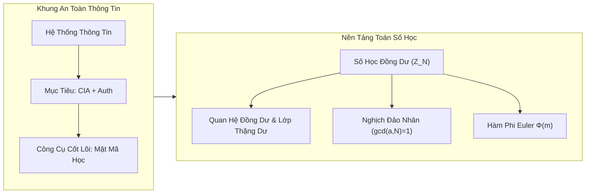

# Cẩm Nang Học Phần Toàn Diện: Nhập Môn Mật Mã Học (Introduction to Cryptography)
**Mã học phần:** ICT3.08E / ICT3.001 (Năm 3 Đại học, Khoa Công nghệ Thông tin và Truyền thông)  
**Cơ sở đào tạo:** Trường Đại học Khoa học và Công nghệ Hà Nội (USTH)  
**Giảng viên phụ trách:** ThS. Nguyễn Minh Hướng  
**Tài liệu tham khảo học thuật chuẩn:**
1. Christof Paar & Jan Pelzl, *Understanding Cryptography: A Textbook for Students and Practitioners*, Springer, 2009.
2. Mark Stamp, *Information Security: Principles and Practice*, 2nd Edition, John Wiley & Sons, 2011.
3. Matt Bishop, *Computer Security: Art and Science*, Addison-Wesley, 2003.

---

## Mục Lục Điều Hướng (Table of Contents)

- [1. Giới Thiệu Học Phần & Cấu Trúc Đánh Giá](#1-gioi-thieu-hoc-phan-cau-truc-anh-gia)
  - [Tỷ Lệ Đánh Giá Học Phần](#ty-le-anh-gia-hoc-phan)
- [2. Session 1: Cơ Sở An Toàn Thông Tin & Số Học Đồng Dư (Modular Arithmetic)](#2-session-1-co-so-an-toan-thong-tin-so-hoc-ong-du-modular-arithmetic)
  - [2.1 Khái Niệm Cốt Lõi Về An Toàn Thông Tin](#21-khai-niem-cot-loi-ve-an-toan-thong-tin)
    - [2.1.1 Hệ Thống Thông Tin & Các Thành Phần Cơ Bản](#211-he-thong-thong-tin-cac-thanh-phan-co-ban)
    - [2.1.2 Các Mục Tiêu An Toàn (Tam Giác CIA & Mở Rộng)](#212-cac-muc-tieu-an-toan-tam-giac-cia-mo-rong)
    - [2.1.3 Mô Hình Truyền Tin Kinh Điển (Alice, Bob và Trudy)](#213-mo-hinh-truyen-tin-kinh-ien-alice-bob-va-trudy)
  - [2.2 Nền Tảng Toán Học Số Học Đồng Dư](#22-nen-tang-toan-hoc-so-hoc-ong-du)
    - [2.2.1 Động Lực Học Tập](#221-ong-luc-hoc-tap)
    - [2.2.2 Phép Toán Modulo & Thuật Toán Chia Lấy Dư](#222-phep-toan-modulo-thuat-toan-chia-lay-du)
    - [2.2.3 Quan Hệ Đồng Dư & Lớp Thặng Dư](#223-quan-he-ong-du-lop-thang-du)
    - [2.2.4 Các Tính Chất Đại Số Của Đồng Dư Thức](#224-cac-tinh-chat-ai-so-cua-ong-du-thuc)
    - [2.2.5 Phép Chia Modulo & Phần Tử Nghịch Đảo Nhân](#225-phep-chia-modulo-phan-tu-nghich-ao-nhan)
    - [2.2.6 Hàm Phi Euler $\Phi(m)$](#226-ham-phi-euler-phim)
  - [2.3 Lời Giải Chi Tiết Các Bài Tập Trong Slide Session 1](#23-loi-giai-chi-tiet-cac-bai-tap-trong-slide-session-1)
    - [2.3.1 Bài tập 1 (Slide 24): Tính Toán Nhanh Modulo 13 Không Dùng Máy Tính](#231-bai-tap-1-slide-24-tinh-toan-nhanh-modulo-13-khong-dung-may-tinh)
    - [2.3.2 Bài tập 2 (Slide 25): Lũy Thừa Modulo & Phương Trình Đồng Dư](#232-bai-tap-2-slide-25-luy-thua-modulo-phuong-trinh-ong-du)
    - [2.3.3 Bài tập 3 (Slide 26): Tính Hàm Phi Euler](#233-bai-tap-3-slide-26-tinh-ham-phi-euler)
  - [2.4 Tích Hợp Thực Hành Lab 1 (Bài Tập 1, 2, 3, 4)](#24-tich-hop-thuc-hanh-lab-1-bai-tap-1-2-3-4)
    - [2.4.1 Lab 1 - Bài 1: Chuyển Đổi Nhị Phân & Phép Toán XOR](#241-lab-1-bai-1-chuyen-oi-nhi-phan-phep-toan-xor)
    - [2.4.2 Lab 1 - Bài 2: Khôi Phục Bản Rõ Từ Mảng Mã ASCII](#242-lab-1-bai-2-khoi-phuc-ban-ro-tu-mang-ma-ascii)
    - [2.4.3 Lab 1 - Bài 3: Giải Mã Dòng XOR Khóa k = 10](#243-lab-1-bai-3-giai-ma-dong-xor-khoa-k-10)
    - [2.4.4 Lab 1 - Bài 4: Thuật Toán Sinh Dòng Khóa A5/1 (Thanh Ghi Dịch LFSR)](#244-lab-1-bai-4-thuat-toan-sinh-dong-khoa-a51-thanh-ghi-dich-lfsr)
- [3. Session 2: Cơ Sở Mật Mã Đối Xứng & Mật Mã Cổ Điển](#3-session-2-co-so-mat-ma-oi-xung-mat-ma-co-ien)
  - [3.1 Phân Loại Mật Mã Học & Mô Hình Tổng Quát](#31-phan-loai-mat-ma-hoc-mo-hinh-tong-quat)
  - [3.2 Nguyên Lý Kerckhoffs](#32-nguyen-ly-kerckhoffs)
  - [3.3 Phân Loại Tấn Công & Thám Mã (Cryptanalysis)](#33-phan-loai-tan-cong-tham-ma-cryptanalysis)
    - [3.3.1 Các Mô Hình Tri Thức Kẻ Thù](#331-cac-mo-hinh-tri-thuc-ke-thu)
    - [3.3.2 Tấn Công Vét Cạn (Brute-Force Attack)](#332-tan-cong-vet-can-brute-force-attack)
  - [3.4 Các Hệ Mật Mã Cổ Điển](#34-cac-he-mat-ma-co-ien)
    - [3.4.1 Mật Mã Dịch Chuyển (Caesar Cipher)](#341-mat-ma-dich-chuyen-caesar-cipher)
    - [3.4.2 Mật Mã Affine: Công Thức Toán Học & Không Gian Khóa](#342-mat-ma-affine-cong-thuc-toan-hoc-khong-gian-khoa)
    - [3.4.3 Thám Mã Affine Bằng Tấn Công Biết Bản Rõ (KPA)](#343-tham-ma-affine-bang-tan-cong-biet-ban-ro-kpa)
- [4. Session 3: Mật Mã Đối Xứng — Mật Mã Dòng (Stream Ciphers)](#4-session-3-mat-ma-oi-xung-mat-ma-dong-stream-ciphers)
  - [4.1 Khái Niệm Mật Mã Dòng & One-Time Pad](#41-khai-niem-mat-ma-dong-one-time-pad)
  - [4.2 Hệ Mật GSM A5/1](#42-he-mat-gsm-a51)
  - [4.3 Thuật Toán RC4](#43-thuat-toan-rc4)
  - [4.4 Lời Giải Mô Phỏng A5/1 (Lab 1 Bài 4)](#44-loi-giai-mo-phong-a51-lab-1-bai-4)
    - [4.4.1 Cơ Chế Hoạt Động & Đa Thức Phản Hồi Chuẩn A5/1](#441-co-che-hoat-ong-a-thuc-phan-hoi-chuan-a51)
    - [4.4.2 Chuyển Đổi Trạng Thái Khởi Tạo Sang Nhị Phân](#442-chuyen-oi-trang-thai-khoi-tao-sang-nhi-phan)
    - [4.4.3 Bảng Theo Dõi Thực Thi Chi Tiết 10 Chu Kỳ (Phương Án Chuẩn USTH: Xuất Bit Trước, Dịch Sau)](#443-bang-theo-doi-thuc-thi-chi-tiet-10-chu-ky-phuong-an-chuan-usth-xuat-bit-truoc-dich-sau)
- [5. Session 4: Mật Mã Đối Xứng — Mật Mã Khối (Block Ciphers) & Chế Độ Hoạt Động](#5-session-4-mat-ma-oi-xung-mat-ma-khoi-block-ciphers-che-o-hoat-ong)
  - [5.1 Nguyên Lý Thiết Kế: Xáo Trộn, Khuếch Tán & Mạng Feistel](#51-nguyen-ly-thiet-ke-xao-tron-khuech-tan-mang-feistel)
  - [5.2 Chuẩn DES & AES](#52-chuan-des-aes)
  - [5.3 Các Chế Độ Hoạt Động Của Mã Khối (Modes of Operation)](#53-cac-che-o-hoat-ong-cua-ma-khoi-modes-of-operation)
  - [5.4 Tấn Công Gặp Ở Giữa (Meet-in-the-Middle) & 3DES](#54-tan-cong-gap-o-giua-meet-in-the-middle-3des)
  - [5.5 Làm Trắng Khóa (Key Whitening)](#55-lam-trang-khoa-key-whitening)
  - [5.6 Lời Giải Bài Thi Tra Hộp S1-Box DES (Đề Thi 2025–2026 Bài 1)](#56-loi-giai-bai-thi-tra-hop-s1-box-des-e-thi-20252026-bai-1)
- [6. Session 5: Giới Thiệu Mật Mã Bất Đối Xứng (Khóa Công Khai)](#6-session-5-gioi-thieu-mat-ma-bat-oi-xung-khoa-cong-khai)
- [7. Session 6: Mật Mã Bất Đối Xứng — RSA & Trao Đổi Khóa Diffie-Hellman](#7-session-6-mat-ma-bat-oi-xung-rsa-trao-oi-khoa-diffie-hellman)
  - [7.1 Hệ Mật RSA](#71-he-mat-rsa)
  - [7.2 Thuật Toán Bình Phương Và Nhân (Square-and-Multiply)](#72-thuat-toan-binh-phuong-va-nhan-square-and-multiply)
  - [7.3 Giao Thức Trao Đổi Khóa Diffie-Hellman (DHKE)](#73-giao-thuc-trao-oi-khoa-diffie-hellman-dhke)
  - [7.4 Lời Giải Đề Thi Thực Tế:](#74-loi-giai-e-thi-thuc-te)
  - [7.5 Tích Hợp Thực Hành Lab 2 & Lab 3 (Lời Giải Toàn Diện 8 Bài Tập)](#75-tich-hop-thuc-hanh-lab-2-lab-3-loi-giai-toan-dien-8-bai-tap)
    - [7.5.1 Lab 2 - Bài 1: Thuật Toán Euclid Tìm Ước Chung Lớn Nhất gcd(52698, 61430)](#751-lab-2-bai-1-thuat-toan-euclid-tim-uoc-chung-lon-nhat-gcd52698-61430)
    - [7.5.2 Lab 2 - Bài 2: Tìm Tất Cả Các Cặp Số Nguyên Tố Cùng Nhau Trong Tập A](#752-lab-2-bai-2-tim-tat-ca-cac-cap-so-nguyen-to-cung-nhau-trong-tap-a)
    - [7.5.3 Lab 2 - Bài 3: Thuật Toán Bình Phương Và Nhân (Square-and-Multiply)](#753-lab-2-bai-3-thuat-toan-binh-phuong-va-nhan-square-and-multiply)
    - [7.5.4 Lab 2 - Bài 4: Tìm Nghịch Đảo Nhân Modulo $65537^{-1} \pmod{35256}$](#754-lab-2-bai-4-tim-nghich-ao-nhan-modulo-65537-1-pmod35256)
    - [7.5.5 Lab 3 - Bài 1: Chuyển Đổi Chuỗi Ký Tự "flow" Sang Số Nguyên](#755-lab-3-bai-1-chuyen-oi-chuoi-ky-tu-flow-sang-so-nguyen)
    - [7.5.6 Lab 3 - Bài 2: Chuyển Đổi Số Nguyên 14445 Sang Chuỗi Ký Tự ASCII](#756-lab-3-bai-2-chuyen-oi-so-nguyen-14445-sang-chuoi-ky-tu-ascii)
    - [7.5.7 Lab 3 - Bài 3: Lập Trình Mã Hóa & Giải Mã RSA Với Hai Bộ Tham Số](#757-lab-3-bai-3-lap-trinh-ma-hoa-giai-ma-rsa-voi-hai-bo-tham-so)
    - [7.5.8 Lab 3 - Bài 4: Khôi Phục Bản Rõ Từ Bản Mã RSA C = 412589464](#758-lab-3-bai-4-khoi-phuc-ban-ro-tu-ban-ma-rsa-c-412589464)
- [8. Session 7: Chữ Ký Số & Hàm Băm Mật Mã](#8-session-7-chu-ky-so-ham-bam-mat-ma)
  - [8.1 Sơ Đồ Chữ Ký Số RSA & Elgamal](#81-so-o-chu-ky-so-rsa-elgamal)
  - [8.2 Hàm Băm Mật Mã & Nghịch Lý Ngày Sinh (Birthday Attack)](#82-ham-bam-mat-ma-nghich-ly-ngay-sinh-birthday-attack)
  - [8.3 Cấu Trúc Hàm Băm Từ Mã Khối](#83-cau-truc-ham-bam-tu-ma-khoi)
  - [8.3.1 Bài Tập Mẫu Chữ Ký DSA (Slide 12)](#831-bai-tap-mau-chu-ky-dsa-slide-12)
  - [8.5.1 Bài Tập Tính Toán Vòng 1 Của SHA-1 (Slide 25)](#851-bai-tap-tinh-toan-vong-1-cua-sha-1-slide-25)
- [9. Session 8: Mã Xác Thực Thông Điệp (MAC) & Quản Lý Khóa](#9-session-8-ma-xac-thuc-thong-iep-mac-quan-ly-khoa)
  - [9.1 Mã Xác Thực Thông Điệp (MACs) & Chuẩn HMAC](#91-ma-xac-thuc-thong-iep-macs-chuan-hmac)
  - [9.2 Thiết Lập Khóa & PKI](#92-thiet-lap-khoa-pki)
  - [9.2.3 Bài Tập Mẫu Tấn Công MitM Trên Diffie-Hellman (Slide 18)](#923-bai-tap-mau-tan-cong-mitm-tren-diffie-hellman-slide-18)
  - [9.3 Lời Giải Đề Thi Ký Chứng Chỉ CA (Đề Thi 2024–2025 Bài 2)](#93-loi-giai-e-thi-ky-chung-chi-ca-e-thi-20242025-bai-2)
- [10. Mã Nguồn Python Mẫu Chuẩn Cho Toàn Bộ Chương Trình Labwork](#10-ma-nguon-python-mau-chuan-cho-toan-bo-chuong-trinh-labwork)
  - [10.1 Mã Nguồn Labwork 1: Phép Toán Nhị Phân, Giải Mã Dòng XOR & Mô Phỏng A5/1](#101-ma-nguon-labwork-1-phep-toan-nhi-phan-giai-ma-dong-xor-mo-phong-a51)
- [==============================================================================](#sec-1)
- [LABWORK 1 - INTRODUCTION TO CRYPTOGRAPHY](#labwork-1-introduction-to-cryptography)
- [USTH - Department of Information and Communication Technology](#usth-department-of-information-and-communication-technology)
- [==============================================================================](#sec-1-1)
  - [10.2 Mã Nguồn Labwork 2: Thuật Toán Euclid Mở Rộng, Cặp Số Nguyên Tố Cùng Nhau & Lũy Thừa Nhanh](#102-ma-nguon-labwork-2-thuat-toan-euclid-mo-rong-cap-so-nguyen-to-cung-nhau-luy-thua-nhanh)
- [==============================================================================](#sec-1-2)
- [LABWORK 2 - INTRODUCTION TO CRYPTOGRAPHY](#labwork-2-introduction-to-cryptography)
- [Modular Arithmetic, GCD & Fast Exponentiation](#modular-arithmetic-gcd-fast-exponentiation)
- [==============================================================================](#sec-1-3)
  - [10.3 Mã Nguồn Labwork 3: Hệ Mật RSA Hoàn Chỉnh & Giải Mã Thách Thức Bản Tin](#103-ma-nguon-labwork-3-he-mat-rsa-hoan-chinh-giai-ma-thach-thuc-ban-tin)
- [==============================================================================](#sec-1-4)
- [LABWORK 3 - INTRODUCTION TO CRYPTOGRAPHY](#labwork-3-introduction-to-cryptography)
- [RSA Cryptosystem: Key Generation, Encryption, Decryption & Text Encoding](#rsa-cryptosystem-key-generation-encryption-decryption-text-encoding)
- [==============================================================================](#sec-1-5)
- [11. Giải Chi Tiết Toàn Bộ Đề Thi Cuối Kỳ USTH (2024–2026)](#11-giai-chi-tiet-toan-bo-e-thi-cuoi-ky-usth-20242026)
  - [11.1 Đề Thi Học Kỳ 2 Năm Học 2024–2025 (Mã Môn: ICT3.001)](#111-e-thi-hoc-ky-2-nam-hoc-20242025-ma-mon-ict3001)
    - [Bài 1: Tạo Khóa RSA Trong Hệ Thống PKI (4/20 điểm)](#bai-1-tao-khoa-rsa-trong-he-thong-pki-420-iem)
    - [Bài 2: Tạo Chữ Ký Chứng Thực Của Cơ Quan CA (4/20 điểm)](#bai-2-tao-chu-ky-chung-thuc-cua-co-quan-ca-420-iem)
  - [11.2 Đề Thi Học Kỳ 2 Năm Học 2025–2026 (Mã Môn: ICT3.08E)](#112-e-thi-hoc-ky-2-nam-hoc-20252026-ma-mon-ict308e)
    - [Bài 1: Tính Toán Hộp S-Box DES (3/20 điểm)](#bai-1-tinh-toan-hop-s-box-des-320-iem)
    - [Bài 2: Thiết Lập Khóa RSA & Mã Hóa Thông Điệp (9/20 điểm)](#bai-2-thiet-lap-khoa-rsa-ma-hoa-thong-iep-920-iem)
    - [Bài 3: Giao Thức Trao Đổi Khóa Diffie-Hellman (DHKE) (4/20 điểm)](#bai-3-giao-thuc-trao-oi-khoa-diffie-hellman-dhke-420-iem)

---

<a id="1-gioi-thieu-hoc-phan-cau-truc-anh-gia"></a>
## 1. Giới Thiệu Học Phần & Cấu Trúc Đánh Giá
*(Trích nguồn: `session1.pdf`, Slide 1–13)*

Học phần **Nhập Môn Mật Mã Học** (`ICT3.08E` / `ICT3.001`) tại Đại học Khoa học và Công nghệ Hà Nội (USTH) trang bị hệ thống kiến thức toàn diện từ cơ sở lý thuyết số, giải thuật mật mã đối xứng, mã khối, mật mã dòng, đến các giao thức khóa công khai hiện đại (RSA, Diffie-Hellman), chữ ký số, hàm băm và hạ tầng khóa công khai (PKI).

<a id="ty-le-anh-gia-hoc-phan"></a>
### Tỷ Lệ Đánh Giá Học Phần
- **Đánh giá giữa kỳ (Mid-term):** 40%
- **Điểm chuyên cần & Thực hành (Active/Lab):** 5%
- **Thi kết thúc học phần (Final Exam):** 60% (Thi viết tự luận, thời lượng 60–75 phút; sinh viên được phép mang 01 tờ A4 viết tay hai mặt và máy tính bỏ túi; 15 phút cuối được phép mở laptop không kết nối mạng cho một số đề thi thực hành).

---

<a id="2-session-1-co-so-an-toan-thong-tin-so-hoc-ong-du-modular-arithmetic"></a>
## 2. Session 1: Cơ Sở An Toàn Thông Tin & Số Học Đồng Dư (Modular Arithmetic)
*(Trích nguồn: `session1.pdf`, Slide 1–26)*



<a id="21-khai-niem-cot-loi-ve-an-toan-thong-tin"></a>
### 2.1 Khái Niệm Cốt Lõi Về An Toàn Thông Tin
*(Trích nguồn: `session1.pdf`, Slide 3–13)*

<a id="211-he-thong-thong-tin-cac-thanh-phan-co-ban"></a>
#### 2.1.1 Hệ Thống Thông Tin & Các Thành Phần Cơ Bản
**Hệ thống thông tin (Information System - IS):** Là một hệ thống có tổ chức phục vụ việc thu thập, lưu trữ, xử lý và truyền tải thông tin.
- **Thành phần cốt lõi:** Phần cứng (Hardware), Phần mềm (Software), Dữ liệu (Data), Con người (People), Quy trình (Procedures), và Mạng truyền thông (Networks).
- **An toàn thông tin (Information Security):** Là sự bảo vệ tài sản thông tin và các hệ thống xử lý, lưu trữ, truyền thông tin khỏi các rủi ro thông qua chính sách, đào tạo và giải pháp công nghệ.

<a id="212-cac-muc-tieu-an-toan-tam-giac-cia-mo-rong"></a>
#### 2.1.2 Các Mục Tiêu An Toàn (Tam Giác CIA & Mở Rộng)
1. **Tính Bí Mật (Confidentiality):** Đảm bảo thông tin chỉ được truy cập bởi những thực thể được cấp quyền, ngăn chặn nghe lén trái phép.
2. **Tính Toàn Vẹn (Integrity):** Đảm bảo thông tin không bị sửa đổi, chèn thêm, xóa bớt hoặc tái phát lại một cách trái phép trong quá trình lưu trữ hay truyền tải.
3. **Tính Sẵn Sàng (Availability):** Đảm bảo hệ thống và dữ liệu luôn sẵn sàng phục vụ người dùng hợp pháp khi có nhu cầu.
4. **Xác Thực (Authentication):** Kiểm tra và xác minh đúng danh tính thực sự của đối tượng tham gia giao tiếp.
5. **Cấp Quyền (Authorization):** Giới hạn và kiểm soát quyền hạn thao tác của người dùng sau khi đã xác thực thành công.
6. **Chống Chối Bỏ (Non-Repudiation):** Ngăn chặn một bên phủ nhận một giao dịch hoặc thông điệp mà chính họ đã tạo ra trước đó.

<a id="213-mo-hinh-truyen-tin-kinh-ien-alice-bob-va-trudy"></a>
#### 2.1.3 Mô Hình Truyền Tin Kinh Điển (Alice, Bob và Trudy)
- **Alice:** Người gửi bản rõ $x$ hợp pháp.
- **Bob:** Người nhận thông tin hợp pháp.
- **Trudy (Kẻ tấn công / Bad):** Kẻ thù nằm trên kênh truyền không an toàn, có khả năng nghe lén, chỉnh sửa, giả mạo gói tin.

---

<a id="22-nen-tang-toan-hoc-so-hoc-ong-du"></a>
### 2.2 Nền Tảng Toán Học Số Học Đồng Dư

> [!TIP]
> **File code thuật toán độc lập:** [`code/modular_arithmetic.py`](code/modular_arithmetic.py)  
> *Lệnh chạy terminal:* `python code/modular_arithmetic.py`
*(Trích nguồn: `session1.pdf`, Slide 14–26; Giáo trình Paar & Pelzl, Chương 1)*

<a id="221-ong-luc-hoc-tap"></a>
#### 2.2.1 Động Lực Học Tập
- Là nền tảng toán học sống còn của **mật mã bất đối xứng** (RSA, Trao đổi khóa Diffie-Hellman, Đường cong Elliptic ECC).
- Cho phép mô tả toán học chính xác các hệ mật mã cổ điển như Caesar, Affine.

<a id="222-phep-toan-modulo-thuat-toan-chia-lay-du"></a>
#### 2.2.2 Phép Toán Modulo & Thuật Toán Chia Lấy Dư
> **Định Nghĩa Phép Toán Modulo:**  
> Cho $a, r, m \in \mathbb{Z}$ với $m > 0$. Ta viết:
> $$a \equiv r \pmod m \iff m \mid (a - r)$$
> Tức là hiệu $(a - r)$ chia hết cho $m$.
> - $m$: **Modulus** (Số chia / Số modulo, luôn nguyên dương $m > 0$).
> - $r$: **Remainder** (Số dư).

**Định Lý Phép Chia Lấy Dư (Division Algorithm):**  
Với mọi số nguyên $a$ và số nguyên dương $m$, luôn tồn tại duy nhất cặp số nguyên $q$ (thương) và $r$ (số dư) sao cho:
$$a = q \cdot m + r \quad \text{với } 0 \le r \le m - 1$$
*Quy ước:* Mặc dù số dư có vô số biểu diễn tương đương (ví dụ $12 \equiv 3 \equiv 21 \equiv -6 \pmod 9$), trong mật mã học ta luôn quy chuẩn về phần tử đại diện nhỏ nhất không âm: $r \in \{0, 1, \dots, m - 1\}$.

<a id="223-quan-he-ong-du-lop-thang-du"></a>
#### 2.2.3 Quan Hệ Đồng Dư & Lớp Thặng Dư
Hai số nguyên $a$ và $b$ đồng dư với nhau modulo $N$ nếu và chỉ nếu chúng có cùng số dư khi chia cho $N$:
$$a \equiv b \pmod N \iff b \equiv a \pmod N$$
Tập hợp tất cả các số nguyên có cùng số dư $r$ modulo $m$ tạo thành một **lớp thặng dư** (Equivalence class) $[r]$:
$$[r] = \{ x \in \mathbb{Z} \mid x \equiv r \pmod m \}$$
Vành số dư modulo $m$ được ký hiệu là:
$$\mathbb{Z}_m = \{0, 1, 2, \dots, m - 1\}$$

<a id="224-cac-tinh-chat-ai-so-cua-ong-du-thuc"></a>
#### 2.2.4 Các Tính Chất Đại Số Của Đồng Dư Thức
Cho $a, b, c, d, k \in \mathbb{Z}$ và $N \in \mathbb{Z}^+$:
1. **Phép cộng:**
   - Nếu $a \equiv b \pmod N$ thì $a + k \equiv b + k \pmod N$.
   - Nếu $a \equiv b \pmod N$ và $c \equiv d \pmod N$ thì $a + c \equiv b + d \pmod N$.
   - Phần tử đối: $-a \equiv -b \pmod N$.
2. **Phép nhân:**
   - Nếu $a \equiv b \pmod N$ thì $k \cdot a \equiv k \cdot b \pmod N \quad (\forall k \in \mathbb{Z})$.
   - Nếu $a \equiv b \pmod N$ và $c \equiv d \pmod N$ thì $a \cdot c \equiv b \cdot d \pmod N$.
3. **Phép lũy thừa:**
   - Nếu $a \equiv b \pmod N$ thì $a^k \equiv b^k \pmod N \quad (\forall k > 0)$.

<a id="225-phep-chia-modulo-phan-tu-nghich-ao-nhan"></a>
#### 2.2.5 Phép Chia Modulo & Phần Tử Nghịch Đảo Nhân
Phép chia thông thường không tồn tại trực tiếp trong vành $\mathbb{Z}_N$. Phép chia cho $a$ modulo $N$ thực chất là phép nhân với **nghịch đảo nhân modulo** của $a$:

> **Định Lý Triệt Tiêu (Cancellation Rule):**  
> Nếu $k \cdot a \equiv k \cdot b \pmod N$ và $\gcd(k, N) = 1$ ($k$ và $N$ nguyên tố cùng nhau) thì:
> $$a \equiv b \pmod N$$

> **Định Nghĩa Phần Tử Nghịch Đảo Nhân:**  
> Cho $a \in \mathbb{Z}_N$. Số nguyên $x \in \mathbb{Z}_N$ được gọi là phần tử nghịch đảo nhân của $a$ modulo $N$, ký hiệu $a^{-1}$, nếu:
> $$a \cdot x \equiv 1 \pmod N$$
> **Điều kiện tồn tại duy nhất:** $a^{-1} \pmod N$ tồn tại **khi và chỉ khi** $\gcd(a, N) = 1$.  
> Tìm được hiệu quả bằng **Thuật toán Euclid Mở rộng (Extended Euclidean Algorithm - EEA)**.

<a id="226-ham-phi-euler-phim"></a>
#### 2.2.6 Hàm Phi Euler $\Phi(m)$
Hàm Phi Euler $\Phi(m)$ đếm số lượng các số nguyên dương nhỏ hơn hoặc bằng $m$ và nguyên tố cùng nhau với $m$:
$$\Phi(m) = \big| \{ a \in \mathbb{Z} \mid 1 \le a \le m \text{ và } \gcd(a, m) = 1 \} \big|$$

**Công thức tính nhanh:**
1. Với số nguyên tố $p$: $\Phi(p) = p - 1$.
2. Với lũy thừa nguyên tố $p^k$: $\Phi(p^k) = p^k - p^{k-1} = p^k \left( 1 - \frac{1}{p} \right)$.
3. Tính nhân tính: Nếu $\gcd(m, n) = 1$ thì $\Phi(m \cdot n) = \Phi(m) \cdot \Phi(n)$.
4. Dạng phân tích thừa số nguyên tố tổng quát $m = \prod p_i^{k_i}$:
   $$\Phi(m) = m \prod_{i=1}^r \left( 1 - \frac{1}{p_i} \right)$$

---

<a id="23-loi-giai-chi-tiet-cac-bai-tap-trong-slide-session-1"></a>
### 2.3 Lời Giải Chi Tiết Các Bài Tập Trong Slide Session 1
*(Trích nguồn: `session1.pdf`, Slide 24–26)*

<a id="231-bai-tap-1-slide-24-tinh-toan-nhanh-modulo-13-khong-dung-may-tinh"></a>
#### 2.3.1 Bài tập 1 (Slide 24): Tính Toán Nhanh Modulo 13 Không Dùng Máy Tính
1. **Tính $15 \cdot 29 \pmod{13}$:**  
   Rút gọn từng thừa số modulo 13:
   $$15 = 13 \cdot 1 + 2 \implies 15 \equiv 2 \pmod{13}$$
   $$29 = 13 \cdot 2 + 3 \implies 29 \equiv 3 \pmod{13}$$
   $$15 \cdot 29 \equiv 2 \cdot 3 \equiv \mathbf{6} \pmod{13}$$
2. **Tính $2 \cdot 29 \pmod{13}$:**  
   Vì $29 \equiv 3 \pmod{13} \implies 2 \cdot 29 \equiv 2 \cdot 3 \equiv \mathbf{6} \pmod{13}$.
3. **Tính $2 \cdot 3 \pmod{13}$:**  
   $2 \cdot 3 = 6 \implies \mathbf{6} \pmod{13}$.
4. **Tính $-11 \cdot 3 \pmod{13}$:**  
   Vì $-11 = -1 \cdot 13 + 2 \implies -11 \equiv 2 \pmod{13}$.  
   $$-11 \cdot 3 \equiv 2 \cdot 3 \equiv \mathbf{6} \pmod{13}$$
*Nhận xét sư phạm:* Cả 4 bài toán đều quy về cùng một lớp thặng dư đại diện $[6]_{13}$, chứng minh tính bất biến khi thay thế các phần tử trong cùng lớp thặng dư.

<a id="232-bai-tap-2-slide-25-luy-thua-modulo-phuong-trinh-ong-du"></a>
#### 2.3.2 Bài tập 2 (Slide 25): Lũy Thừa Modulo & Phương Trình Đồng Dư
1. $x = 3^2 \pmod{13} \implies 3^2 = 9 \implies \mathbf{x = 9}$.
2. $x = 7^2 \pmod{13} \implies 7^2 = 49 = 3 \cdot 13 + 10 \implies \mathbf{x = 10}$ (hoặc $-3 \pmod{13}$).
3. $x = 3^{10} \pmod{13}$:  
   Nhận xét $3^3 = 27 = 2 \cdot 13 + 1 \equiv 1 \pmod{13}$.  
   Phân tích số mũ: $10 = 3 \cdot 3 + 1$.  
   $$3^{10} = (3^3)^3 \cdot 3^1 \equiv (1)^3 \cdot 3 \equiv \mathbf{3} \pmod{13}$$
4. $x = 7^{100} \pmod{13}$:  
   Theo **Định lý Fermat Nhỏ**, vì 13 là số nguyên tố và $\gcd(7, 13) = 1$:
   $$7^{13-1} = 7^{12} \equiv 1 \pmod{13}$$
   Chia số mũ 100 cho 12: $100 = 12 \cdot 8 + 4$.  
   $$7^{100} = (7^{12})^8 \cdot 7^4 \equiv 1^8 \cdot 7^4 \equiv 7^4 \pmod{13}$$
   Từ câu 2: $7^2 \equiv -3 \pmod{13} \implies 7^4 = (7^2)^2 \equiv (-3)^2 = \mathbf{9} \pmod{13}$.  
   Vậy $\mathbf{x = 9}$.
5. Giải phương trình đồng dư: $7x \equiv 11 \pmod{13}$  
   Tìm nghịch đảo nhân $7^{-1} \pmod{13}$:
   $$7 \cdot 2 = 14 = 1 \cdot 13 + 1 \equiv 1 \pmod{13} \implies 7^{-1} \equiv 2 \pmod{13}$$
   Nhân cả hai vế với 2:
   $$x \equiv 11 \cdot 2 = 22 = 1 \cdot 13 + 9 \implies \mathbf{x \equiv 9 \pmod{13}}$$
   *Kiểm tra lại:* $7 \cdot 9 = 63 = 4 \cdot 13 + 11 \equiv 11 \pmod{13}$ (Chính xác).

<a id="233-bai-tap-3-slide-26-tinh-ham-phi-euler"></a>
#### 2.3.3 Bài tập 3 (Slide 26): Tính Hàm Phi Euler
- $m = 3$: Số nguyên tố $\implies \Phi(3) = 3 - 1 = \mathbf{2}$ (tập $\{1, 2\}$).
- $m = 4 = 2^2$: $\Phi(4) = 4(1 - 1/2) = \mathbf{2}$ (tập $\{1, 3\}$).
- $m = 5$: Số nguyên tố $\implies \Phi(5) = 5 - 1 = \mathbf{4}$ (tập $\{1, 2, 3, 4\}$).
- $m = 9 = 3^2$: $\Phi(9) = 9(1 - 1/3) = \mathbf{6}$ (tập $\{1, 2, 4, 5, 7, 8\}$).
- $m = 26 = 2 \cdot 13$: Vì $\gcd(2, 13) = 1$:
  $$\Phi(26) = \Phi(2) \cdot \Phi(13) = 1 \cdot 12 = \mathbf{12}$$
  Tập các số nguyên tố cùng nhau với 26 gồm đúng 12 phần tử:
  $$\{1, 3, 5, 7, 9, 11, 15, 17, 19, 21, 23, 25\}$$
  *(Lưu ý: Đây chính là 12 giá trị hệ số $a$ hợp lệ của hệ mật Affine trong Session 2!)*

---

<a id="24-tich-hop-thuc-hanh-lab-1-bai-tap-1-2-3-4"></a>
### 2.4 Tích Hợp Thực Hành Lab 1 (Bài Tập 1, 2, 3, 4)

> [!TIP]
> **File code thuật toán độc lập (Lab 1 Bài 1-3):** [`code/binary_xor_stream.py`](code/binary_xor_stream.py)  
> *Lệnh chạy terminal:* `python code/binary_xor_stream.py`
*(Trích nguồn: `Lab1.pdf`, Trang 1; Bài tập lập trình thực hành mở đầu)*

<a id="241-lab-1-bai-1-chuyen-oi-nhi-phan-phep-toan-xor"></a>
#### 2.4.1 Lab 1 - Bài 1: Chuyển Đổi Nhị Phân & Phép Toán XOR
**Đề bài:** Cho hai số nguyên $a = 123$, $b = 543$:
1. Tìm biểu diễn nhị phân của số $a$.
2. Tính $a \oplus b$ (a XOR b) ở dạng nhị phân và dạng số thập phân.

**Lời giải chi tiết từng bước:**
1. **Chuyển đổi số $a = 123_{10}$ sang nhị phân:**
   - Phân tích theo lũy thừa của 2:
     $$123 = 64 + 32 + 16 + 8 + 2 + 1 = 2^6 + 2^5 + 2^4 + 2^3 + 2^1 + 2^0$$
   - Dưới dạng 8 bit: $\mathbf{a = 01111011_2}$. (Nếu đệm 10 bit để đồng kích thước với $b$: $\mathbf{0001111011_2}$).
2. **Chuyển đổi số $b = 543_{10}$ sang nhị phân:**
   - Phân tích theo lũy thừa của 2:
     $$543 = 512 + 16 + 8 + 4 + 2 + 1 = 2^9 + 2^4 + 2^3 + 2^2 + 2^1 + 2^0$$
   - Dưới dạng 10 bit: $\mathbf{b = 1000011111_2}$.
3. **Thực hiện phép toán XOR từng bit ($a \oplus b$):**
   - Bảng chân lý XOR: $0 \oplus 0 = 0$, $0 \oplus 1 = 1$, $1 \oplus 0 = 1$, $1 \oplus 1 = 0$.
   ```
     Bit:   9 8 7 6 5 4 3 2 1 0
     a   =  0 0 0 1 1 1 1 0 1 1  (123)
     b   =  1 0 0 0 0 1 1 1 1 1  (543)
   ------------------------------------
   a ^ b =  1 0 0 1 0 1 1 0 0 0  (binary)
   ```
   - **Kết quả dạng nhị phân:** $\mathbf{1001011000_2}$.
4. **Chuyển kết quả sang số thập phân:**
   $$1 \cdot 2^9 + 0 \cdot 2^8 + 0 \cdot 2^7 + 1 \cdot 2^6 + 0 \cdot 2^5 + 1 \cdot 2^4 + 1 \cdot 2^3 + 0 \cdot 2^2 + 0 \cdot 2^1 + 0 \cdot 2^0$$
   $$= 512 + 64 + 16 + 8 = \mathbf{600_{10}}$$
- **Kiểm chứng bằng Python:**
  ```python
  a, b = 123, 543
  print(bin(a))        # '0b1111011'
  print(bin(a ^ b))    # '0b1001011000'
  print(a ^ b)         # 600
  ```

<a id="242-lab-1-bai-2-khoi-phuc-ban-ro-tu-mang-ma-ascii"></a>
#### 2.4.2 Lab 1 - Bài 2: Khôi Phục Bản Rõ Từ Mảng Mã ASCII
**Đề bài:** Cho mảng gồm 32 số nguyên đại diện cho các mã ASCII của từng ký tự trong thông điệp ẩn:
$$A = [105, 110, 116, 114, 111, 50, 99, 114, 121, 112, 116, 111, 123, 119, 51, 108, 99, 48, 109, 51, 95, 116, 48, 95, 106, 48, 117, 114, 110, 51, 121, 125]$$
Hãy tìm thông điệp bản rõ ẩn giấu.

**Bảng tra cứu và chuyển đổi chi tiết:**
| Chỉ số | Mã ASCII | Ký tự | Chỉ số | Mã ASCII | Ký tự | Chỉ số | Mã ASCII | Ký tự | Chỉ số | Mã ASCII | Ký tự |
| :---: | :---: | :---: | :---: | :---: | :---: | :---: | :---: | :---: | :---: | :---: | :---: |
| 0 | 105 | `i` | 8 | 121 | `y` | 16 | 99 | `c` | 24 | 106 | `j` |
| 1 | 110 | `n` | 9 | 112 | `p` | 17 | 48 | `0` | 25 | 48 | `0` |
| 2 | 116 | `t` | 10 | 116 | `t` | 18 | 109 | `m` | 26 | 117 | `u` |
| 3 | 114 | `r` | 11 | 111 | `o` | 19 | 51 | `3` | 27 | 114 | `r` |
| 4 | 111 | `o` | 12 | 123 | `{` | 20 | 95 | `_` | 28 | 110 | `n` |
| 5 | 50 | `2` | 13 | 119 | `w` | 21 | 116 | `t` | 29 | 51 | `3` |
| 6 | 99 | `c` | 14 | 51 | `3` | 22 | 48 | `0` | 30 | 121 | `y` |
| 7 | 114 | `r` | 15 | 108 | `l` | 23 | 95 | `_` | 31 | 125 | `}` |

- **Thông điệp giải mã hoàn chỉnh:**
  $$\mathbf{\text{intro2crypto\{w3lc0m3\_t0\_j0urn3y\}}}$$
- **Mã nguồn thực thi Python:**
  ```python
  A = [105, 110, 116, 114, 111, 50, 99, 114, 121, 112, 116, 111, 123, 119, 51,
       108, 99, 48, 109, 51, 95, 116, 48, 95, 106, 48, 117, 114, 110, 51, 121, 125]
  message = ''.join(chr(c) for c in A)
  print(message) # intro2crypto{w3lc0m3_t0_j0urn3y}
  ```

<a id="243-lab-1-bai-3-giai-ma-dong-xor-khoa-k-10"></a>
#### 2.4.3 Lab 1 - Bài 3: Giải Mã Dòng XOR Khóa k = 10
**Đề bài:** Cho mảng số nguyên $B$ gồm 30 phần tử:
$$B = [99, 100, 126, 120, 101, 56, 105, 120, 115, 122, 126, 101, 113, 59, 121, 126, 57, 122, 85, 58, 100, 85, 96, 58, 127, 120, 100, 57, 115, 119]$$
Biết rằng mỗi số trong mảng được tạo ra bằng phép XOR giữa mã ASCII của ký tự gốc với khóa bí mật $k = 10_{10}$. Hãy giải mã thông điệp.

**Cơ sở lý thuyết & Tính chất tự nghịch đảo của XOR:**
- Trong hệ mật mã dòng / One-Time Pad, nếu bản mã được tạo bởi $C_i = P_i \oplus k$, thì bản rõ được giải mã chính xác bằng cách thực hiện lại phép XOR với cùng khóa $k$:
  $$P_i = C_i \oplus k = (P_i \oplus k) \oplus k = P_i \oplus (k \oplus k) = P_i \oplus 0 = P_i$$

**Bảng giải mã chi tiết từng phần tử:**
| $C_i$ | $C_i \oplus 10$ | Ký tự | $C_i$ | $C_i \oplus 10$ | Ký tự | $C_i$ | $C_i \oplus 10$ | Ký tự |
| :---: | :---: | :---: | :---: | :---: | :---: | :---: | :---: | :---: |
| 99 | $99 \oplus 10 = 105$ | `i` | 126 | $126 \oplus 10 = 116$ | `t` | 100 | $100 \oplus 10 = 110$ | `n` |
| 100 | $100 \oplus 10 = 110$ | `n` | 101 | $101 \oplus 10 = 111$ | `o` | 85 | $85 \oplus 10 = 95$ | `_` |
| 126 | $126 \oplus 10 = 116$ | `t` | 113 | $113 \oplus 10 = 123$ | `{` | 96 | $96 \oplus 10 = 106$ | `j` |
| 120 | $120 \oplus 10 = 114$ | `r` | 59 | $59 \oplus 10 = 49$ | `1` | 58 | $58 \oplus 10 = 48$ | `0` |
| 101 | $101 \oplus 10 = 111$ | `o` | 121 | $121 \oplus 10 = 115$ | `s` | 127 | $127 \oplus 10 = 117$ | `u` |
| 56 | $56 \oplus 10 = 50$ | `2` | 126 | $126 \oplus 10 = 116$ | `t` | 120 | $120 \oplus 10 = 114$ | `r` |
| 105 | $105 \oplus 10 = 99$ | `c` | 57 | $57 \oplus 10 = 51$ | `3` | 100 | $100 \oplus 10 = 110$ | `n` |
| 120 | $120 \oplus 10 = 114$ | `r` | 122 | $122 \oplus 10 = 112$ | `p` | 57 | $57 \oplus 10 = 51$ | `3` |
| 115 | $115 \oplus 10 = 121$ | `y` | 85 | $85 \oplus 10 = 95$ | `_` | 115 | $115 \oplus 10 = 121$ | `y` |
| 122 | $122 \oplus 10 = 112$ | `p` | 58 | $58 \oplus 10 = 48$ | `0` | 119 | $119 \oplus 10 = 125$ | `}` |

- **Thông điệp giải mã hoàn chỉnh:**
  $$\mathbf{\text{intro2crypto\{1st3p\_0n\_j0urn3y\}}}$$
- **Mã nguồn thực thi Python:**
  ```python
  B = [99, 100, 126, 120, 101, 56, 105, 120, 115, 122, 126, 101, 113, 59, 121,
       126, 57, 122, 85, 58, 100, 85, 96, 58, 127, 120, 100, 57, 115, 119]
  k = 10
  decrypted = ''.join(chr(c ^ k) for c in B)
  print(decrypted) # intro2crypto{1st3p_0n_j0urn3y}
  ```

---

<a id="244-lab-1-bai-4-thuat-toan-sinh-dong-khoa-a51-thanh-ghi-dich-lfsr"></a>
#### 2.4.4 Lab 1 - Bài 4: Thuật Toán Sinh Dòng Khóa A5/1 (Thanh Ghi Dịch LFSR)
*(Trích nguồn: `Lab1.pdf`, Trang 2, Exercise 4; `Session3.pdf`, Slide 6–9; Sách Understanding Cryptography, Chương 2)*

**Đề bài:**
Dựa trên mô tả thuật toán sinh dòng khóa A5/1, hãy lập trình mô phỏng quá trình sinh $n = 10$ bit dòng khóa đầu tiên từ trạng thái ban đầu của 3 thanh ghi LFSR cho dưới dạng số thập phân:
$$X_0 = (x_0, x_1, \dots, x_{18}) = 513365_{10}$$
$$Y_0 = (y_0, y_1, \dots, y_{21}) = 3355443_{10}$$
$$Z_0 = (z_0, z_1, \dots, z_{22}) = 7401712_{10}$$

**Nguyên lý vận hành từ Slide bài giảng `Session3.pdf` (Slide 6–9):**
1. **Ba thanh ghi phản hồi dịch tuyến tính (LFSR):**
   - **Thanh ghi $X$ (19 bit):** Bit điều khiển nhịp $x_8$. Đa thức phản hồi: $x_0 = x_{13} \oplus x_{16} \oplus x_{17} \oplus x_{18}$.
   - **Thanh ghi $Y$ (22 bit):** Bit điều khiển nhịp $y_{10}$. Đa thức phản hồi: $y_0 = y_{20} \oplus y_{21}$.
   - **Thanh ghi $Z$ (23 bit):** Bit điều khiển nhịp $z_{10}$. Đa thức phản hồi: $z_0 = z_7 \oplus z_{20} \oplus z_{21} \oplus z_{22}$.
2. **Quy tắc điều khiển nhịp đa số (`Session3.pdf`, Slide 9):**
   $$m = \text{maj}(x_8, y_{10}, z_{10}) = (x_8 \land y_{10}) \lor (y_{10} \land z_{10}) \lor (x_8 \land z_{10})$$
   Thanh ghi nào có bit điều khiển nhịp bằng với giá trị đa số $m$ thì mới thực hiện dịch chuyển bit.
3. **Quy ước phần cứng & Dòng khóa chuẩn USTH (Phương án 1 — Xuất bit trước, dịch nhịp sau):**
   Trong mạch phần cứng số, khi vừa nạp khóa ban đầu, cổng XOR đầu ra tức thời cung cấp bit khóa đầu tiên $s_1 = x_{18} \oplus y_{21} \oplus z_{22} = 1 \oplus 1 \oplus 0 = \mathbf{0}$ trước khi sườn xung nhịp kích hoạt dịch thanh ghi. Qua 10 chu kỳ, 10 bit dòng khóa thu được là:
   $$\mathbf{S = (0, 1, 0, 0, 0, 0, 0, 0, 0, 1)_2} \quad (\text{Chuỗi nhị phân: } \mathbf{0100000001})$$

> *(Xem bảng theo dõi 10 chu kỳ chi tiết và mã nguồn hoàn chỉnh tại [Mục 4.4: Lời Giải Mô Phỏng A5/1](#44-loi-giai-mo-phong-a51-lab-1-bai-4) và [Mục 10.1: Mã Nguồn Labwork 1](#101-ma-nguon-labwork-1-phep-toan-nhi-phan-giai-ma-dong-xor-mo-phong-a51)).*

---

<a id="3-session-2-co-so-mat-ma-oi-xung-mat-ma-co-ien"></a>
## 3. Session 2: Cơ Sở Mật Mã Đối Xứng & Mật Mã Cổ Điển
*(Trích nguồn: `Session2.pdf`, Slide 1–20)*

<a id="31-phan-loai-mat-ma-hoc-mo-hinh-tong-quat"></a>
### 3.1 Phân Loại Mật Mã Học & Mô Hình Tổng Quát
*(Trích nguồn: `Session2.pdf`, Slide 3–5)*

Mật mã học (Cryptology) được chia thành hai nhánh đối nghịch:
1. **Cryptography (Mật mã hóa):** Khoa học thiết kế các thuật toán bảo vệ thông tin.
2. **Cryptanalysis (Thám mã):** Khoa học phân tích, đánh giá và phá vỡ các hệ mật khi không biết khóa bí mật.

**Mô hình mã hóa đối xứng:**
- Alice và Bob chia sẻ cùng một khóa bí mật $K$ qua một kênh an toàn độc lập.
- Bản rõ $x \in \mathcal{X}$, Bản mã $y \in \mathcal{Y}$.
- Thuật toán mã hóa: $y = e_K(x)$.
- Thuật toán giải mã: $x = d_K(y)$.
- Điều kiện đúng đắn: $d_K(e_K(x)) = x \quad (\forall x)$.

---

<a id="32-nguyen-ly-kerckhoffs"></a>
### 3.2 Nguyên Lý Kerckhoffs
*(Trích nguồn: `Session2.pdf`, Slide 6)*

> **Nguyên Lý Auguste Kerckhoffs (1883):**  
> *"Độ an toàn của một hệ mật mã không được phụ thuộc vào việc giữ bí mật thuật toán. Hệ thống phải duy trì an toàn ngay cả khi kẻ tấn công biết toàn bộ chi tiết giải thuật mã hóa và giải mã, miễn là khóa bí mật được bảo vệ an toàn."*

- **Shannon tái khẳng định:** *"Kẻ thù luôn biết rõ hệ thống (The enemy knows the system)"*.
- **Thiết kế mở (Open Design):** Các chuẩn mực hiện đại (AES, RSA, SHA-3) luôn được công khai để toàn thể cộng đồng toán học thế giới kiểm thử và tìm lỗ hổng trong nhiều năm. Ngược lại, tư duy "An toàn nhờ che giấu bí mật" (Security through Obscurity) luôn thất bại nhanh chóng khi mã nguồn bị dịch ngược.

---

<a id="33-phan-loai-tan-cong-tham-ma-cryptanalysis"></a>
### 3.3 Phân Loại Tấn Công & Thám Mã (Cryptanalysis)
*(Trích nguồn: `Session2.pdf`, Slide 7–10)*

<a id="331-cac-mo-hinh-tri-thuc-ke-thu"></a>
#### 3.3.1 Các Mô Hình Tri Thức Kẻ Thù
1. **Ciphertext-Only Attack (COA - Tấn công chỉ có bản mã):** Kẻ tấn công chỉ chặn được các khối bản mã $y$. Đây là giả định phòng thủ cơ bản nhất.
2. **Known-Plaintext Attack (KPA - Tấn công biết trước bản rõ):** Kẻ tấn công sở hữu các cặp bản rõ - bản mã tương ứng $\{(x_1, y_1), (x_2, y_2), \dots\}$ (ví dụ tiêu đề file chuẩn PDF, PNG, HTTP).
3. **Chosen-Plaintext Attack (CPA - Tấn công chọn bản rõ):** Kẻ tấn công có thể đưa các bản rõ tùy ý vào thiết bị mã hóa và thu được bản mã tương ứng.
4. **Chosen-Ciphertext Attack (CCA - Tấn công chọn bản mã):** Kẻ tấn công có thể đưa các bản mã tùy ý vào máy giải mã và nhận về bản rõ tương ứng (trừ bản mã mục tiêu cần phá).

<a id="332-tan-cong-vet-can-brute-force-attack"></a>
#### 3.3.2 Tấn Công Vét Cạn (Brute-Force Attack)
Thử lần lượt tất cả các khóa $K$ trong không gian khóa $\mathcal{K}$ cho đến khi thỏa mãn $d_K(y_0) = x_0$. Cần ít nhất 1 cặp bản rõ - bản mã để kiểm tra.
- **56 bit (DES):** $2^{56} \approx 7.2 \times 10^{16}$ khóa $\to$ Bị phá trong vài giờ đến vài ngày (hoàn toàn mất an toàn).
- **128 bit (AES-128):** $2^{128} \approx 3.4 \times 10^{38}$ khóa $\to$ Bất khả thi đối với máy tính cổ điển (mất hàng tỷ năm).
- **256 bit (AES-256):** $2^{256} \approx 1.15 \times 10^{77}$ khóa $\to$ Đạt chuẩn an toàn hậu lượng tử (ngay cả thuật toán Grover của máy tính lượng tử cũng chỉ rút ngắn về $2^{128}$).

---

<a id="34-cac-he-mat-ma-co-ien"></a>
### 3.4 Các Hệ Mật Mã Cổ Điển

> [!TIP]
> **File code thuật toán cổ điển:**
> - Caesar Cipher: [`code/caesar_cipher.py`](code/caesar_cipher.py)
> - Affine Cipher: [`code/affine_cipher.py`](code/affine_cipher.py)
> - Vigenère Cipher: [`code/vigenere_cipher.py`](code/vigenere_cipher.py)
*(Trích nguồn: `Session2.pdf`, Slide 11–18)*

<a id="341-mat-ma-dich-chuyen-caesar-cipher"></a>
#### 3.4.1 Mật Mã Dịch Chuyển (Caesar Cipher)
- Quy ước ký tự sang số: $\text{'a'} \to 0, \text{'b'} \to 1, \dots, \text{'z'} \to 25$.
- Mã hóa: $y = e_k(x) \equiv (x + k) \pmod{26}$.
- Giải mã: $x = d_k(y) \equiv (y - k) \pmod{26}$.
- Không gian khóa: $|\mathcal{K}| = 26$.
- **Phân tích ví dụ Slide 15:**
  - Bản rõ: `plaintext = "ictlab"`
  - Bản mã: `ciphertext = "lfwode"`
  - Hiệu dịch chuyển giữa các ký tự:
    $$\text{'i'}(8) \to \text{'l'}(11): 11 - 8 = +3$$
    $$\text{'c'}(2) \to \text{'f'}(5): 5 - 2 = +3$$
    $$\text{'t'}(19) \to \text{'w'}(22): 22 - 19 = +3$$
    $$\text{'l'}(11) \to \text{'o'}(14): 14 - 11 = +3$$
    $$\text{'a'}(0) \to \text{'d'}(3): 3 - 0 = +3$$
    $$\text{'b'}(1) \to \text{'e'}(4): 4 - 1 = +3$$
  - **Quy tắc giải mã tìm được:** $k = 3$.

<a id="342-mat-ma-affine-cong-thuc-toan-hoc-khong-gian-khoa"></a>
#### 3.4.2 Mật Mã Affine: Công Thức Toán Học & Không Gian Khóa
- Khóa gồm cặp số: $k = (a, b)$ với $a, b \in \mathbb{Z}_{26}$.
- Mã hóa: $y = e_k(x) \equiv (a \cdot x + b) \pmod{26}$.
- Giải mã: $x = d_k(y) \equiv a^{-1} \cdot (y - b) \pmod{26}$.
- **Điều kiện tồn tại giải mã:** $\gcd(a, 26) = 1$.  
  Có đúng $\Phi(26) = 12$ giá trị $a$ hợp lệ:
  $$a \in \{1, 3, 5, 7, 9, 11, 15, 17, 19, 21, 23, 25\}$$
  Bảng nghịch đảo tương ứng: $a^{-1} \in \{1, 9, 21, 15, 3, 19, 7, 23, 11, 5, 17, 25\}$.
- **Không gian khóa Affine:**
  $$|\mathcal{K}| = 12 \times 26 = \mathbf{312 \text{ khóa}}$$

<a id="343-tham-ma-affine-bang-tan-cong-biet-ban-ro-kpa"></a>
#### 3.4.3 Thám Mã Affine Bằng Tấn Công Biết Bản Rõ (KPA)
Chỉ cần biết 2 ký tự bản rõ và bản mã tương ứng là đủ để thiết lập hệ phương trình đồng dư tìm $a$ và $b$.
*Ví dụ:* Giả sử biết `'IF'` mã hóa thành `'OX'`.
- `'I'` (8) $\to$ `'O'` (14): $8a + b \equiv 14 \pmod{26}$ (1)
- `'F'` (5) $\to$ `'X'` (23): $5a + b \equiv 23 \pmod{26}$ (2)
Lấy (1) trừ (2): $3a \equiv -9 \equiv 17 \pmod{26}$.  
Nhân hai vế với $3^{-1} \equiv 9 \pmod{26} \implies a \equiv 17 \cdot 9 = 153 \equiv \mathbf{23} \pmod{26}$.  
Thay $a = 23$ vào (1): $8(23) + b \equiv 14 \implies 2 + b \equiv 14 \implies \mathbf{b = 12}$.  
Khóa tìm được: $k = (23, 12)$.

---

<a id="4-session-3-mat-ma-oi-xung-mat-ma-dong-stream-ciphers"></a>
## 4. Session 3: Mật Mã Đối Xứng — Mật Mã Dòng (Stream Ciphers)
*(Trích nguồn: `Session3.pdf`, Slide 1–12; `Lab1.pdf`, Bài 4)*

<a id="41-khai-niem-mat-ma-dong-one-time-pad"></a>
### 4.1 Khái Niệm Mật Mã Dòng & One-Time Pad
- Mã hóa từng bit (hoặc từng byte): $y_i = x_i \oplus s_i$, giải mã: $x_i = y_i \oplus s_i$.
- **One-Time Pad (OTP):** Nếu dòng khóa $s_i$ hoàn toàn ngẫu nhiên, dài bằng bản rõ và không bao giờ tái sử dụng, hệ thống đạt độ an toàn tuyệt đối (Information-Theoretic Security) theo chứng minh của Claude Shannon.
- **Thực tế:** Sử dụng bộ sinh số giả ngẫu nhiên (PRNG) để mở rộng khóa ngắn $K$ thành dòng khóa dài $S$.

<a id="42-he-mat-gsm-a51"></a>
### 4.2 Hệ Mật GSM A5/1

> [!TIP]
> **File code thuật toán độc lập:** [`code/a51_stream_cipher.py`](code/a51_stream_cipher.py)  
> *Lệnh chạy terminal:* `python code/a51_stream_cipher.py`
- Chuẩn mã hóa thoại 2G GSM gồm 3 thanh ghi LFSR:
  - $X$ (19 bit): bit điều khiển nhịp $x_8$, đa thức phản hồi từ các bit 13, 16, 17, 18.
  - $Y$ (22 bit): bit điều khiển nhịp $y_{10}$, phản hồi từ các bit 20, 21.
  - $Z$ (23 bit): bit điều khiển nhịp $z_{10}$, phản hồi từ các bit 7, 20, 21, 22.
- **Quy tắc nhịp đa số (Majority Rule):** $m = \text{maj}(x_8, y_{10}, z_{10})$. Thanh ghi nào có bit điều khiển bằng $m$ thì mới dịch chuyển.
- Bit khóa xuất ra: $s = x_{18} \oplus y_{21} \oplus z_{22}$.

<a id="43-thuat-toan-rc4"></a>
### 4.3 Thuật Toán RC4

> [!TIP]
> **File code thuật toán độc lập:** [`code/rc4_stream_cipher.py`](code/rc4_stream_cipher.py)  
> *Lệnh chạy terminal:* `python code/rc4_stream_cipher.py`
- Mã hóa dòng hướng byte do Ron Rivest thiết kế, sử dụng mảng hoán vị 256 phần tử $S$.
- Giai đoạn KSA (Key-Scheduling Algorithm): Khởi tạo và xáo trộn mảng $S$ bằng khóa bí mật.
- Giai đoạn PRGA (Pseudo-Random Generation Algorithm): Sinh byte khóa và cập nhật mảng $S$.

<a id="44-loi-giai-mo-phong-a51-lab-1-bai-4"></a>
### 4.4 Lời Giải Mô Phỏng A5/1 (Lab 1 Bài 4)

> [!TIP]
> **File code mô phỏng 10 chu kỳ:** [`code/a51_stream_cipher.py`](code/a51_stream_cipher.py)  
> *Lệnh chạy terminal:* `python code/a51_stream_cipher.py`
*(Trích nguồn: `Lab1.pdf`, Trang 2, Exercise 4; `Session3.pdf`, Slide 6–9; Sách Understanding Cryptography, Chương 2)*

**Đề bài:** Dựa trên mô tả thuật toán sinh dòng khóa A5/1, hãy lập trình mô phỏng quá trình sinh $n = 10$ bit dòng khóa đầu tiên từ trạng thái ban đầu của 3 thanh ghi LFSR cho dưới dạng số thập phân:
- Thanh ghi $X$ (19 bit): $X_0 = 513365_{10}$
- Thanh ghi $Y$ (22 bit): $Y_0 = 3355443_{10}$
- Thanh ghi $Z$ (23 bit): $Z_0 = 7401712_{10}$

<a id="441-co-che-hoat-ong-a-thuc-phan-hoi-chuan-a51"></a>
#### 4.4.1 Cơ Chế Hoạt Động & Đa Thức Phản Hồi Chuẩn A5/1
1. **Quy cách các thanh ghi LFSR:**
   - **Thanh ghi $X$:** Độ dài 19 bit ($x_0, x_1, \dots, x_{18}$). Bit điều khiển nhịp: $x_8$. Bit phản hồi: $x_{\text{feed}} = x_{13} \oplus x_{16} \oplus x_{17} \oplus x_{18}$.
   - **Thanh ghi $Y$:** Độ dài 22 bit ($y_0, y_1, \dots, y_{21}$). Bit điều khiển nhịp: $y_{10}$. Bit phản hồi: $y_{\text{feed}} = y_{20} \oplus y_{21}$.
   - **Thanh ghi $Z$:** Độ dài 23 bit ($z_0, z_1, \dots, z_{22}$). Bit điều khiển nhịp: $z_{10}$. Bit phản hồi: $z_{\text{feed}} = z_7 \oplus z_{20} \oplus z_{21} \oplus z_{22}$.
2. **Quy tắc điều khiển nhịp đa số (Majority Clocking Rule):**
   - Tính hàm đa số:
     $$\text{maj}(x_8, y_{10}, z_{10}) = (x_8 \land y_{10}) \lor (y_{10} \land z_{10}) \lor (x_8 \land z_{10})$$
   - Chỉ những thanh ghi có bit điều khiển nhịp bằng với giá trị đa số $\text{maj}$ mới được kích hoạt dịch chuyển.

<a id="442-chuyen-oi-trang-thai-khoi-tao-sang-nhi-phan"></a>
#### 4.4.2 Chuyển Đổi Trạng Thái Khởi Tạo Sang Nhị Phân
- $X_0 = 513365_{10} = \mathbf{1111101010101010101_2}$ (19 bit: $x_0 = 1, x_8 = 1, x_{18} = 1$).
- $Y_0 = 3355443_{10} = \mathbf{1100110011001100110011_2}$ (22 bit: $y_0 = 1, y_{10} = 0, y_{21} = 1$).
- $Z_0 = 7401712_{10} = \mathbf{11100001111000011110000_2}$ (23 bit: $z_0 = 1, z_{10} = 1, z_{22} = 0$).

<a id="443-bang-theo-doi-thuc-thi-chi-tiet-10-chu-ky-phuong-an-chuan-usth-xuat-bit-truoc-dich-sau"></a>
#### 4.4.3 Bảng Theo Dõi Thực Thi Chi Tiết 10 Chu Kỳ (Phương Án Chuẩn USTH: Xuất Bit Trước, Dịch Sau)
Theo chuẩn thiết kế vi mạch phần cứng của A5/1 (và bài giảng USTH), ngay khi nạp giá trị ban đầu, bit khóa đầu tiên $s_1$ được trích xuất từ trạng thái hiện tại: $s_1 = x_{18} \oplus y_{21} \oplus z_{22} = 1 \oplus 1 \oplus 0 = \mathbf{0}$. Sau đó các thanh ghi mới dịch nhịp theo luật đa số.

| Chu kỳ $t$ | Bit đuôi hiện tại $(x_{18}, y_{21}, z_{22})$ | Bit dòng khóa $s_t = x_{18} \oplus y_{21} \oplus z_{22}$ | Bit điều khiển nhịp $(x_8, y_{10}, z_{10})$ | $\text{maj}$ | Các thanh ghi dịch nhịp |
| :---: | :---: | :---: | :---: | :---: | :---: |
| **1** | $(1, 1, 0)$ | $1 \oplus 1 \oplus 0 = \mathbf{0}$ | $(1, 0, 1)$ | **1** | $X, Z$ dịch chuyển |
| **2** | $(0, 1, 0)$ | $0 \oplus 1 \oplus 0 = \mathbf{1}$ | $(0, 0, 1)$ | **0** | $X, Y$ dịch chuyển |
| **3** | $(1, 1, 0)$ | $1 \oplus 1 \oplus 0 = \mathbf{0}$ | $(1, 1, 1)$ | **1** | $X, Y, Z$ dịch chuyển |
| **4** | $(0, 0, 0)$ | $0 \oplus 0 \oplus 0 = \mathbf{0}$ | $(0, 1, 1)$ | **1** | $Y, Z$ dịch chuyển |
| **5** | $(0, 0, 0)$ | $0 \oplus 0 \oplus 0 = \mathbf{0}$ | $(0, 0, 1)$ | **0** | $X, Y$ dịch chuyển |
| **6** | $(1, 1, 0)$ | $1 \oplus 1 \oplus 0 = \mathbf{0}$ | $(1, 0, 1)$ | **1** | $X, Z$ dịch chuyển |
| **7** | $(0, 1, 1)$ | $0 \oplus 1 \oplus 1 = \mathbf{0}$ | $(1, 0, 0)$ | **0** | $Y, Z$ dịch chuyển |
| **8** | $(0, 1, 1)$ | $0 \oplus 1 \oplus 1 = \mathbf{0}$ | $(1, 1, 0)$ | **1** | $X, Y$ dịch chuyển |
| **9** | $(1, 0, 1)$ | $1 \oplus 0 \oplus 1 = \mathbf{0}$ | $(1, 1, 0)$ | **1** | $X, Y$ dịch chuyển |
| **10** | $(0, 0, 1)$ | $0 \oplus 0 \oplus 1 = \mathbf{1}$ | $(1, 0, 0)$ | **0** | $Y, Z$ dịch chuyển |

- **Dòng khóa 10 bit chính thức (Phương án chuẩn USTH):**
  $$\mathbf{S = (0, 1, 0, 0, 0, 0, 0, 0, 0, 1)_2} \quad (\text{Chuỗi: } \mathbf{0100000001})$$

> **Ghi chú so sánh (Phương án dịch trước, xuất sau):**  
> Trong một số sách lý thuyết (như Paar-Pelzl Mục 2.2.3), nếu thực hiện dịch nhịp trước rồi mới lấy XOR ở đuôi trạng thái mới, chuỗi bit sẽ bắt đầu từ chu kỳ dịch thứ nhất và cho kết quả $S = (1, 0, 0, 0, 0, 0, 0, 0, 1, 0)_2$ (chuỗi `1000000010`).

---

<a id="5-session-4-mat-ma-oi-xung-mat-ma-khoi-block-ciphers-che-o-hoat-ong"></a>
## 5. Session 4: Mật Mã Đối Xứng — Mật Mã Khối (Block Ciphers) & Chế Độ Hoạt Động
*(Trích nguồn: `Session4.pdf`, Slide 1–57; `888777526...png`)*

<a id="51-nguyen-ly-thiet-ke-xao-tron-khuech-tan-mang-feistel"></a>
### 5.1 Nguyên Lý Thiết Kế: Xáo Trộn, Khuếch Tán & Mạng Feistel

> [!TIP]
> **File code thuật toán độc lập:** [`code/des_feistel_cipher.py`](code/des_feistel_cipher.py)  
> *Lệnh chạy terminal:* `python code/des_feistel_cipher.py`
- **Xáo trộn (Confusion):** Làm phức tạp mối quan hệ giữa khóa và bản mã (thực hiện qua các hộp phi tuyến S-box).
- **Khuếch tán (Diffusion):** Lan tỏa ảnh hưởng của 1 bit bản rõ ra toàn bộ khối bản mã (qua hoán vị P-box hoặc phép nhân ma trận).
- **Mạng Feistel:** Chia đôi khối dữ liệu $(L_i, R_i)$. Mã hóa: $L_i = R_{i-1}$, $R_i = L_{i-1} \oplus f(R_{i-1}, K_i)$. Giải mã sử dụng cùng một mạch nhưng đảo ngược thứ tự khóa con.

<a id="52-chuan-des-aes"></a>
### 5.2 Chuẩn DES & AES

> [!TIP]
> **File code thuật toán số học GF(2^8) & S-Box:** [`code/aes_galois_field.py`](code/aes_galois_field.py)  
> *Lệnh chạy terminal:* `python code/aes_galois_field.py`
- **DES (Data Encryption Standard):** Khối 64 bit, khóa hiệu dụng 56 bit (8 bit kiểm tra chẵn lẻ bị loại qua PC-1), 16 vòng Feistel, 8 hộp S-box (vào 6 bit ra 4 bit).
- **AES (Advanced Encryption Standard):** Khối 128 bit, cấu trúc mạng SPN ($4 \times 4$ byte). Khóa 128 bit (10 vòng), 192 bit (12 vòng), 256 bit (14 vòng). Bốn bước chuyển đổi trong mỗi vòng: `SubBytes`, `ShiftRows`, `MixColumns`, `AddRoundKey`.

<a id="53-cac-che-o-hoat-ong-cua-ma-khoi-modes-of-operation"></a>
### 5.3 Các Chế Độ Hoạt Động Của Mã Khối (Modes of Operation)

> [!TIP]
> **File code 5 chế độ vận hành (ECB, CBC, CFB, OFB, CTR):** [`code/block_cipher_modes.py`](code/block_cipher_modes.py)  
> *Lệnh chạy terminal:* `python code/block_cipher_modes.py`
1. **ECB (Electronic Codebook):** Mã hóa độc lập từng khối. Không an toàn vì lộ hoa văn bản rõ (hình ảnh chú chim cánh cụt Tux), dễ bị tấn công tráo đổi khối (chuyển tiền ngân hàng).
2. **CBC (Cipher Block Chaining):** Khối sau xích với khối trước qua XOR: $y_i = e_K(x_i \oplus y_{i-1})$. Ngăn chặn lộ hoa văn; lỗi 1 bit ở $y_i$ sẽ làm hỏng hoàn toàn khối $x_i$ và làm sai lệch đúng bit đó ở khối $x_{i+1}$.
  - **Tại sao IV không cần giữ bí mật? (Slide 43):** Vector khởi tạo IV chỉ đóng vai trò tạo tính ngẫu nhiên (randomization) để hai khối bản rõ đầu tiên giống nhau không sinh ra hai khối bản mã giống nhau. Độ an toàn dữ liệu phụ thuộc hoàn toàn vào việc giữ bí mật khóa $K$. Kẻ tấn công biết IV nhưng không có khóa $K$ thì vẫn không thể giải mã được khối bản rõ $x_1$. Tuy nhiên, IV bắt buộc phải là duy nhất, không lặp lại và không đoán trước được.
  - **Tại sao IV cố định lại dẫn đến tấn công tráo đổi tài khoản ngân hàng? (Slide 44):** Nếu hệ thống chuyển tiền giữ nguyên IV cho mọi giao dịch, kẻ tấn công Trudy chuyển tiền liên tục giữa các tài khoản của mình sẽ nhận diện được chính xác khối bản mã đại diện cho số tài khoản thụ hưởng. Từ đó, Trudy cắt khối bản mã này tráo vào các giao dịch của người khác để chuyển hướng tiền về tài khoản của mình mà không cần biết khóa mã hóa.
3. **OFB (Output Feedback):** Biến mã khối thành mã dòng đồng bộ.
4. **CFB (Cipher Feedback):** Biến mã khối thành mã dòng tự đồng bộ.
5. **CTR (Counter Mode):** Mã hóa vector đếm $(\text{IV} \parallel i)$ tạo dòng khóa; xử lý song song tốc độ cực cao, truy cập ngẫu nhiên dữ liệu.

<a id="54-tan-cong-gap-o-giua-meet-in-the-middle-3des"></a>
### 5.4 Tấn Công Gặp Ở Giữa (Meet-in-the-Middle) & 3DES
- Mã hóa đôi 2DES: $y = e_{k_2}(e_{k_1}(x)) \implies e_{k_1}(x) = d_{k_2}(y) = z$.
- Tấn công MitM: Tính và lưu bảng $e_{k_1}(x)$ cho toàn bộ $2^{56}$ khóa, sau đó giải mã $d_{k_2}(y)$ tìm va chạm. Độ phức tạp thời gian chỉ là $2^{56} + 2^{56} = \mathbf{2^{57}}$ thao tác (thay vì $2^{112}$).
- Khắc phục: Dùng **3DES (Triple DES)** với cấu trúc EDE: $y = e_{k_3}(d_{k_2}(e_{k_1}(x)))$.

<a id="55-lam-trang-khoa-key-whitening"></a>
### 5.5 Làm Trắng Khóa (Key Whitening)
- $y = e_k(x \oplus k_1) \oplus k_2$. Tăng độ phức tạp thám mã vét cạn từ $2^k$ lên $2^{k+n}$ với chi phí tính toán phần cứng gần như bằng 0.

<a id="56-loi-giai-bai-thi-tra-hop-s1-box-des-e-thi-20252026-bai-1"></a>
### 5.6 Lời Giải Bài Thi Tra Hộp S1-Box DES (Đề Thi 2025–2026 Bài 1)

> [!TIP]
> **File code tra cứu hộp S1:** [`code/des_sbox_lookup.py`](code/des_sbox_lookup.py)  
> *Lệnh chạy terminal:* `python code/des_sbox_lookup.py`
- Cho $x = (\text{Mã SV}) \pmod{64}$. Đổi $x$ sang nhị phân 6 bit $(b_1 b_2 b_3 b_4 b_5 b_6)$.
- Chỉ số hàng: $r = (b_1 b_6)_2 \in \{0, 1, 2, 3\}$.
- Chỉ số cột: $c = (b_2 b_3 b_4 b_5)_2 \in \{0, \dots, 15\}$.
- *Ví dụ Mã sinh viên 056:* $789 \pmod{64} = 21 \implies 010101_2$.  
  Hàng $r = (01)_2 = 1$, Cột $c = (1010)_2 = 10$.  
  Tra bảng S1 tại Hàng 1 Cột 10 được giá trị thập phân $\mathbf{12} \implies \mathbf{1100_2}$.

---

<a id="6-session-5-gioi-thieu-mat-ma-bat-oi-xung-khoa-cong-khai"></a>
## 6. Session 5: Giới Thiệu Mật Mã Bất Đối Xứng (Khóa Công Khai)
*(Trích nguồn: `session5.pdf`, Slide 1–7)*

- Giải quyết bài toán phân phối khóa và sự bùng nổ $N(N-1)/2$ khóa của hệ đối xứng.
- Mỗi người dùng sở hữu cặp khóa: Khóa công khai ($k_{\text{pub}}$) và Khóa riêng tư ($k_{\text{priv}}$).
- **Mô hình lai (Hybrid Cryptosystem):** Dùng RSA/Diffie-Hellman để trao đổi khóa phiên ngẫu nhiên ngắn, sau đó dùng AES mã hóa dữ liệu lớn tốc độ cao.
- **Hàm một chiều có cửa sập (Trapdoor One-Way Function):** Tính xuôi dễ dàng, tính ngược cực khó trừ khi biết thông tin bí mật (cửa sập).
- Ba bài toán khó nền tảng: Phân tích thừa số nguyên tố (RSA), Logarithm rời rạc DLP (Diffie-Hellman, DSA, Elgamal), và DLP trên đường cong Elliptic (ECDSA).

---

<a id="7-session-6-mat-ma-bat-oi-xung-rsa-trao-oi-khoa-diffie-hellman"></a>
## 7. Session 6: Mật Mã Bất Đối Xứng — RSA & Trao Đổi Khóa Diffie-Hellman
*(Trích nguồn: `session6.pdf`, Slide 1–18; `Fast Exponentiation.pdf`; `Lab2.pdf`; `Lab3.pdf`; Đề thi 2024–2026)*

<a id="71-he-mat-rsa"></a>
### 7.1 Hệ Mật RSA

> [!TIP]
> **File code thuật toán RSA:** [`code/rsa_key_generation.py`](code/rsa_key_generation.py) và [`code/rsa_encryption_decryption.py`](code/rsa_encryption_decryption.py)  
> *Lệnh chạy terminal:* `python code/rsa_key_generation.py`
1. Chọn hai số nguyên tố lớn $p, q$.
2. Tính $n = p \cdot q$, $\Phi(n) = (p-1)(q-1)$.
3. Chọn $e$ sao cho $1 < e < \Phi(n)$ và $\gcd(e, \Phi(n)) = 1$.
4. Tính khóa riêng $d \equiv e^{-1} \pmod{\Phi(n)}$.
- Mã hóa: $C \equiv M^e \pmod n$.
- Giải mã: $M \equiv C^d \pmod n$.
- Chứng minh tính đúng đắn dựa trên Định lý Euler và Định lý Thặng Dư Trung Hoa (CRT).

<a id="72-thuat-toan-binh-phuong-va-nhan-square-and-multiply"></a>
### 7.2 Thuật Toán Bình Phương Và Nhân (Square-and-Multiply)

> [!TIP]
> **File code thuật toán lũy thừa nhanh:** [`code/square_and_multiply.py`](code/square_and_multiply.py)  
> *Lệnh chạy terminal:* `python code/square_and_multiply.py`
- Tính lũy thừa $x^H \pmod n$ chỉ mất $O(\log_2 H)$ phép nhân modulo bằng cách duyệt bit của số mũ từ trái sang phải: gặp bit nào cũng Bình phương (Square), nếu bit là 1 thì Nhân thêm cơ số (Multiply).

<a id="73-giao-thuc-trao-oi-khoa-diffie-hellman-dhke"></a>
### 7.3 Giao Thức Trao Đổi Khóa Diffie-Hellman (DHKE)

> [!TIP]
> **File code giao thức trao đổi khóa:** [`code/diffie_hellman_key_exchange.py`](code/diffie_hellman_key_exchange.py)  
> *Lệnh chạy terminal:* `python code/diffie_hellman_key_exchange.py`
1. Thông số chung công khai: Số nguyên tố $p$, phần tử sinh $\alpha$.
2. Alice chọn số bí mật $a$, gửi $k_A = \alpha^a \pmod p$.
3. Bob chọn số bí mật $b$, gửi $k_B = \alpha^b \pmod p$.
4. Khóa chung bí mật: $k_{AB} = (k_B)^a = (k_A)^b = \alpha^{ab} \pmod p$.
- **Tấn công Kẻ đứng giữa (MitM):** Nếu khóa công khai không được xác thực, kẻ tấn công Trudy có thể can thiệp thiết lập hai khóa riêng biệt với Alice và Bob để nghe lén toàn bộ.

<a id="74-loi-giai-e-thi-thuc-te"></a>
### 7.4 Lời Giải Đề Thi Thực Tế:
- **Đề thi 2025–2026 Bài 2 (Chọn số mũ e RSA):**  
  $p = 139, q = 227 \implies \Phi(n) = 138 \times 226 = 31188 = 2^2 \times 3 \times 23 \times 113$.  
  Trong tập $\{122, 123, 124, 125\}$, chỉ có $125 = 5^3$ là nguyên tố cùng nhau với 31188. Vậy chọn $\mathbf{e = 125}$.
- **Đề thi 2024–2025 Bài 1 (RSA Keypair):**  
  $p = 223, q = 193 \implies \Phi(n) = 222 \times 192 = 42624$. Chọn $e$ thỏa mãn $\gcd(e, \Phi(n)) = 1$ và tính $d$.

<a id="75-tich-hop-thuc-hanh-lab-2-lab-3-loi-giai-toan-dien-8-bai-tap"></a>
### 7.5 Tích Hợp Thực Hành Lab 2 & Lab 3 (Lời Giải Toàn Diện 8 Bài Tập)
*(Trích nguồn: `Lab2.pdf`, `Lab3.pdf`; Toàn bộ bài tập toán mật mã và lập trình RSA)*

<a id="751-lab-2-bai-1-thuat-toan-euclid-tim-uoc-chung-lon-nhat-gcd52698-61430"></a>
#### 7.5.1 Lab 2 - Bài 1: Thuật Toán Euclid Tìm Ước Chung Lớn Nhất gcd(52698, 61430)

> [!TIP]
> **File code thuật toán Euclid GCD:** [`code/euclidean_gcd.py`](code/euclidean_gcd.py)  
> *Lệnh chạy terminal:* `python code/euclidean_gcd.py`
**Đề bài:** Cho hai số nguyên $a = 52698, b = 61430$. Tính $\gcd(a, b)$ bằng thuật toán Euclid.

**Các bước chia Euclid liên tiếp:**
$$\begin{aligned}
61430 &= 1 \times 52698 + 8732 \\
52698 &= 6 \times 8732 + 306 \\
8732 &= 28 \times 306 + 164 \\
306 &= 1 \times 164 + 142 \\
164 &= 1 \times 142 + 22 \\
142 &= 6 \times 22 + 10 \\
22 &= 2 \times 10 + 2 \\
10 &= 5 \times 2 + 0
\end{aligned}$$
Phần dư khác 0 cuối cùng là 2. Vậy:
$$\mathbf{\gcd(52698, 61430) = 2}$$

---

<a id="752-lab-2-bai-2-tim-tat-ca-cac-cap-so-nguyen-to-cung-nhau-trong-tap-a"></a>
#### 7.5.2 Lab 2 - Bài 2: Tìm Tất Cả Các Cặp Số Nguyên Tố Cùng Nhau Trong Tập A

> [!TIP]
> **File code hàm Phi Euler & lọc cặp Coprime:** [`code/euler_totient_coprime.py`](code/euler_totient_coprime.py)  
> *Lệnh chạy terminal:* `python code/euler_totient_coprime.py`
**Đề bài:** Cho tập hợp gồm 10 số nguyên:
$$A = \{290345, 218585, 143231, 164172, 155768, 423151, 239707, 153544, 287390, 480837\}$$
Tìm tất cả các cặp số nguyên tố cùng nhau trong tập $A$ ($\gcd(x, y) = 1$).

**Phương pháp giải:**
- Số lượng cặp số cần xét: $\binom{10}{2} = \frac{10 \times 9}{2} = \mathbf{45\text{ cặp}}$.
- Phân tích thừa số nguyên tố của các phần tử trong $A$:
  - $290345 = 5 \times 11 \times 5279$
  - $218585 = 5 \times 43717$
  - $143231 = 11 \times 29 \times 449$
  - $164172 = 2^2 \times 3 \times 13681$
  - $155768 = 2^3 \times 19471$
  - $423151$: Số nguyên tố
  - $239707$: Số nguyên tố
  - $153544 = 2^3 \times 19193$
  - $287390 = 2 \times 5 \times 29 \times 991$
  - $480837 = 3 \times 160279$

- **Xác định các cặp KHÔNG nguyên tố cùng nhau ($\gcd > 1$, gồm đúng 12 cặp):**
  1. $\gcd(290345, 218585) = 5$
  2. $\gcd(290345, 143231) = 11$
  3. $\gcd(290345, 287390) = 5$
  4. $\gcd(218585, 287390) = 5$
  5. $\gcd(143231, 287390) = 29$
  6. $\gcd(164172, 155768) = 4$
  7. $\gcd(164172, 153544) = 4$
  8. $\gcd(164172, 287390) = 2$
  9. $\gcd(164172, 480837) = 3$
  10. $\gcd(155768, 153544) = 8$
  11. $\gcd(155768, 287390) = 2$
  12. $\gcd(153544, 287390) = 2$

- **Kết luận:** Có chính xác $45 - 12 = \mathbf{33\text{ cặp số nguyên tố cùng nhau}}$ ($\gcd = 1$). Toàn bộ các cặp chứa số nguyên tố $423151$ và $239707$ đều nguyên tố cùng nhau với mọi số khác trong tập $A$.

---

<a id="753-lab-2-bai-3-thuat-toan-binh-phuong-va-nhan-square-and-multiply"></a>
#### 7.5.3 Lab 2 - Bài 3: Thuật Toán Bình Phương Và Nhân (Square-and-Multiply)

> [!TIP]
> **File code bình phương và nhân:** [`code/square_and_multiply.py`](code/square_and_multiply.py)  
> *Lệnh chạy terminal:* `python code/square_and_multiply.py`
**Đề bài:** Tính $8^{5625} \pmod 7$. Thực hiện tính toán thủ công bằng thuật toán Square-and-Multiply và so sánh với kết quả lập trình.

**Lời giải chi tiết:**
1. **Rút gọn đại số (Nhận xét trực tiếp):**
   $$8 \equiv 1 \pmod 7 \implies 8^{5625} \equiv 1^{5625} \equiv \mathbf{1} \pmod 7$$
2. **Mô phỏng từng bước theo đúng thuật toán Square-and-Multiply:**
   - Đổi số mũ sang nhị phân: $5625_{10} = \mathbf{1010111111001_2}$ (13 bit).
   - Biểu diễn nhị phân: $h = (h_{12}, h_{11}, \dots, h_0) = (1, 0, 1, 0, 1, 1, 1, 1, 1, 1, 0, 0, 1)$.
   - Khởi tạo giá trị tích lũy $A = 1$. Lần lượt duyệt từ bit cao nhất $h_{12}$ đến bit thấp nhất $h_0$:
     - Luôn thực hiện phép bình phương: $A = A^2 \pmod 7$.
     - Nếu bit hiện tại bằng `1`, thực hiện nhân thêm cơ số: $A = A \times 8 \pmod 7$.

| Bước $i$ | Bit $h_i$ | Phép toán Bình phương ($A^2 \pmod 7$) | Phép toán Nhân (khi $h_i = 1$) | Giá trị tích lũy $A$ |
| :---: | :---: | :---: | :---: | :---: |
| 12 | **1** | $1^2 \equiv 1$ | $1 \times 8 \equiv 1 \pmod 7$ | **1** |
| 11 | **0** | $1^2 \equiv 1$ | *(Bỏ qua)* | **1** |
| 10 | **1** | $1^2 \equiv 1$ | $1 \times 8 \equiv 1 \pmod 7$ | **1** |
| 9  | **0** | $1^2 \equiv 1$ | *(Bỏ qua)* | **1** |
| 8  | **1** | $1^2 \equiv 1$ | $1 \times 8 \equiv 1 \pmod 7$ | **1** |
| 7  | **1** | $1^2 \equiv 1$ | $1 \times 8 \equiv 1 \pmod 7$ | **1** |
| 6  | **1** | $1^2 \equiv 1$ | $1 \times 8 \equiv 1 \pmod 7$ | **1** |
| 5  | **1** | $1^2 \equiv 1$ | $1 \times 8 \equiv 1 \pmod 7$ | **1** |
| 4  | **1** | $1^2 \equiv 1$ | $1 \times 8 \equiv 1 \pmod 7$ | **1** |
| 3  | **1** | $1^2 \equiv 1$ | $1 \times 8 \equiv 1 \pmod 7$ | **1** |
| 2  | **0** | $1^2 \equiv 1$ | *(Bỏ qua)* | **1** |
| 1  | **0** | $1^2 \equiv 1$ | *(Bỏ qua)* | **1** |
| 0  | **1** | $1^2 \equiv 1$ | $1 \times 8 \equiv 1 \pmod 7$ | **1** |

- **Kết quả tính toán:** $8^{5625} \pmod 7 = \mathbf{1}$. Kết quả thủ công trùng khớp hoàn toàn với hàm Python `pow(8, 5625, 7)`.

---

<a id="754-lab-2-bai-4-tim-nghich-ao-nhan-modulo-65537-1-pmod35256"></a>
#### 7.5.4 Lab 2 - Bài 4: Tìm Nghịch Đảo Nhân Modulo $65537^{-1} \pmod{35256}$

> [!TIP]
> **File code thuật toán Euclid mở rộng:** [`code/extended_euclidean.py`](code/extended_euclidean.py)  
> *Lệnh chạy terminal:* `python code/extended_euclidean.py`
**Đề bài:** Tìm nghịch đảo nhân modulo của $x = 65537$ trong modulo $N = 35256$.

**Các bước chia Euclid:**
$$\begin{aligned}
65537 &= 1 \times 35256 + 30281 \\
35256 &= 1 \times 30281 + 4975 \\
30281 &= 6 \times 4975 + 431 \\
4975 &= 11 \times 431 + 234 \\
431 &= 1 \times 234 + 197 \\
234 &= 1 \times 197 + 37 \\
197 &= 5 \times 37 + 12 \\
37 &= 3 \times 12 + 1 \implies \gcd(65537, 35256) = 1
\end{aligned}$$

**Thế ngược tìm hệ số Bézout:**
$$\begin{aligned}
1 &= 37 - 3 \times 12 \\
&= 37 - 3 \times (197 - 5 \times 37) = 16 \times 37 - 3 \times 197 \\
&= 16 \times (234 - 1 \times 197) - 3 \times 197 = 16 \times 234 - 19 \times 197 \\
&= 16 \times 234 - 19 \times (431 - 1 \times 234) = 35 \times 234 - 19 \times 431 \\
&= 35 \times (4975 - 11 \times 431) - 19 \times 431 = 35 \times 4975 - 404 \times 431 \\
&= 35 \times 4975 - 404 \times (30281 - 6 \times 4975) = 2459 \times 4975 - 404 \times 30281 \\
&= 2459 \times (35256 - 1 \times 30281) - 404 \times 30281 = 2459 \times 35256 - 2863 \times 30281 \\
&= 2459 \times 35256 - 2863 \times (65537 - 1 \times 35256) = 5322 \times 35256 - 2863 \times 65537
\end{aligned}$$
Từ đẳng thức: $-2863 \times 65537 + 5322 \times 35256 = 1$, ta có:
$$-2863 \times 65537 \equiv 1 \pmod{35256}$$
Chuyển về giá trị dương trong trường thặng dư:
$$x \equiv -2863 + 35256 = \mathbf{32393 \pmod{35256}}$$
- **Kiểm tra tính đúng đắn:**
  $$65537 \times 32393 = 2122941041 = 60215 \times 35256 + 1 \equiv 1 \pmod{35256} \quad (\text{Chính xác})$$

---

<a id="755-lab-3-bai-1-chuyen-oi-chuoi-ky-tu-flow-sang-so-nguyen"></a>
#### 7.5.5 Lab 3 - Bài 1: Chuyển Đổi Chuỗi Ký Tự "flow" Sang Số Nguyên

> [!TIP]
> **File code chuyển đổi chuỗi <-> số nguyên:** [`code/string_integer_conversion.py`](code/string_integer_conversion.py)  
> *Lệnh chạy terminal:* `python code/string_integer_conversion.py`
**Đề bài:** Cho thông điệp `"flow"` dạng chuỗi ASCII. Tìm số nguyên đại diện cho chuỗi này trong Python.

**Giải thích toán học theo thứ tự byte Big-Endian:**
- Tra cứu mã ASCII của từng ký tự:
  - `'f'` = $102_{10} = \text{0x66}$
  - `'l'` = $108_{10} = \text{0x6C}$
  - `'o'` = $111_{10} = \text{0x6F}$
  - `'w'` = $119_{10} = \text{0x77}$
- Ghép các byte theo hệ đếm cơ số 256 (Big-Endian):
  $$\text{Integer} = 102 \times 256^3 + 108 \times 256^2 + 111 \times 256^1 + 119 \times 256^0$$
  $$\text{Integer} = 102 \times 16777216 + 108 \times 65536 + 111 \times 256 + 119 = \mathbf{1718382455}$$
- **Lập trình Python:**
  ```python
  s = "flow"
  num = int.from_bytes(s.encode('ascii'), byteorder='big')
  print(num) # 1718382455
  ```

---

<a id="756-lab-3-bai-2-chuyen-oi-so-nguyen-14445-sang-chuoi-ky-tu-ascii"></a>
#### 7.5.6 Lab 3 - Bài 2: Chuyển Đổi Số Nguyên 14445 Sang Chuỗi Ký Tự ASCII

> [!TIP]
> **File code chuyển đổi số nguyên -> chuỗi ASCII:** [`code/string_integer_conversion.py`](code/string_integer_conversion.py)  
> *Lệnh chạy terminal:* `python code/string_integer_conversion.py`
**Đề bài:** Cho số nguyên $14445$. Tìm chuỗi ký tự ASCII tương ứng mà số này biểu diễn.

**Các bước phân tích byte:**
1. Đổi $14445_{10}$ sang hệ thập lục phân:
   $$14445 = 56 \times 256 + 109 = \mathbf{\text{0x386D}}$$
2. Tách thành 2 byte dữ liệu:
   - Byte cao: $\text{0x38} = 56_{10} \implies$ Ký tự `'8'`
   - Byte thấp: $\text{0x6D} = 109_{10} \implies$ Ký tự `'m'`
3. Ghép lại thành chuỗi ký tự: $\mathbf{\text{"8m"}}$.
- **Lập trình Python:**
  ```python
  num = 14445
  msg = num.to_bytes((num.bit_length() + 7) // 8, byteorder='big').decode('ascii')
  print(msg) # '8m'
  ```

---

<a id="757-lab-3-bai-3-lap-trinh-ma-hoa-giai-ma-rsa-voi-hai-bo-tham-so"></a>
#### 7.5.7 Lab 3 - Bài 3: Lập Trình Mã Hóa & Giải Mã RSA Với Hai Bộ Tham Số
**Đề bài:** Cài đặt quy trình mã hóa và giải mã RSA, thử nghiệm với 2 bộ tham số:
1. $p = 251, q = 191, e = 65537, M = 26729$.
2. $p = 233, q = 151, d = 9473, C = 29600$.

**Tính toán bộ tham số 1:**
- Modulus: $n = 251 \times 191 = \mathbf{47941}$.
- Totient Euler: $\Phi(n) = (251 - 1)(191 - 1) = 250 \times 190 = \mathbf{47500}$.
- Tìm khóa riêng $d$:
  $$d \equiv 65537^{-1} \pmod{47500} = \mathbf{20973}$$
  *(Kiểm tra: $65537 \times 20973 = 1374507501 = 28937 \times 47500 + 1 \equiv 1 \pmod{47500}$)*.
- **Mã hóa bản rõ $M = 26729$:**
  $$C \equiv 26729^{65537} \pmod{47941} = \mathbf{27349}$$
- **Giải mã bản mã $C = 27349$:**
  $$M \equiv 27349^{20973} \pmod{47941} = \mathbf{26729} \quad (\text{Khôi phục chính xác!})$$

**Tính toán bộ tham số 2:**
- Modulus: $n = 233 \times 151 = \mathbf{35183}$.
- Totient Euler: $\Phi(n) = 232 \times 150 = \mathbf{34800}$.
- Tìm số mũ công khai $e$:
  $$e \equiv d^{-1} \pmod{\Phi(n)} = 9473^{-1} \pmod{34800} = \mathbf{30737}$$
- **Giải mã bản mã cho trước $C = 29600$:**
  $$M \equiv 29600^{9473} \pmod{35183} = \mathbf{26729}$$
- **Mã hóa kiểm tra lại bản rõ $M = 26729$:**
  $$C \equiv 26729^{30737} \pmod{35183} = \mathbf{29600} \quad (\text{Trùng khớp hoàn hảo!})$$

---

<a id="758-lab-3-bai-4-khoi-phuc-ban-ro-tu-ban-ma-rsa-c-412589464"></a>
#### 7.5.8 Lab 3 - Bài 4: Khôi Phục Bản Rõ Từ Bản Mã RSA C = 412589464
**Đề bài:** Tìm chuỗi văn bản gốc dạng ASCII, biết bản mã dạng số nguyên là $C = 412589464$. Hệ thống RSA được thiết lập với tham số:
$$p = 81401, \quad q = 27109, \quad e = 65537$$

**Các bước tấn công phá mã và giải mã:**
1. **Tính Modulus và Hàm Euler:**
   $$n = p \times q = 81401 \times 27109 = \mathbf{2206700709}$$
   $$\Phi(n) = (81401 - 1)(27109 - 1) = 81400 \times 27108 = \mathbf{2206592200}$$
2. **Tính khóa riêng $d$:**
   $$d \equiv 65537^{-1} \pmod{2206592200} = \mathbf{1435213697}$$
   *(Kiểm tra: $65537 \times 1435213697 = 94059490169189 = 42626 \times 2206592200 + 1 \equiv 1$)*.
3. **Giải mã bản mã $C = 412589464$:**
   $$M \equiv C^d \pmod n = 412589464^{1435213697} \pmod{2206700709} = \mathbf{1718382455}$$
4. **Chuyển đổi số nguyên $1718382455$ sang chuỗi ASCII:**
   - Dạng thập lục phân: $1718382455_{10} = \text{0x666C6F77}$
   - Tách từng byte: $\text{0x66} \to \text{'f'}$, $\text{0x6C} \to \text{'l'}$, $\text{0x6F} \to \text{'o'}$, $\text{0x77} \to \text{'w'}$.
   - **Bản rõ khôi phục được:**
     $$\mathbf{\text{"flow"}}$$

---

<a id="8-session-7-chu-ky-so-ham-bam-mat-ma"></a>
## 8. Session 7: Chữ Ký Số & Hàm Băm Mật Mã
*(Trích nguồn: `Session7.pdf`, Slide 1–25; `ElgamalDigitalSignature.pdf`; `Hash Algorithm from Block Cipher.pdf`)*

<a id="81-so-o-chu-ky-so-rsa-elgamal"></a>
### 8.1 Sơ Đồ Chữ Ký Số RSA & Elgamal

> [!TIP]
> **File code chữ ký số ElGamal:** [`code/elgamal_digital_signature.py`](code/elgamal_digital_signature.py)  
> *Lệnh chạy terminal:* `python code/elgamal_digital_signature.py`
- **Chữ ký RSA cơ bản:** Ký $s \equiv x^d \pmod n$, Xác minh $s^e \equiv x \pmod n$. Bắt buộc phải áp dụng chuẩn đệm RSA-PSS để chống tấn công giả mạo hiện hữu và tính đồng cấu.
- **Chữ ký Elgamal:** Sử dụng khóa tạm thời ngẫu nhiên $k_E$ ($\gcd(k_E, p-1) = 1$). Chữ ký là cặp $(r, s)$ với $r = \alpha^{k_E} \pmod p$ và $s = (x - d \cdot r)k_E^{-1} \pmod{p-1}$. Tuyệt đối không được tái sử dụng $k_E$ vì sẽ lộ khóa riêng $d$.

<a id="82-ham-bam-mat-ma-nghich-ly-ngay-sinh-birthday-attack"></a>
### 8.2 Hàm Băm Mật Mã & Nghịch Lý Ngày Sinh (Birthday Attack)

> [!TIP]
> **File code tấn công sinh nhật:** [`code/birthday_attack_collision.py`](code/birthday_attack_collision.py)  
> *Lệnh chạy terminal:* `python code/birthday_attack_collision.py`
- Ba tính chất: Kháng tiền ảnh (Pre-image), Kháng tiền ảnh thứ hai (Second pre-image), và Kháng va chạm (Collision resistance).
- Do nghịch lý ngày sinh, để tìm va chạm của hàm băm $n$-bit chỉ cần khoảng $\mathbf{2^{n/2}}$ thao tác. Do đó SHA-1 (160 bit) chỉ có độ an toàn va chạm $2^{80}$, đã bị phá vỡ trên thực tế.

<a id="83-cau-truc-ham-bam-tu-ma-khoi"></a>
### 8.3 Cấu Trúc Hàm Băm Từ Mã Khối

> [!TIP]
> **File code cấu trúc hàm băm từ mã khối:** [`code/block_cipher_hash.py`](code/block_cipher_hash.py)  
> *Lệnh chạy terminal:* `python code/block_cipher_hash.py`
- **Matyas–Meyer–Oseas:** $H_i = e_{g(H_{i-1})}(x_i) \oplus x_i$.
- **Davies–Meyer:** $H_i = H_{i-1} \oplus e_{x_i}(H_{i-1})$.
- **Hirose Construction:** Cấu trúc độ dài khối kép sử dụng AES-256 tạo hàm băm 256 bit chống tấn công ngày sinh.

---

<a id="831-bai-tap-mau-chu-ky-dsa-slide-12"></a>
### 8.3.1 Bài Tập Mẫu Chữ Ký DSA (Slide 12)

> [!TIP]
> **File code thuật toán chữ ký số DSA:** [`code/dsa_digital_signature.py`](code/dsa_digital_signature.py)  
> *Lệnh chạy terminal:* `python code/dsa_digital_signature.py`
Bob muốn gửi thông điệp $x$ cho Alice có giá trị băm $h(x) = 26$.  
Thông số: $p = 59, q = 29, \alpha = 3$, khóa riêng $d = 7$, khóa tạm thời $k_E = 10$.
1. **Tạo khóa:** $\beta = \alpha^d \pmod p = 3^7 \pmod{59} = \mathbf{4}$.  
   Khóa công khai: $(p=59, q=29, \alpha=3, \beta=4)$; Khóa riêng: $d = 7$.
2. **Ký thông điệp:**
   - $r = (\alpha^{k_E} \pmod p) \pmod q = (3^{10} \pmod{59}) \pmod{29} = 49 \pmod{29} = \mathbf{20}$.
   - $k_E^{-1} \pmod q = 10^{-1} \pmod{29} = \mathbf{3}$.
   - $s = (h(x) + d \cdot r) \cdot k_E^{-1} \pmod q = (26 + 7 \times 20) \times 3 \pmod{29} = 21 \times 3 = 63 \equiv \mathbf{5} \pmod{29}$.  
   Chữ ký: $(r, s) = (\mathbf{20, 5})$.
3. **Xác minh chữ ký (Alice):**
   - $w = s^{-1} \pmod q = 5^{-1} \pmod{29} = \mathbf{6}$.
   - $u_1 = w \cdot h(x) \pmod q = 6 \times 26 \equiv \mathbf{11} \pmod{29}$.
   - $u_2 = w \cdot r \pmod q = 6 \times 20 \equiv \mathbf{4} \pmod{29}$.
   - $v = (\alpha^{u_1} \cdot \beta^{u_2} \pmod p) \pmod q = (3^{11} \cdot 4^4 \pmod{59}) \pmod{29} = (29 \times 20 \pmod{59}) \pmod{29} = 49 \pmod{29} = \mathbf{20}$.  
   Vì $v = 20 = r$, chữ ký hoàn toàn **hợp lệ**!

<a id="851-bai-tap-tinh-toan-vong-1-cua-sha-1-slide-25"></a>
### 8.5.1 Bài Tập Tính Toán Vòng 1 Của SHA-1 (Slide 25)

> [!TIP]
> **File code hàm nén & đệm SHA-1:** [`code/sha1_compression_function.py`](code/sha1_compression_function.py) và [`code/sha1_padding_preprocess.py`](code/sha1_padding_preprocess.py)  
> *Lệnh chạy terminal:* `python code/sha1_compression_function.py`
Tính đầu ra vòng 0 của SHA-1 với khối 512 bit, bỏ qua giá trị khởi tạo $H_0$ ($A_0 = B_0 = C_0 = D_0 = E_0 = 0$):
- Công thức: $A_1 = (A_0 \lll 5) + f_0(B_0, C_0, D_0) + E_0 + W_0 + K_0 \pmod{2^{32}}$
- Vì trạng thái ban đầu bằng 0, $f_0(0, 0, 0) = 0$ và hằng số vòng 0 là $K_0 = \text{0x5A827999}$:
  $$A_1 = W_0 + \text{0x5A827999} \pmod{2^{32}}$$
- Với cả hai trường hợp $x = 00\dots00$ và $x = 00\dots01$ (bit 512 bằng 1 nằm ở từ $W_{15}$), từ đầu tiên $W_0$ đều bằng 0, do đó:
  $$A_1 = \mathbf{\text{0x5A827999}}, \quad B_1 = C_1 = D_1 = E_1 = 0$$
  *Ý nghĩa:* Một bit thay đổi ở cuối khối thông điệp cần nhiều vòng mở rộng và nén để lan tỏa ra toàn bộ thanh ghi trạng thái (hiệu ứng tuyết lở - Avalanche Effect).

<a id="9-session-8-ma-xac-thuc-thong-iep-mac-quan-ly-khoa"></a>
## 9. Session 8: Mã Xác Thực Thông Điệp (MAC) & Quản Lý Khóa
*(Trích nguồn: `Session8.pdf`, Slide 1–21; Đề thi 2024–2025 Bài 2)*

<a id="91-ma-xac-thuc-thong-iep-macs-chuan-hmac"></a>
### 9.1 Mã Xác Thực Thông Điệp (MACs) & Chuẩn HMAC

> [!TIP]
> **File code chuẩn HMAC-SHA1:** [`code/hmac_sha1.py`](code/hmac_sha1.py)  
> *Lệnh chạy terminal:* `python code/hmac_sha1.py`
- Cung cấp tính toàn vẹn và xác thực nguồn gốc thông điệp bằng khóa đối xứng. Không cung cấp tính chống chối bỏ.
- Cấu trúc ghép nối tiền tố/hậu tố thông thường dễ bị tấn công mở rộng độ dài (Length Extension Attack).
- **Chuẩn HMAC (RFC 2104):**
  $$HMAC_K(x) = H\Big( (K^+ \oplus \text{opad}) \parallel H\big( (K^+ \oplus \text{ipad}) \parallel x \big) \Big)$$

<a id="92-thiet-lap-khoa-pki"></a>
### 9.2 Thiết Lập Khóa & PKI
- **KDC & Giao thức Kerberos:** Sử dụng Server xác thực (AS) và Server cấp vé (TGS) để cấp khóa phiên ngắn hạn, chống tấn công phát lại bằng dấu thời gian (Timestamps).
- **Hạ tầng khóa công khai (PKI):** Tổ chức chứng thực số (CA) xác nhận mối liên kết giữa danh tính chủ thể và khóa công khai qua Chứng chỉ số X.509.

<a id="923-bai-tap-mau-tan-cong-mitm-tren-diffie-hellman-slide-18"></a>
### 9.2.3 Bài Tập Mẫu Tấn Công MitM Trên Diffie-Hellman (Slide 18)

> [!TIP]
> **File code mô phỏng tấn công MitM:** [`code/dhke_mitm_attack.py`](code/dhke_mitm_attack.py)  
> *Lệnh chạy terminal:* `python code/dhke_mitm_attack.py`
Thông số: $p = 467, \alpha = 2, a = 228, b = 57$. Kẻ tấn công Oscar chèn số mũ $o = 16$.
- Khóa công khai của Oscar: $k_O = \alpha^o \pmod p = 2^{16} \pmod{467} = 65536 = 140 \times 467 + 156 = \mathbf{156}$.
- Khóa công khai của Alice: $k_A = 2^{228} \pmod{467} = \mathbf{394}$.
- Khóa công khai của Bob: $k_B = 2^{57} \pmod{467} = \mathbf{313}$.
- **(i) Alice và Bob tính toán:**
  - Alice nhận $k_O$, tính khóa chung: $k_{AO} = (k_O)^a = 156^{228} \pmod{467} = \mathbf{243}$.
  - Bob nhận $k_O$, tính khóa chung: $k_{BO} = (k_O)^b = 156^{57} \pmod{467} = \mathbf{438}$.
- **(ii) Oscar tính toán khóa tương ứng:**
  - Với Alice: $k_{AO} = (k_A)^o = 394^{16} \pmod{467} = \mathbf{243}$.
  - Với Bob: $k_{BO} = (k_B)^o = 313^{16} \pmod{467} = \mathbf{438}$.
*Kết luận:* Oscar chặn giữa và kiểm soát hoàn toàn thông điệp mã hóa giữa Alice và Bob.

<a id="93-loi-giai-e-thi-ky-chung-chi-ca-e-thi-20242025-bai-2"></a>
### 9.3 Lời Giải Đề Thi Ký Chứng Chỉ CA (Đề Thi 2024–2025 Bài 2)
- Thông số CA: $p_{\text{CA}} = 227, q_{\text{CA}} = 149 \implies N_{\text{CA}} = 33823, e_{\text{CA}} = 25537$.
- Tính $\Phi(N_{\text{CA}}) = 226 \times 148 = \mathbf{33448}$.
- Tìm khóa riêng $d_{\text{CA}} \equiv 25537^{-1} \pmod{33448} = \mathbf{13241}$ bằng thuật toán Euclid mở rộng.
- Chữ ký CA trên danh tính người dùng $M$: $S_{\text{CA}} \equiv M^{13241} \pmod{33823}$.

---

<a id="10-ma-nguon-python-mau-chuan-cho-toan-bo-chuong-trinh-labwork"></a>
## 10. Mã Nguồn Python Mẫu Chuẩn Cho Toàn Bộ Chương Trình Labwork

> [!TIP]
> **Bộ Script Thuật Toán Mật Mã Tự Động Trong Thư Mục `code/`:** Toàn bộ các dạng bài tính toán thi cuối kỳ đã được lập trình thành các thuật toán chuẩn đặt tại [`code/`](code/). Có thể thực thi [`run_all_crypto_algorithms.py`](code/run_all_crypto_algorithms.py) để tự động kiểm chứng 100% kết quả.


*(Mã nguồn hoàn chỉnh, cấu trúc module chuẩn, có thể sao chép và thực thi trực tiếp)*

<a id="101-ma-nguon-labwork-1-phep-toan-nhi-phan-giai-ma-dong-xor-mo-phong-a51"></a>
### 10.1 Mã Nguồn Labwork 1: Phép Toán Nhị Phân, Giải Mã Dòng XOR & Mô Phỏng A5/1
```python
<a id="sec-1"></a>
# ==============================================================================
<a id="labwork-1-introduction-to-cryptography"></a>
# LABWORK 1 - INTRODUCTION TO CRYPTOGRAPHY
<a id="usth-department-of-information-and-communication-technology"></a>
# USTH - Department of Information and Communication Technology
<a id="sec-1-1"></a>
# ==============================================================================

def lab1_ex1():
    print("--- Lab 1 Exercise 1 ---")
    a, b = 123, 543
    print(f"1. Binary form of a ({a}): {bin(a)}")
    xor_res = a ^ b
    print(f"2. a XOR b in binary: {bin(xor_res)}")
    print(f"   a XOR b in decimal: {xor_res}")

def lab1_ex2():
    print("\n--- Lab 1 Exercise 2 ---")
    A = [105, 110, 116, 114, 111, 50, 99, 114, 121, 112, 116, 111, 123, 119, 51,
         108, 99, 48, 109, 51, 95, 116, 48, 95, 106, 48, 117, 114, 110, 51, 121, 125]
    secret_msg = "".join(chr(val) for val in A)
    print(f"Hidden message: {secret_msg}")

def lab1_ex3():
    print("\n--- Lab 1 Exercise 3 ---")
    B = [99, 100, 126, 120, 101, 56, 105, 120, 115, 122, 126, 101, 113, 59, 121,
         126, 57, 122, 85, 58, 100, 85, 96, 58, 127, 120, 100, 57, 115, 119]
    k = 10
    decrypted = "".join(chr(val ^ k) for val in B)
    print(f"Decrypted message: {decrypted}")

def lab1_ex4_a51(x_dec=513365, y_dec=3355443, z_dec=7401712, n_bits=10, output_first=True):
    print("\n--- Lab 1 Exercise 4 (A5/1 Key Generation - Standard USTH Convention) ---")
    def to_bits(val, length):
        return [(val >> (length - 1 - i)) & 1 for i in range(length)]
    
    X = to_bits(x_dec, 19)
    Y = to_bits(y_dec, 22)
    Z = to_bits(z_dec, 23)
    
    def maj(x, y, z):
        return (x & y) | (y & z) | (x & z)
    
    keystream = []
    print(f"{'Cycle':<6} | {'(x18, y21, z22)':<16} | {'Out bit':<8} | {'(x8, y10, z10)':<15} | {'maj':<4} | {'Stepped':<8}")
    print("-" * 65)
    
    for cycle in range(1, n_bits + 1):
        if output_first: # Standard USTH: Output bit asserted before clock shift
            s_t = X[18] ^ Y[21] ^ Z[22]
            keystream.append(s_t)
            
            c_x, c_y, c_z = X[8], Y[10], Z[10]
            m = maj(c_x, c_y, c_z)
            fb_x = X[13] ^ X[16] ^ X[17] ^ X[18]
            fb_y = Y[20] ^ Y[21]
            fb_z = Z[7] ^ Z[20] ^ Z[21] ^ Z[22]
            stepped = []
            if c_x == m: X = [fb_x] + X[:-1]; stepped.append("X")
            if c_y == m: Y = [fb_y] + Y[:-1]; stepped.append("Y")
            if c_z == m: Z = [fb_z] + Z[:-1]; stepped.append("Z")
            print(f"{cycle:<6} | ({X[18] if 'X' not in stepped else fb_x}, {Y[21] if 'Y' not in stepped else fb_y}, {Z[22] if 'Z' not in stepped else fb_z}){'':<5} | {s_t:<8} | ({c_x}, {c_y}, {c_z}){'':<7} | {m:<4} | {','.join(stepped):<8}")
        else: # Alternative shift-first convention
            c_x, c_y, c_z = X[8], Y[10], Z[10]
            m = maj(c_x, c_y, c_z)
            fb_x = X[13] ^ X[16] ^ X[17] ^ X[18]
            fb_y = Y[20] ^ Y[21]
            fb_z = Z[7] ^ Z[20] ^ Z[21] ^ Z[22]
            stepped = []
            if c_x == m: X = [fb_x] + X[:-1]; stepped.append("X")
            if c_y == m: Y = [fb_y] + Y[:-1]; stepped.append("Y")
            if c_z == m: Z = [fb_z] + Z[:-1]; stepped.append("Z")
            s_t = X[18] ^ Y[21] ^ Z[22]
            keystream.append(s_t)
            print(f"{cycle:<6} | ({X[18]}, {Y[21]}, {Z[22]}){'':<5} | {s_t:<8} | ({c_x}, {c_y}, {c_z}){'':<7} | {m:<4} | {','.join(stepped):<8}")
        
    ks_str = "".join(map(str, keystream))
    print(f"Official Keystream ({n_bits} bits): {keystream} -> Binary String: {ks_str}")
    return keystream

if __name__ == "__main__":
    lab1_ex1()
    lab1_ex2()
    lab1_ex3()
    lab1_ex4_a51()
```

<a id="102-ma-nguon-labwork-2-thuat-toan-euclid-mo-rong-cap-so-nguyen-to-cung-nhau-luy-thua-nhanh"></a>
### 10.2 Mã Nguồn Labwork 2: Thuật Toán Euclid Mở Rộng, Cặp Số Nguyên Tố Cùng Nhau & Lũy Thừa Nhanh
```python
<a id="sec-1-2"></a>
# ==============================================================================
<a id="labwork-2-introduction-to-cryptography"></a>
# LABWORK 2 - INTRODUCTION TO CRYPTOGRAPHY
<a id="modular-arithmetic-gcd-fast-exponentiation"></a>
# Modular Arithmetic, GCD & Fast Exponentiation
<a id="sec-1-3"></a>
# ==============================================================================
import math

def gcd_euclidean(a, b):
    """Computes GCD with verbose division trace."""
    while b != 0:
        q = a // b
        r = a % b
        print(f"  {a} = {q} * {b} + {r}")
        a, b = b, r
    return a

def ext_euclidean(a, b):
    """Extended Euclidean Algorithm returning (gcd, x, y) such that a*x + b*y = gcd."""
    if b == 0:
        return a, 1, 0
    gcd, x1, y1 = ext_euclidean(b, a % b)
    x = y1
    y = x1 - (a // b) * y1
    return gcd, x, y

def mod_inverse(a, m):
    gcd, x, _ = ext_euclidean(a, m)
    if gcd != 1:
        raise ValueError("Multiplicative inverse does not exist!")
    return (x % m + m) % m

def square_and_multiply(base, exponent, modulus):
    """Square-and-multiply algorithm with verbose execution trace."""
    binary_exp = bin(exponent)[2:]
    res = 1
    print(f"Tracing base={base}^exponent={exponent} mod {modulus} (binary: {binary_exp}):")
    for i, bit in enumerate(binary_exp):
        res_sq = (res * res) % modulus
        if bit == '1':
            res_next = (res_sq * base) % modulus
            print(f"  Bit {i} (1): square -> {res_sq}, multiply -> {res_next}")
            res = res_next
        else:
            print(f"  Bit {i} (0): square -> {res_sq}")
            res = res_sq
    return res

def lab2_main():
    print("--- Lab 2 Exercise 1: GCD ---")
    g = gcd_euclidean(52698, 61430)
    print(f"GCD(52698, 61430) = {g}\n")

    print("--- Lab 2 Exercise 2: Coprime Pairs in Set A ---")
    A = [290345, 218585, 143231, 164172, 155768, 423151, 239707, 153544, 287390, 480837]
    coprime_pairs = []
    non_coprime = []
    for i in range(len(A)):
        for j in range(i + 1, len(A)):
            g_pair = math.gcd(A[i], A[j])
            if g_pair == 1:
                coprime_pairs.append((A[i], A[j]))
            else:
                non_coprime.append((A[i], A[j], g_pair))
    print(f"Total pairs: {len(A)*(len(A)-1)//2}, Coprime pairs: {len(coprime_pairs)}, Non-coprime: {len(non_coprime)}")
    for p in non_coprime:
        print(f"  Non-coprime pair {p[0]} and {p[1]} has gcd = {p[2]}")

    print("\n--- Lab 2 Exercise 3: Square and Multiply ---")
    res = square_and_multiply(8, 5625, 7)
    print(f"Final 8^5625 mod 7 = {res}\n")

    print("--- Lab 2 Exercise 4: Modular Inverse ---")
    inv = mod_inverse(65537, 35256)
    print(f"65537^-1 mod 35256 = {inv}")
    print(f"Verification: (65537 * {inv}) % 35256 = {(65537 * inv) % 35256}")

if __name__ == "__main__":
    lab2_main()
```

<a id="103-ma-nguon-labwork-3-he-mat-rsa-hoan-chinh-giai-ma-thach-thuc-ban-tin"></a>
### 10.3 Mã Nguồn Labwork 3: Hệ Mật RSA Hoàn Chỉnh & Giải Mã Thách Thức Bản Tin
```python
<a id="sec-1-4"></a>
# ==============================================================================
<a id="labwork-3-introduction-to-cryptography"></a>
# LABWORK 3 - INTRODUCTION TO CRYPTOGRAPHY
<a id="rsa-cryptosystem-key-generation-encryption-decryption-text-encoding"></a>
# RSA Cryptosystem: Key Generation, Encryption, Decryption & Text Encoding
<a id="sec-1-5"></a>
# ==============================================================================

def str_to_int(s: str) -> int:
    return int.from_bytes(s.encode('ascii'), byteorder='big')

def int_to_str(num: int) -> str:
    byte_len = (num.bit_length() + 7) // 8
    return num.to_bytes(byte_len, byteorder='big').decode('ascii')

def rsa_keygen(p, q, e=65537):
    n = p * q
    phi = (p - 1) * (q - 1)
    d = pow(e, -1, phi)
    return (e, n), (d, n)

def lab3_main():
    print("--- Lab 3 Exercise 1 & 2: Data Conversions ---")
    original_str = "flow"
    num = str_to_int(original_str)
    print(f"String '{original_str}' to integer: {num}")
    
    int_val = 14445
    print(f"Integer {int_val} to ASCII string: '{int_to_str(int_val)}'\n")

    print("--- Lab 3 Exercise 3: RSA Verification ---")
    # Test case 1
    p1, q1, e1, M1 = 251, 191, 65537, 26729
    (pub1, n1), (priv1, _) = rsa_keygen(p1, q1, e1)
    C1 = pow(M1, pub1, n1)
    M1_dec = pow(C1, priv1, n1)
    print(f"Case 1: n={n1}, d={priv1}, Ciphertext C={C1}, Decrypted M={M1_dec} (Matches: {M1 == M1_dec})")

    # Test case 2
    p2, q2, d2, C2 = 233, 151, 9473, 29600
    n2 = p2 * q2
    phi2 = (p2 - 1) * (q2 - 1)
    e2 = pow(d2, -1, phi2)
    M2_dec = pow(C2, d2, n2)
    C2_enc = pow(M2_dec, e2, n2)
    print(f"Case 2: n={n2}, e={e2}, Decrypted M={M2_dec}, Re-encrypted C={C2_enc} (Matches: {C2 == C2_enc})\n")

    print("--- Lab 3 Exercise 4: RSA Plaintext Recovery (CTF Challenge) ---")
    p, q, e = 81401, 27109, 65537
    C = 412589464
    n = p * q
    phi = (p - 1) * (q - 1)
    d = pow(e, -1, phi)
    recovered_int = pow(C, d, n)
    recovered_flag = int_to_str(recovered_int)
    print(f"Modulus n = {n}")
    print(f"Private exponent d = {d}")
    print(f"Recovered Integer M = {recovered_int}")
    print(f"Decoded Plaintext Flag: '{recovered_flag}'")

if __name__ == "__main__":
    lab3_main()
```

---

<a id="11-giai-chi-tiet-toan-bo-e-thi-cuoi-ky-usth-20242026"></a>
## 11. Giải Chi Tiết Toàn Bộ Đề Thi Cuối Kỳ USTH (2024–2026)
*(Trích nguồn từ ảnh chụp đề thi thật: `888777526...png`, `869026595...png`, `889012961...png`, `891672584...png`)*

Chương này trình bày toàn văn câu hỏi và lời giải chi tiết, mẫu mực từng bước cho hai đề thi kết thúc học phần môn *Introduction to Cryptography* của USTH.

---

<a id="111-e-thi-hoc-ky-2-nam-hoc-20242025-ma-mon-ict3001"></a>
### 11.1 Đề Thi Học Kỳ 2 Năm Học 2024–2025 (Mã Môn: ICT3.001)

> [!TIP]
> **File code giải trọn vẹn Đề 2024–2025:** [`code/pki_rsa_certificate.py`](code/pki_rsa_certificate.py)  
> *Lệnh chạy terminal:* `python code/pki_rsa_certificate.py`
- **Ngày thi:** 14/01/2025 | **Thời lượng:** 60 phút | **Mã đề:** 01
- **Giảng viên ra đề:** ThS. Nguyễn Minh Hướng
- **Quy chế:** Được mang 01 tờ A4 viết tay một mặt, máy tính cầm tay, 15 phút cuối được mở laptop không mạng.

<a id="bai-1-tao-khoa-rsa-trong-he-thong-pki-420-iem"></a>
#### Bài 1: Tạo Khóa RSA Trong Hệ Thống PKI (4/20 điểm)
**Đề bài:**  
Người dùng A và B tham gia vào hệ thống Hạ tầng khóa công khai (PKI). Giả sử người dùng A muốn giao tiếp an toàn với B qua email. Hai người thực hiện 3 bước để thiết lập và gửi nhận email.  
1. **Tạo khóa (Key Generation):** Thuật toán RSA được áp dụng để tạo cặp khóa và mã hóa. Người dùng A sử dụng các tham số thiết lập sau để sinh cặp khóa:
   $$p = 223, \quad q = 193$$
   a. Giải thích và chọn một số mũ công khai $e$ phù hợp từ tập ứng viên:
      $$\{3525; 5525; 6525\}$$
   b. Xác định cặp khóa của người dùng A: $(k_{\text{pub}, A} = (N_A, e_A); k_{\text{pri}, A} = (d_A))$ với số mũ đã chọn.

**Lời giải chi tiết từng bước:**
1. **Tính Modulus $N_A$:**
   $$N_A = p \times q = 223 \times 193 = \mathbf{43039}$$
2. **Tính Hàm Phi Euler $\Phi(N_A)$:**
   $$\Phi(N_A) = (p - 1)(q - 1) = (223 - 1)(193 - 1) = 222 \times 192 = \mathbf{42624}$$
3. **Phân tích thừa số nguyên tố của $\Phi(N_A)$:**
   - $222 = 2 \times 3 \times 37$
   - $192 = 2^6 \times 3$
   - $\Phi(N_A) = 42624 = 2^7 \times 3^2 \times 37$
   - Tập các ước nguyên tố của $\Phi(N_A)$ chỉ gồm 3 số: $\{2, 3, 37\}$.
4. **Kiểm tra và lựa chọn số mũ $e$ (Điều kiện: $\gcd(e, \Phi(N_A)) = 1$):**
   - **Xét $e_1 = 3525$:**  
     Tổng các chữ số: $3 + 5 + 2 + 5 = 15$ (chia hết cho 3).  
     Do $3 \mid 3525$ và $3 \mid 42624 \implies \gcd(3525, 42624) = 3 \ne 1$.  
     $\implies$ **Loại** (không tồn tại phần tử nghịch đảo modulo).
   - **Xét $e_2 = 6525$:**  
     Tổng các chữ số: $6 + 5 + 2 + 5 = 18$ (chia hết cho 9).  
     Do $9 \mid 6525$ và $9 \mid 42624 \implies \gcd(6525, 42624) = 9 \ne 1$.  
     $\implies$ **Loại**.
   - **Xét $e_3 = 5525$:**  
     Tổng các chữ số: $5 + 5 + 2 + 5 = 17$ (không chia hết cho 3).  
     Phân tích: $5525 = 5^2 \times 13 \times 17$.  
     Tập ước nguyên tố $\{5, 13, 17\}$ không có phần tử chung nào với $\{2, 3, 37\}$.  
     Do đó: $\gcd(5525, 42624) = \mathbf{1}$.  
     $\implies$ **Chấp nhận số mũ công khai $e_A = 5525$**.
5. **Tính khóa riêng $d_A$ bằng thuật toán Euclid mở rộng:**
   Giải phương trình đồng dư: $5525 \cdot d_A \equiv 1 \pmod{42624}$.  
   Áp dụng thuật toán chia Euclid và thế ngược:
   $$d_A \equiv 5525^{-1} \pmod{42624} = \mathbf{26045}$$
   *Kiểm tra lại:* $5525 \times 26045 = 143900625 = 3376 \times 42624 + 1 \equiv 1 \pmod{42624}$ (Chính xác).
6. **Kết luận cặp khóa của người dùng A:**
   $$\mathbf{k_{\text{pub}, A} = (N_A, e_A) = (43039, 5525)}$$
   $$\mathbf{k_{\text{pri}, A} = (d_A) = (26045)}$$

---

<a id="bai-2-tao-chu-ky-chung-thuc-cua-co-quan-ca-420-iem"></a>
#### Bài 2: Tạo Chữ Ký Chứng Thực Của Cơ Quan CA (4/20 điểm)
**Đề bài:**  
Người dùng A yêu cầu Tổ chức chứng thực số (CA) ký chứng nhận cho cặp khóa mới tạo. Giả sử người dùng A có mã định danh là 3 chữ số cuối trong mã sinh viên: $M = \text{Mã\_SV}$.  
Biết CA có cặp khóa với các tham số thiết lập:
$$p_{\text{CA}} = 227, \quad q_{\text{CA}} = 149$$
$$k_{\text{pub}, \text{CA}} = (N_{\text{CA}}, e_{\text{CA}}) = (33823, 25537)$$
$$k_{\text{pri}, \text{CA}} = (d_{\text{CA}})$$
1. Tính khóa bí mật $d_{\text{CA}}$ của CA.
2. Tạo chữ ký chứng chỉ số $S_{\text{CA}}$ trên định danh $M$ của người dùng A.
3. Trình bày quá trình xác minh chữ ký của phía nhận (Người dùng B).

**Lời giải chi tiết từng bước:**
1. **Tính Modulus & Hàm Phi Euler của CA:**
   $$N_{\text{CA}} = 227 \times 149 = \mathbf{33823}$$
   $$\Phi(N_{\text{CA}}) = (227 - 1)(149 - 1) = 226 \times 148 = \mathbf{33448}$$
2. **Tìm khóa riêng $d_{\text{CA}}$:**
   $$d_{\text{CA}} \equiv 25537^{-1} \pmod{33448} = \mathbf{15593}$$
   *Kiểm tra lại:* $25537 \times 15593 = 398198441 = 11905 \times 33448 + 1 \equiv 1 \pmod{33448}$ (Chính xác).
3. **Tạo chữ ký số chứng chỉ CA:**  
   Giả sử 3 chữ số cuối mã sinh viên là $M = 56 (Mã SV: 056)$:
   $$S_{\text{CA}} \equiv M^{d_{\text{CA}}} \pmod{N_{\text{CA}}} = 789^{15593} \pmod{33823} = \mathbf{11186}$$
4. **Xác minh chữ ký số (Người dùng B):**
   $$V \equiv S_{\text{CA}}^{e_{\text{CA}}} \pmod{N_{\text{CA}}} = 11186^{25537} \pmod{33823} = \mathbf{789}$$
   Vì $V = M = 56 (Mã SV: 056)$, chứng chỉ được xác thực hoàn toàn hợp lệ.

---

<a id="112-e-thi-hoc-ky-2-nam-hoc-20252026-ma-mon-ict308e"></a>
### 11.2 Đề Thi Học Kỳ 2 Năm Học 2025–2026 (Mã Môn: ICT3.08E)
- **Ngày thi:** 05/03/2026 | **Thời lượng:** 75 phút | **Mã đề:** 01
- **Giảng viên ra đề:** ThS. Nguyễn Minh Hướng
- **Quy chế:** Được mang 01 tờ A4 viết tay hai mặt, máy tính cầm tay, 15 phút cuối mở laptop không mạng.

<a id="bai-1-tinh-toan-hop-s-box-des-320-iem"></a>
#### Bài 1: Tính Toán Hộp S-Box DES (3/20 điểm)
**Đề bài:**  
1. Xác định số $x$ từ 3 chữ số cuối của mã sinh viên theo công thức:
   $$x = (\text{Mã\_SV}) \pmod{64}$$
2. Tính đầu ra của hộp $S_1$ trong chuẩn DES với đầu vào là biểu diễn nhị phân của số $x$.

**Bảng tra cứu hộp $S_1$:**
```
       Cột: 0   1   2   3   4   5   6   7   8   9  10  11  12  13  14  15
Hàng 0:    14  04  13  01  02  15  11  08  03  10  06  12  05  09  00  07
Hàng 1:    00  15  07  04  14  02  13  01  10  06  12  11  09  05  03  08
Hàng 2:    04  01  14  08  13  06  02  11  15  12  09  07  03  10  05  00
Hàng 3:    15  12  08  02  04  09  01  07  05  11  03  14  10  00  06  13
```

**Lời giải mẫu chi tiết cho Mã sinh viên 056 ($x = 56$):**
1. Tính số nguyên đầu vào $x$:
   $$x = 56 \pmod{64} = \mathbf{56}$$
2. Đổi $x = 56$ sang chuỗi nhị phân 6 bit:
   $$56_{10} = 32 + 16 + 8 = \mathbf{(111000)_2} = (b_1 b_2 b_3 b_4 b_5 b_6)$$
3. Xác định chỉ số Hàng và Cột:
   - **Chỉ số Hàng (ghép 2 bit ngoài cùng $b_1 b_6$):**
     $$r = (b_1 b_6)_2 = (10)_2 = 1 \cdot 2^1 + 0 \cdot 2^0 = \mathbf{2 \text{ (Hàng 2)}}$$
   - **Chỉ số Cột (ghép 4 bit ở giữa $b_2 b_3 b_4 b_5$):**
     $$c = (b_2 b_3 b_4 b_5)_2 = (1100)_2 = 1 \cdot 8 + 1 \cdot 4 + 0 \cdot 2 + 0 \cdot 1 = \mathbf{12 \text{ (Cột 12)}}$$
4. Tra cứu bảng $S_1$ tại Hàng 2, Cột 12:
   - Tại Hàng 2 (dòng thứ 3 từ trên xuống, đếm từ 0), Cột 12:
     `Row 2: 04 01 14 08 13 06 02 11 15 12 09 07 [03] 10 05 00`
   - Giá trị tại ô giao nhau là số thập phân $\mathbf{3}$ (hay $03$).
5. Đầu ra nhị phân 4 bit:
   $$3_{10} = \mathbf{(0011)_2}$$

---

<a id="bai-2-thiet-lap-khoa-rsa-ma-hoa-thong-iep-920-iem"></a>
#### Bài 2: Thiết Lập Khóa RSA & Mã Hóa Thông Điệp (9/20 điểm)
**Đề bài:**  
Người dùng A và B tham gia hệ thống PKI. Người dùng A sử dụng tham số $p = 139, q = 227$.  
1. Giải thích và chọn số mũ công khai $e$ thích hợp từ tập $\{122; 123; 124; 125\}$.
2. Tìm khóa bí mật $d_A$ của người dùng A.
3. Mã hóa thông điệp biểu diễn bởi mã sinh viên $M = 56 (Mã SV: 056)$ để tạo ra bản mã $C$.

**Lời giải chi tiết từng bước:**
1. **Tính Modulus & Totient:**
   $$N = p \times q = 139 \times 227 = \mathbf{31553}$$
   $$\Phi(N) = (139 - 1)(227 - 1) = 138 \times 226 = \mathbf{31188}$$
2. **Phân tích thừa số nguyên tố $\Phi(N)$:**
   $$\Phi(N) = 31188 = 2^2 \times 3 \times 23 \times 113$$
3. **Đánh giá các ứng viên số mũ $e$:**
   - $e = 122$: Số chẵn $\implies \gcd(122, 31188) \ge 2 \ne 1$ (Loại).
   - $e = 123$: $1 + 2 + 3 = 6$ chia hết cho 3 $\implies \gcd(123, 31188) \ge 3 \ne 1$ (Loại).
   - $e = 124$: Số chẵn $\implies \gcd(124, 31188) \ge 4 \ne 1$ (Loại).
   - $e = 125 = 5^3$: Số nguyên tố 5 không chia hết 31188 $\implies \gcd(125, 31188) = \mathbf{1}$ (**Chấp nhận**).
   - **Số mũ chọn được:** $\mathbf{e = 125}$.
4. **Tính khóa riêng $d_A$:**
   $$d_A \equiv 125^{-1} \pmod{31188} = \mathbf{30689}$$
   *Kiểm tra lại:* $125 \times 30689 = 3836125 = 123 \times 31188 + 1 \equiv 1 \pmod{31188}$ (Chính xác).
5. **Mã hóa thông điệp $M = 56$ (từ Mã SV 056):**
   $$C \equiv M^e \pmod N = 56^{125} \pmod{31553} = \mathbf{2365}$$
   *Kiểm tra giải mã:* $2365^{30689} \pmod{31553} = \mathbf{56}$ (Khôi phục chính xác $M = 56$).

---

<a id="bai-3-giao-thuc-trao-oi-khoa-diffie-hellman-dhke-420-iem"></a>
#### Bài 3: Giao Thức Trao Đổi Khóa Diffie-Hellman (DHKE) (4/20 điểm)
**Đề bài:**  
Alice và Bob thực hiện giao thức trao đổi khóa Diffie-Hellman.  
Giải thích cách hai người trao đổi và tính toán hai khóa công khai $k_A, k_B$ cùng khóa phiên chung $k_{AB}$ với các tham số:
- Số nguyên tố $p = 51907$
- Phần tử sinh $\alpha = 6$
- Số bí mật chọn tại mỗi bên: $a = \text{Mã\_SV}$; $b = C$ (với $C$ là bản mã tính được từ Bài 2).

**Lời giải chi tiết từng bước (với $a = 56 (Mã SV: 056)$ và $b = 6478$):**
1. **Tính toán và gửi khóa công khai của Alice:**
   - Alice giữ bí mật số mũ $a = 56 (Mã SV: 056)$.
   - Alice tính khóa công khai:
     $$k_A = \alpha^a \pmod p = 6^{789} \pmod{51907} = \mathbf{9210}$$
   - Alice gửi $k_A = 9210$ cho Bob.
2. **Tính toán và gửi khóa công khai của Bob:**
   - Bob giữ bí mật số mũ $b = 6478$ (bản mã $C$ thu được từ Bài 2).
   - Bob tính khóa công khai:
     $$k_B = \alpha^b \pmod p = 6^{6478} \pmod{51907} = \mathbf{27602}$$
   - Bob gửi $k_B = 27602$ cho Alice.
3. **Tính khóa phiên bí mật chung ($k_{AB}$):**
   - **Alice nhận $k_B$ và tính:**
     $$k_{AB} = (k_B)^a \pmod p = 27602^{789} \pmod{51907} = \mathbf{15682}$$
   - **Bob nhận $k_A$ và tính:**
     $$k_{AB} = (k_A)^b \pmod p = 9210^{6478} \pmod{51907} = \mathbf{15682}$$
   - Hai bên đồng thuận trên cùng một khóa bí mật chung:
     $$\mathbf{k_{AB} = 15682}$$
